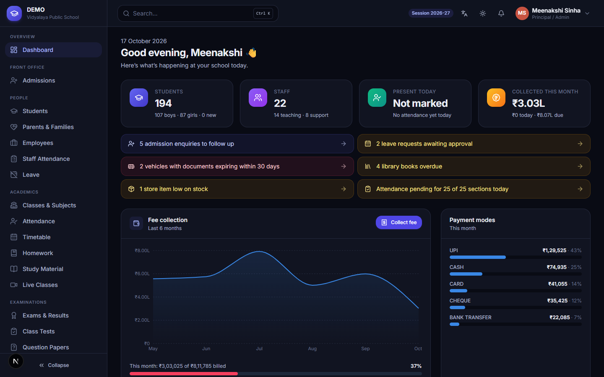
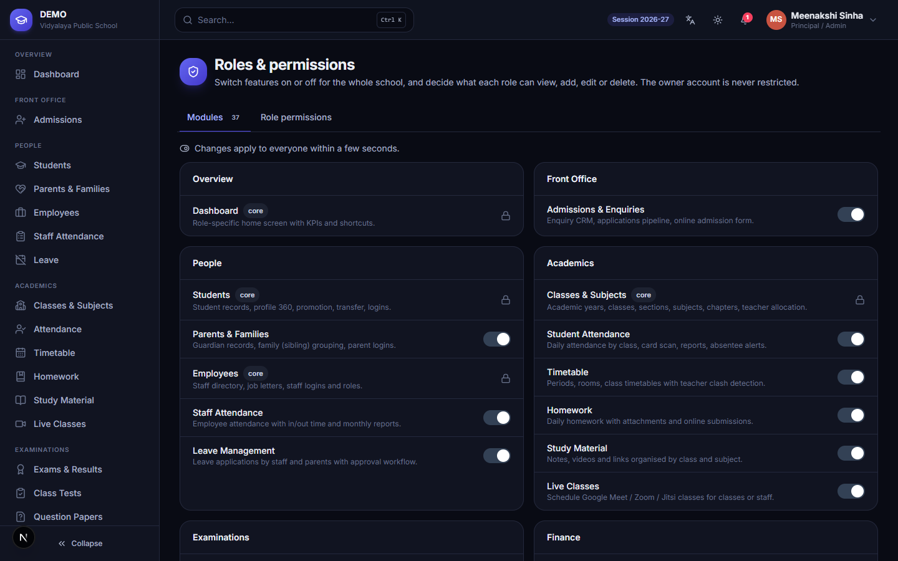
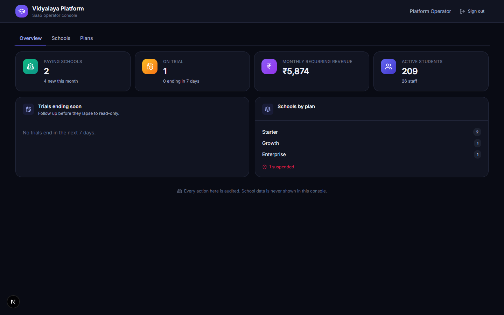
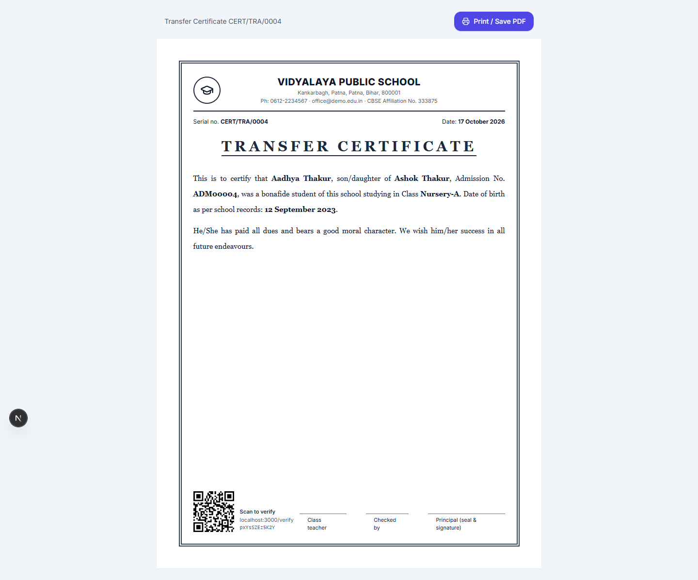
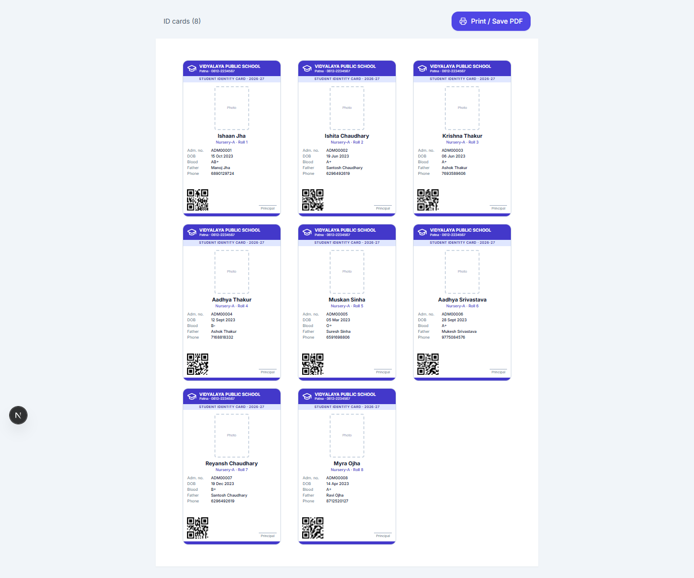
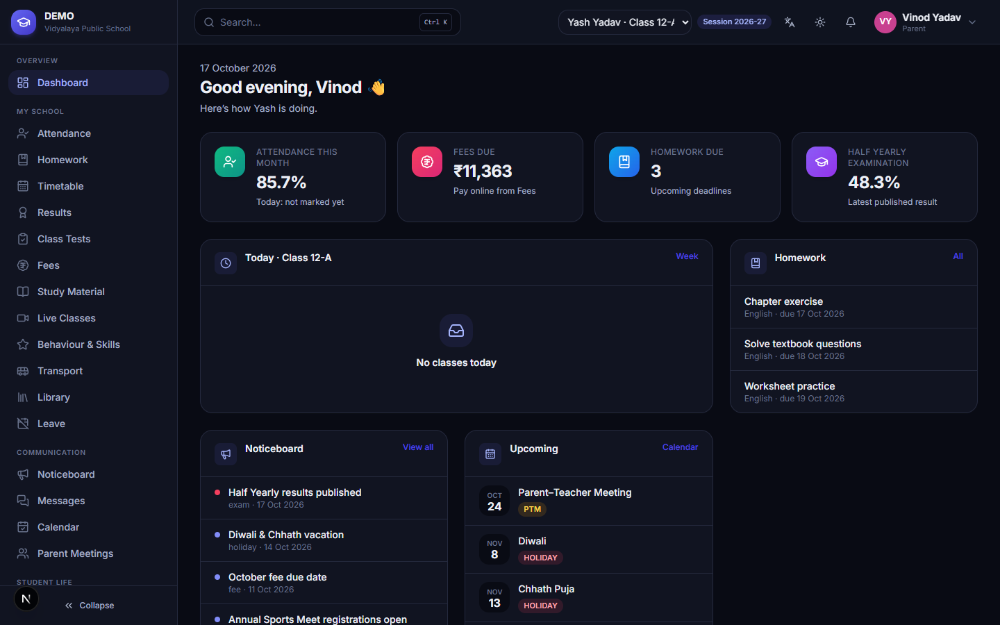
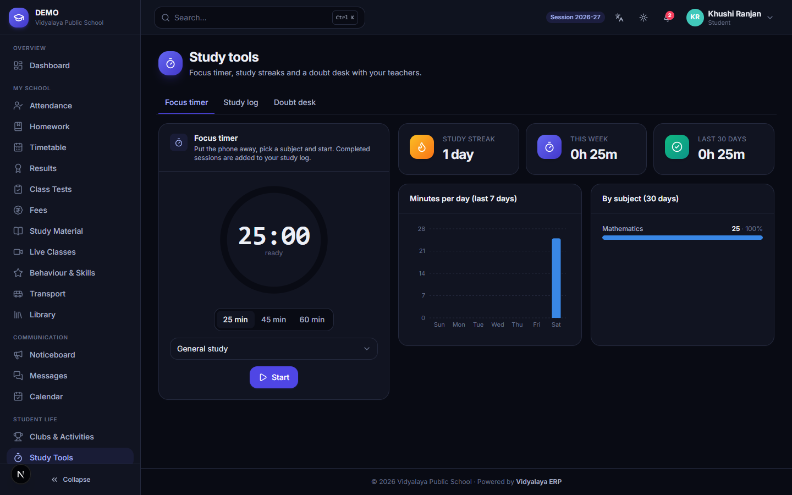

<div align="center">

# 🏫 Vidyalaya ERP

### Multi-school SaaS for Indian K-12 schools — admissions to alumni, in one secure place

[](https://nextjs.org/)
[](https://react.dev/)
[](https://www.typescriptlang.org/)
[](https://www.prisma.io/)
[](https://www.mysql.com/)
[](https://srmecotech.com)



</div>

Vidyalaya ERP runs any number of schools from one deployment. Each school gets its own branding, settings, feature switches and role permissions, while the platform operator onboards schools, sells plans and manages subscriptions. Built for CBSE, ICSE and State Board schools: CBSE grading, RTE quota, UDISE+/PEN/APAAR fields, UPI fee payments, DLT-compliant SMS, English and Hindi.

> The requirements analysis, eSkooly parity matrix and build status are in [docs/REQUIREMENTS_ANALYSIS.md](docs/REQUIREMENTS_ANALYSIS.md).

## Contents

[Highlights](#highlights) · [Modules](#modules) · [Roles](#roles--permissions) · [Security](#security--privacy) · [Quick start](#quick-start) · [Demo accounts](#demo-accounts) · [Testing](#testing) · [Deployment](#deployment) · [Project layout](#project-layout)

## Highlights

- **Every feature can be switched off, every role tuned.** Owners and principals turn modules on or off for the whole school and set view / add / edit / delete per role. Parent and student access can be narrowed but never widened.
- **True multi-tenancy.** Every query is scoped to the school by a Prisma extension; teachers see only their sections, parents only their own children.
- **Platform console.** Onboard a school in under a minute with campus, session, grade scale, fee heads, certificate templates and an owner login ready. Plans bundle modules with student and campus limits. Trials lapse to **read-only** (never locked out of their data).
- **Fees that reconcile.** Monthly/quarterly structures, concessions, RTE, transport, late fees, family-wise collection, cancellations with reversal, gap-free receipts, Razorpay UPI/card payments settling to the school's own account.
- **QR-verifiable certificates.** TC, bonafide, character, merit and experience certificates from editable templates, each with a serial number and a public verification page.
- **AI assistant** that knows the user's role and relevant school data, with a per-user daily allowance. It acts as a study tutor (with child-safety rules) for students and a drafting assistant for staff.

<table>
<tr>
<td></td>
<td></td>
</tr>
<tr>
<td align="center"><em>Module switches and per-role rights</em></td>
<td align="center"><em>Platform console for the SaaS operator</em></td>
</tr>
<tr>
<td></td>
<td></td>
</tr>
<tr>
<td align="center"><em>Certificates with QR verification</em></td>
<td align="center"><em>ID cards whose QR works with scan attendance</em></td>
</tr>
<tr>
<td></td>
<td></td>
</tr>
<tr>
<td align="center"><em>Parent portal (all siblings, one login)</em></td>
<td align="center"><em>Student focus timer and study streaks</em></td>
</tr>
</table>

## Modules

| Area | What it covers |
|---|---|
| Front office | Admissions CRM (enquiry → admitted), public online application form, admission letters |
| People | Students (sibling detection, CSV import, promotion, TC, documents, logins), parents & families, employees, staff attendance, leave workflow |
| Academics | Classes, sections, subjects, chapters, teacher allocation, attendance (incl. QR ID-card scan), timetable with clash detection, homework with submissions, study material, live classes |
| Examinations | Exams, marks, CBSE grade scale, ranks, report cards, class tests, question bank and paper generator, behaviour & skills |
| Finance | Fee structures, invoices, collection, receipts, defaulters, reminders, online payments, accounts ledger, payroll and payslips |
| Communication | Noticeboard, rules, messages with contact policies, SMS/WhatsApp via DLT templates, events calendar, parent-teacher meetings, notifications |
| Operations | Transport (vehicles, routes, stops, allocations), library, store/POS, assets, certificates & ID cards |
| Student life | Clubs & activities with waitlists and achievements, study tools and doubt desk, AI assistant |
| Administration | Reports (student info, parent contacts, UDISE+ class strength, attendance eligibility, birthdays), settings, roles & permissions, audit log |

## Roles & permissions

Owner/Director, Principal/Admin, Teacher, Accountant, Front Office, Librarian, Transport Manager, Store Manager, Other Staff, Parent, Student, plus the Platform Operator. Defaults are in [`src/lib/modules.ts`](src/lib/modules.ts); each school overrides them under **Roles & permissions**. The owner is never restricted, and only the owner can change the Principal/Admin role.

## Security & privacy

- No built-in or shared accounts; `NEXTAUTH_SECRET` and `DATA_ENCRYPTION_KEY` are required in production.
- Sign-in by school code + username/email/mobile; lockout and per-IP/per-account rate limits; temporary passwords must be changed; sign out everywhere.
- Server-side permission and row-scope checks on every API route; same-origin checks on mutations; CSP, HSTS and frame protection.
- Aadhaar and gateway credentials encrypted with AES-256-GCM, with only the last 4 Aadhaar digits ever shown; secrets never returned by any API.
- Uploaded files kept outside the web root, type-checked and served after access checks; admin-authored HTML sanitised and every substituted value escaped.
- DPDP consent records; a read-only audit log of every change, sign-in and support action.

## Quick start

Requirements: Node.js 22, MySQL 8.

```bash
npm install
cp .env.example .env          # set DATABASE_URL and NEXTAUTH_SECRET at minimum
npm run db:reset              # create tables and load two demo schools
npm run dev                   # http://localhost:3000
```

## Demo accounts

Password for every account: `Demo@12345` (override with `SEED_PASSWORD`).

| School code | Usernames |
|---|---|
| `DEMO` (Enterprise plan, ~200 students) | `owner`, `admin`, `teacher`, `accountant`, `reception`, `librarian`, `transport`, `store`, `parent`, `student` |
| `GVS` (Starter plan, certificates switched off) | `owner`, `admin`, `teacher` |
| *(leave empty)* | `platform` — the SaaS operator console |

## Testing

```bash
npm run typecheck             # TypeScript
npm run lint                  # ESLint (Next.js rules)
npm test                      # unit tests (vitest)
npm run test:api              # API integration suite — needs a freshly seeded DB and a running server
npx playwright test           # browser smoke test of every menu page per role (uses installed Chrome)
```

`TEST_BASE_URL` points the API and browser suites at another server. Both suites clear login rate-limit counters in the test database first, so never run them against production.

## Deployment

1. Provision MySQL 8 and set every variable from `.env.example`. Generate `NEXTAUTH_SECRET` and `DATA_ENCRYPTION_KEY`, and back up the encryption key securely.
2. `npm ci && npx prisma db push && npm run build && npm start` behind HTTPS.
3. Create the operator account: `OPERATOR_PASSWORD='…' npm run platform:operator -- ops "Your Name"`. Sign in with an empty school code, create plans, then onboard schools.
4. Each school adds its own Razorpay, SMS (DLT) and WhatsApp credentials under **Settings**. Point the Razorpay webhook at the URL shown there.
5. Persist `STORAGE_DIR` (uploaded documents) and include it and the database in backups.

## Project layout

```
prisma/schema.prisma        multi-tenant data model        prisma/seed.ts   demo schools
src/proxy.ts                auth routing (Next.js 16)       next.config.js   security headers / CSP
src/server/api.ts           route wrapper: auth, RBAC, tenant scope, read-only mode, errors
src/server/db.ts            tenant-scoped Prisma client, gap-free sequences
src/server/services/        fees, people, exams, messaging, razorpay, ai, provisioning …
src/lib/modules.ts          module catalogue and default role permissions
src/app/(app)/              school app pages          src/app/platform/   operator console
src/app/api/                REST endpoints            src/app/print/      printable documents
tests/unit  tests/api  tests/e2e
legacy/                     previous single-school version, kept for reference only
```

---

<div align="center">Built for Indian schools · Powered by SRM ECO TECH</div>
