# Vidyalaya ERP — User Guide & Use-Case Document

| | |
|---|---|
| **Product** | Vidyalaya ERP — multi-school School Management System |
| **Document version** | 2.0 |
| **Last updated** | 18 October 2026 |
| **Audience** | School owners, principals, office staff, teachers, accountants, librarians, transport and store managers, parents and students |
| **Languages in the app** | English and हिन्दी (Hindi) |

---

## Table of contents

1. [About this guide](#1-about-this-guide)
2. [Getting started](#2-getting-started)
3. [Roles and access](#3-roles-and-access)
4. [Quick-start by role](#4-quick-start-by-role)
5. [Module guide](#5-module-guide)
   - 5.1 [Dashboard](#51-dashboard)
   - 5.2 [Admissions & Enquiries](#52-admissions--enquiries)
   - 5.3 [Students](#53-students)
   - 5.4 [Parents & Families](#54-parents--families)
   - 5.5 [Employees](#55-employees)
   - 5.6 [Classes & Subjects](#56-classes--subjects)
   - 5.7 [Student Attendance](#57-student-attendance)
   - 5.8 [Staff Attendance](#58-staff-attendance)
   - 5.9 [Leave Management](#59-leave-management)
   - 5.10 [Timetable](#510-timetable)
   - 5.11 [Homework](#511-homework)
   - 5.12 [Study Material](#512-study-material)
   - 5.13 [Live Classes](#513-live-classes)
   - 5.14 [Exams & Report Cards](#514-exams--report-cards)
   - 5.15 [Class Tests](#515-class-tests)
   - 5.16 [Question Papers](#516-question-papers)
   - 5.17 [Behaviour & Skills](#517-behaviour--skills)
   - 5.18 [Fees](#518-fees)
   - 5.19 [Accounts](#519-accounts)
   - 5.20 [Payroll](#520-payroll)
   - 5.21 [Noticeboard](#521-noticeboard)
   - 5.22 [Messages](#522-messages)
   - 5.23 [SMS & WhatsApp](#523-sms--whatsapp)
   - 5.24 [Calendar & Events](#524-calendar--events)
   - 5.25 [Parent Meetings](#525-parent-meetings)
   - 5.26 [Transport](#526-transport)
   - 5.27 [Library](#527-library)
   - 5.28 [Store & POS](#528-store--pos)
   - 5.29 [Assets & Inventory](#529-assets--inventory)
   - 5.30 [Certificates & ID Cards](#530-certificates--id-cards)
   - 5.31 [Reports](#531-reports)
   - 5.32 [Clubs & Activities](#532-clubs--activities)
   - 5.33 [Study Tools](#533-study-tools)
   - 5.34 [AI Assistant](#534-ai-assistant)
   - 5.35 [School Settings](#535-school-settings)
   - 5.36 [Roles & Permissions](#536-roles--permissions)
   - 5.37 [Audit Log](#537-audit-log)
   - 5.38 [My Profile & Notifications](#538-my-profile--notifications)
   - 5.39 [Public pages: online admission and certificate verification](#539-public-pages-online-admission-and-certificate-verification)
   - 5.40 [Platform console (SaaS operator)](#540-platform-console-saas-operator)
   - 5.41 [Hostel](#541-hostel)
   - 5.42 [Live bus tracking and Driver mode](#542-live-bus-tracking-and-driver-mode)
   - 5.43 [Phone app and notifications](#543-phone-app-and-notifications)
   - 5.44 [Gate & Visitors](#544-gate--visitors)
   - 5.45 [Discipline register](#545-discipline-register)
   - 5.46 [Report-card remarks and Gradebook](#546-report-card-remarks-and-gradebook)
   - 5.47 [Online exams](#547-online-exams)
   - 5.48 [Polls & forms](#548-polls--forms)
   - 5.49 [Discussions](#549-discussions)
   - 5.50 [Gallery](#550-gallery)
   - 5.51 [News & blog](#551-news--blog)
   - 5.52 [Reminders](#552-reminders)
   - 5.53 [Tasks](#553-tasks)
   - 5.54 [Document manager](#554-document-manager)
   - 5.55 [Alumni](#555-alumni)
   - 5.56 [Placements](#556-placements)
   - 5.57 [Apps (App Frame)](#557-apps-app-frame)
   - 5.58 [Fees: advance, instant invoices and fee import](#558-fees-advance-instant-invoices-and-fee-import)
   - 5.59 [Imports, exports and the report builder](#559-imports-exports-and-the-report-builder)
   - 5.60 [Email, single sign-on and BigBlueButton](#560-email-single-sign-on-and-bigbluebutton)
6. [Real-world use cases](#6-real-world-use-cases)
7. [Troubleshooting and FAQ](#7-troubleshooting-and-faq)
8. [Appendices](#8-appendices)

---

## 1. About this guide

This guide explains how to use every screen in Vidyalaya ERP, organised by module, and shows which roles use each one. Section 4 gives each role a short list of the screens they use daily. Section 6 walks through common school workflows from start to finish.

### 1.1 Conventions

| Convention | Meaning |
|---|---|
| **Bold text** | A button, tab, menu item or field label exactly as it appears on screen, for example **New admission**. |
| *Sidebar → Group → Item* | Where to find a screen in the left-hand menu, for example *Sidebar → People → Students*. |
| **Expected result:** | What the system does after a step. If you see something different, check [Troubleshooting](#7-troubleshooting-and-faq). |
| `V` `C` `E` `D` | Permission letters: **V**iew, **C**reate, **E**dit, **D**elete. |
| **Figure** with red numbered outlines | A real screenshot of the product (demo school data). The numbers match the **Callouts** key printed under each figure. |

> **Note:** Your school can switch modules off and change what each role is allowed to do (see [Roles & Permissions](#536-roles--permissions)). If a menu item described here is missing, your school has either switched it off or not given your role access to it.

---

## 2. Getting started

### 2.1 Signing in

Every school has a **school code** (for example `DEMO`). Your school office gives you the code together with your username and a temporary password.

<!-- placeholder: Login page on desktop with the brand panel on the left and the sign-in form on the right. Arrow 1 → "School code" field. Arrow 2 → "Username, email or mobile" field. Arrow 3 → "Password" field with the show/hide eye icon. Arrow 4 → "Sign in securely" button. -->
<!-- fig:01-login -->
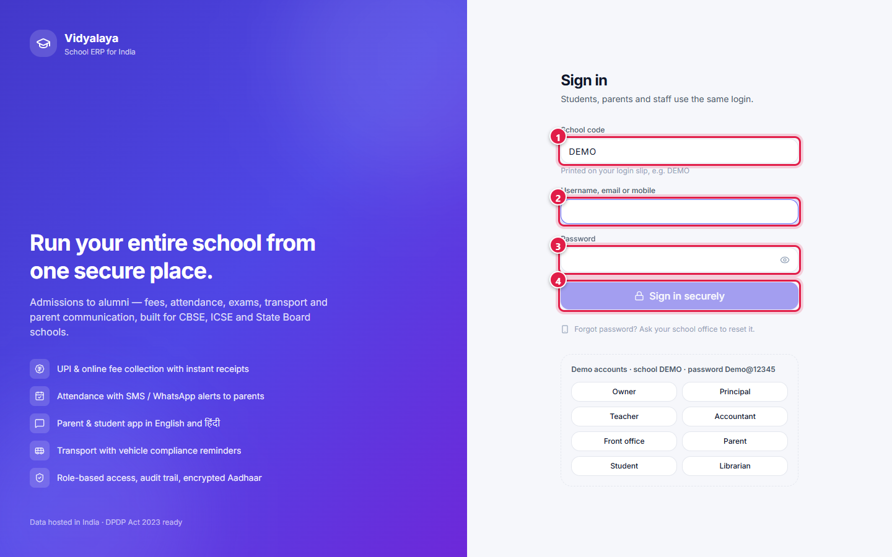

*Figure 1. Login page on desktop with the brand panel on the left and the sign-in form on the right.*

> **Callouts:** **1** School code · **2** Username, email or mobile · **3** Password (eye icon shows it) · **4** Sign in
<!-- /fig -->

**Steps**

1. Open your school's Vidyalaya web address in a browser (Chrome, Edge, Safari or Firefox; works on phone, tablet and computer).
2. **School code** — type your school's code. Letters are converted to capitals automatically.
3. **Username, email or mobile** — type any one of these.
4. **Password** — type your password. Use the eye icon to check what you typed.
5. Click **Sign in securely**.

**Expected result:** You land on your **Dashboard**. On your first sign-in you are sent to **Change password** first (see 2.2).

**Security rules you may run into**

| Situation | What happens |
|---|---|
| Wrong school code, username or password | The message *"Invalid school code, username or password."* For security, it never says which one was wrong. |
| 5 wrong passwords in a row | The account is locked for 15 minutes. Wait, or ask an administrator to **Unlock** it (see [Manage logins](#manage-logins)). |
| Too many attempts from one network | Sign-in pauses for a few minutes (*"Too many login attempts from this network"*). |
| School suspended | *"This school account is suspended. Please contact support."* |
| Session length | You stay signed in for up to 12 hours of activity, then must sign in again. |

### 2.2 First sign-in: changing your temporary password

Accounts created by the school start with a one-time temporary password. You must replace it before you can use the system.

<!-- placeholder: Change password screen. Arrow 1 → "Current password" field. Arrow 2 → "New password" field with the policy hint. Arrow 3 → "Update password" button. -->
<!-- fig:60-profile -->
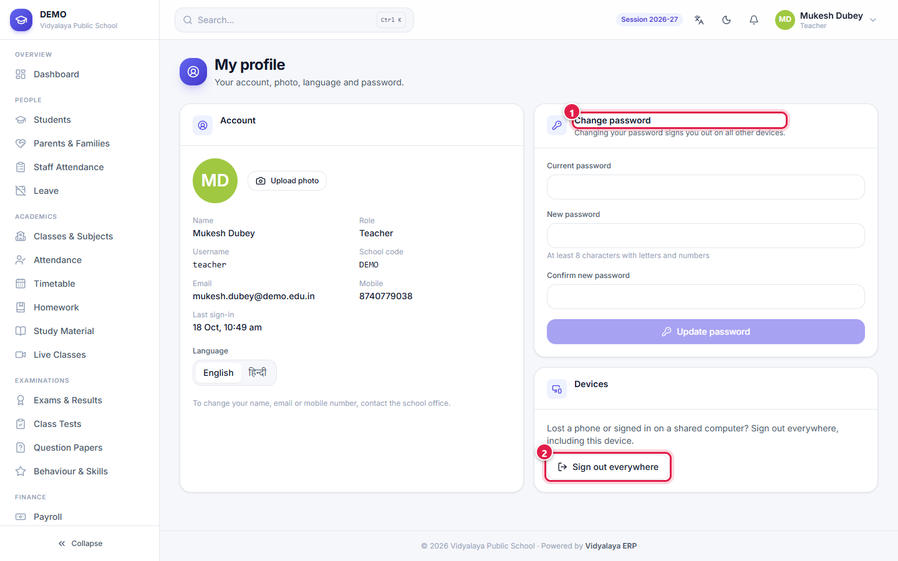

*Figure 2. Change password screen.*

> **Callouts:** **1** Change password · **2** End all sessions
<!-- /fig -->

1. **Current password** — type the temporary password you were given.
2. **New password** — at least 8 characters, using both letters and numbers. It must not contain your username and must differ from the current password.
3. Click **Update password**.

**Expected result:** The password is saved, you are signed out on every other device, and you continue to the Dashboard.

### 2.3 Finding your way around

<!-- placeholder: Desktop app frame. Arrow 1 → left sidebar with grouped menu (Overview, People, Academics…). Arrow 2 → "Collapse" control at the bottom of the sidebar. Arrow 3 → search bar with "Ctrl K" hint in the top bar. Arrow 4 → academic-year badge. Arrow 5 → language button. Arrow 6 → dark-mode button. Arrow 7 → notification bell with unread count. Arrow 8 → avatar menu showing name and role. -->
<!-- fig:02-app-frame -->
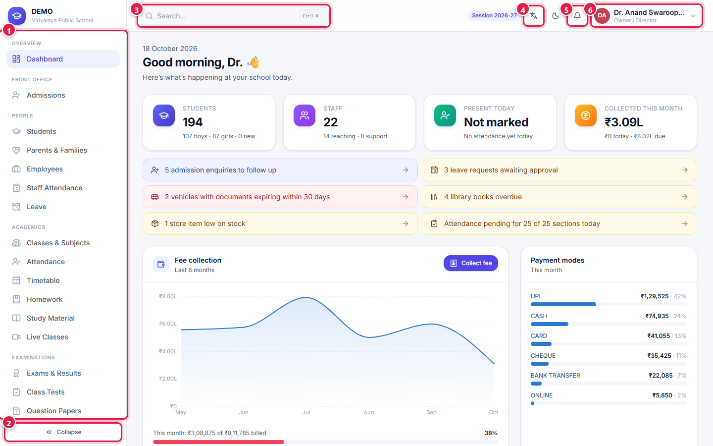

*Figure 3. Desktop app frame.*

> **Callouts:** **1** Sidebar: only the modules your role can open · **2** Collapse the sidebar to icons · **3** Search any page (Ctrl K) · **4** English / हिन्दी · **5** Notifications · **6** My profile, change password, sign out
<!-- /fig -->

| Element | What it does |
|---|---|
| **Sidebar** | Shows only the modules your role can open, grouped by area. On desktop you can collapse it to icons; your choice is remembered. On phones and tablets it opens from the ☰ menu button and closes when you pick an item. |
| **Search (Ctrl K / ⌘ K)** | Opens a command palette. Type part of a page name (in English or Hindi) and press Enter to jump to it. |
| **Academic year badge** | The session currently in use, for example *2026-27*. |
| **Language button** | Opens a menu of the languages your school offers (up to 12: English, हिन्दी, বাংলা, मराठी, తెలుగు, தமிழ், ગુજરાતી, ಕನ್ನಡ, മലയാളം, ਪੰਜਾਬੀ, ଓଡ଼ିଆ, অসমীয়া). Your choice is remembered on your account. |
| **Theme button** | Switches between light and dark mode. |
| **Notification bell** | Shows your latest alerts (fee receipts, absences, leave decisions, messages). Click one to open it, or **Mark all read**. |
| **Avatar menu** | **My profile**, **Change password**, and **Sign out**. |
| **Child selector** (parents with more than one child) | A drop-down in the top bar that chooses which child every screen shows. |

**Responsive behaviour**

<!-- fig:66-dark-mode -->
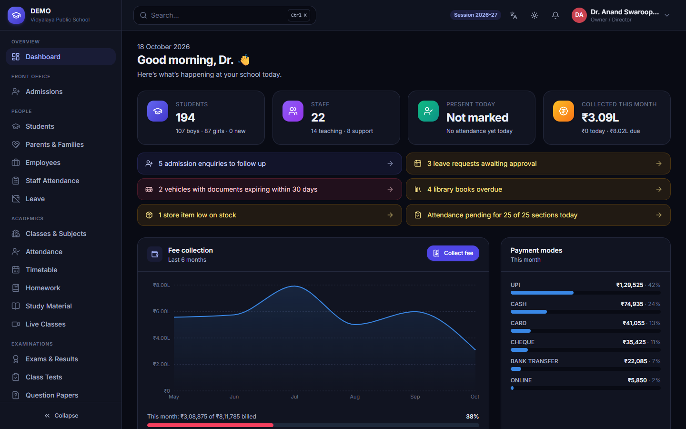

*Figure 4. The same dashboard in dark mode.*
<!-- /fig -->

<!-- fig:67-hindi -->
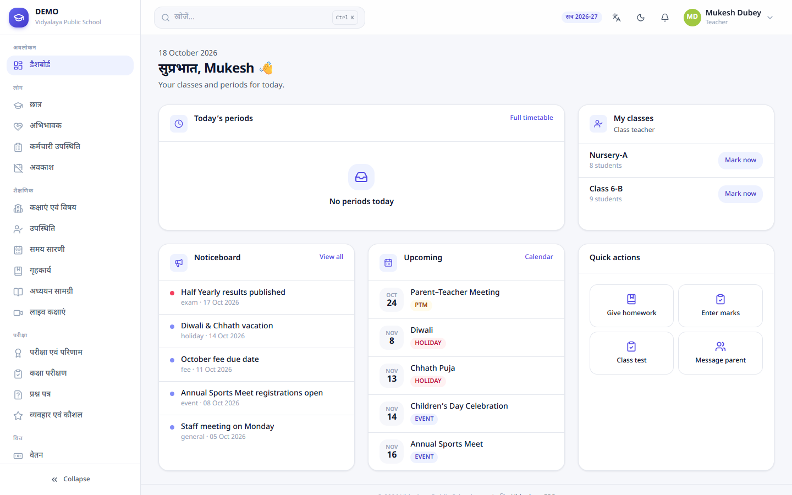

*Figure 5. The teacher dashboard in Hindi (language button in the top bar).*
<!-- /fig -->

<!-- fig:75-language-menu -->
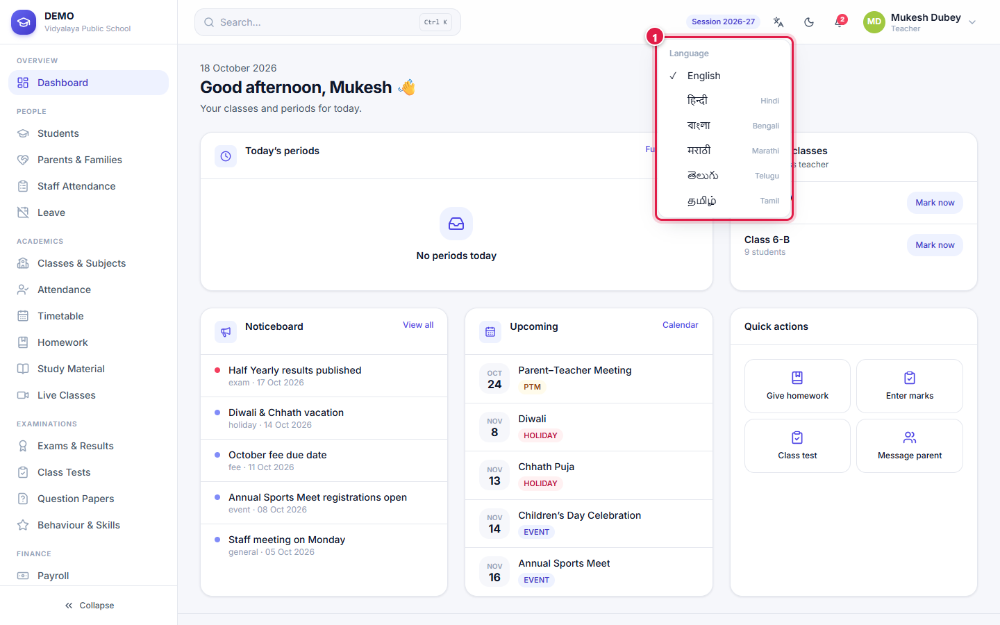

*Figure 6. Language menu: each person picks from the languages the school offers.*

> **Callouts:** **1** Pick from the languages your school offers
<!-- /fig -->

<!-- fig:76-tamil-dashboard -->
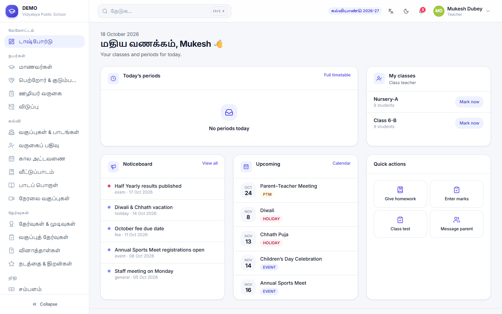

*Figure 7. The teacher dashboard in Tamil.*
<!-- /fig -->

| Device | Layout |
|---|---|
| Phone (under 640 px) | Sidebar hidden behind ☰. Tables scroll sideways inside their card, and forms stack into one column. Name and role are hidden in the top bar, but the avatar menu still works. |
| Tablet (640–1023 px) | Same as phone for the sidebar. Forms and cards use two columns where space allows. |
| Desktop (1024 px and up) | Fixed sidebar (collapsible). Wide screens show side panels next to main content, such as the fee receipt panel. |

### 2.4 Read-only mode (lapsed subscription)

If your school's trial or subscription ends, a red banner appears at the top of every page. You can still **view** and **print** all data, but changes are paused until the plan is renewed. Your own password, language and sign-out still work. During a trial, an amber banner shows the trial end date.

### 2.5 Getting help

- An empty page with a lock icon and the message *"You don't have access"* means your role is not permitted to use that screen. Ask your administrator.
- The message *"Something went wrong. Please try again."* means an unexpected error. Retry once. If it continues, note the time and the screen and tell your administrator, who can find the event in the [Audit Log](#537-audit-log).

---

## 3. Roles and access

### 3.1 The roles

| Role (as shown in the app) | Who it is for | Typical responsibilities |
|---|---|---|
| **Owner / Director** | School owner or trust representative | Full, unrestricted access. The only role that can create or manage Principal/Admin accounts and change the Principal/Admin permission row. |
| **Principal / Admin** | Principal, vice-principal, school administrator | Runs the school day to day: admissions, academics, exams, fees, staff, settings. |
| **Teacher** | Class and subject teachers | Attendance, homework, marks, class tests, behaviour, study material, live classes. Sees only their own sections. |
| **Accountant** | Accounts office | Fee collection, invoices, defaulters, accounts, payroll, financial reports. |
| **Front Office** | Receptionist | Enquiries, admissions, student and family records, fee counter, certificates. |
| **Librarian** | Library staff | Book catalogue, issue and return, fines. |
| **Transport Manager** | Transport in-charge | Vehicles and compliance dates, routes, stops, student allocation. |
| **Store Manager** | Store keeper | Uniform/book store billing (POS), stock, asset register. |
| **Other Staff** | Any other employee with a login | Own attendance, leave, payslips, notices, messages. |
| **Parent** | One login per family | All their children: attendance, homework, results, fees (including online payment), transport, leave, messages, meetings. |
| **Student** | One login per student | Own homework (with online submission), timetable, results, study material, clubs, study tools, AI study buddy. |
| **Platform Admin** | The SaaS operator (not a school user) | Onboards schools, manages plans and subscriptions. Never sees school data screens. |

### 3.2 How access is decided

Access is checked in three layers, in this order:

1. **Module switch.** The school (or its subscription plan) can turn whole modules on or off. A switched-off module disappears for everyone. *Core* modules (Dashboard, Students, Employees, Classes & Subjects, School Settings, Roles & Permissions, Audit Log) can never be switched off.
2. **Role permission.** For each module, each role has View / Create / Edit / Delete rights. The defaults are listed in [Appendix A](#appendix-a--default-permission-matrix), and administrators can change them in [Roles & Permissions](#536-roles--permissions).
3. **Data scope.** Even with permission, you only see the records that belong to you:

| Role | Records you see |
|---|---|
| Owner, Principal/Admin, Accountant, Front Office, Librarian, Transport, Store, Other Staff | The whole school |
| Teacher | Students and families in the sections where you are **class teacher** or **teach a subject** (set in [Classes & Subjects → Teacher allocation](#56-classes--subjects)) |
| Parent | Only your own children |
| Student | Only yourself |

Additional rules that always apply:

- Salary figures are visible only to roles that **manage** payroll. Other staff see only their own payslips.
- Staff with view-only Staff Attendance see only their own attendance row.
- Teachers can enter exam marks only for subjects they teach in a section, or for any subject in a section where they are class teacher.
- Teachers can edit or delete only the homework, tests, material, observations and live classes they created themselves.
- Parent and Student rights can be narrowed but never widened beyond the defaults.
- Nobody can manage their own login from the staff/student login screens. Use **My profile** instead.

---

## 4. Quick-start by role

Each list below shows where that role spends most of its time, with links to the full instructions.

### 4.1 Owner / Director and Principal / Admin

| Daily / periodic task | Where |
|---|---|
| Check today's KPIs: strength, attendance, fee collection, absentees, birthdays | [Dashboard](#51-dashboard) |
| Move enquiries through the admission pipeline | [Admissions](#52-admissions--enquiries) |
| Admit students, promote at session end | [Students](#53-students) |
| Hire staff, create staff logins | [Employees](#55-employees) |
| Set up classes, sections, subjects, teacher allocation | [Classes & Subjects](#56-classes--subjects) |
| Approve staff leave | [Leave](#59-leave-management) |
| Create exams, publish results, print report cards | [Exams](#514-exams--report-cards) |
| Review collection and defaulters | [Fees](#518-fees) |
| Run monthly salary | [Payroll](#520-payroll) |
| Post notices, send bulk SMS | [Noticeboard](#521-noticeboard), [SMS & WhatsApp](#523-sms--whatsapp) |
| Configure the school, gateways, numbering | [School Settings](#535-school-settings) |
| Control who can do what | [Roles & Permissions](#536-roles--permissions) |
| Investigate changes | [Audit Log](#537-audit-log) |

### 4.2 Teacher

| Task | Where |
|---|---|
| See today's periods and your classes | [Dashboard](#51-dashboard) |
| Mark attendance (or scan ID cards) | [Student Attendance](#57-student-attendance) |
| Give and check homework | [Homework](#511-homework) |
| Enter exam marks | [Exams → Marks entry](#514-exams--report-cards) |
| Run quick class tests | [Class Tests](#515-class-tests) |
| Build question papers | [Question Papers](#516-question-papers) |
| Rate behaviour and record observations | [Behaviour & Skills](#517-behaviour--skills) |
| Share notes and schedule online classes | [Study Material](#512-study-material), [Live Classes](#513-live-classes) |
| Approve leave for students in your class; apply for your own leave | [Leave](#59-leave-management) |
| Answer student doubts | [Study Tools → Doubt desk](#533-study-tools) |
| Talk to parents | [Messages](#522-messages), [Parent Meetings](#525-parent-meetings) |

### 4.3 Accountant

| Task | Where |
|---|---|
| Collect fees at the counter, print receipts | [Fees → Collect](#518-fees) |
| Generate monthly invoices | [Fees → Invoices](#518-fees) |
| Chase defaulters, apply late fees, send reminders | [Fees → Defaulters](#518-fees) |
| Daily collection report | [Fees → Report](#518-fees) |
| Record income and expenses | [Accounts](#519-accounts) |
| Pay salaries, download the bank sheet | [Payroll](#520-payroll) |
| Financial and student reports | [Reports](#531-reports) |

### 4.4 Front Office (Receptionist)

| Task | Where |
|---|---|
| Log walk-in and phone enquiries; share the online form | [Admissions](#52-admissions--enquiries) |
| Admit students and print admission letters and login slips | [Students → New admission](#53-students) |
| Update family contact details | [Parents & Families](#54-parents--families) |
| Collect fees at the counter | [Fees → Collect](#518-fees) |
| Issue TC, bonafide and character certificates; print ID cards | [Certificates & ID Cards](#530-certificates--id-cards) |
| Send SMS to parents | [SMS & WhatsApp](#523-sms--whatsapp) |

### 4.5 Librarian, Transport Manager, Store Manager, Other Staff

| Role | Main screens |
|---|---|
| Librarian | [Library](#527-library): catalogue, issue, return and fines |
| Transport Manager | [Transport](#526-transport): vehicles (insurance/fitness/PUC/permit expiry), routes and stops, student allocation, manifest; [Live map, driver and GPS device links](#542-live-bus-tracking-and-driver-mode) |
| Bus driver (any staff login linked to a vehicle) | [Driver mode](#542-live-bus-tracking-and-driver-mode): start and end trips; the phone shares the bus location |
| Store Manager | [Store & POS](#528-store--pos), [Assets & Inventory](#529-assets--inventory) |
| Every staff member | [Staff Attendance](#58-staff-attendance) (own record), [Leave](#59-leave-management), [Payroll](#520-payroll) (own payslips), [Noticeboard](#521-noticeboard), [Messages](#522-messages), [Calendar](#524-calendar--events) |

### 4.6 Parent

The sidebar shows a **My School** group. If you have more than one child, choose the child in the top bar or on the Dashboard first.

| Task | Where |
|---|---|
| Today at a glance: attendance, homework due, fees due, latest result | [Dashboard](#51-dashboard) |
| Attendance calendar | [Attendance](#57-student-attendance) |
| Homework and submissions | [Homework](#511-homework) |
| Results and report cards | [Results](#514-exams--report-cards) |
| Pay fees online, download receipts | [Fees](#518-fees) |
| Apply leave for your child | [Leave](#59-leave-management) |
| Bus route and stop; **where the bus is now** and its ETA | [Transport](#526-transport), [Live tracking](#542-live-bus-tracking-and-driver-mode) |
| Child's hostel room and warden contact | [Hostel](#541-hostel) |
| Install the app and get phone alerts | [Phone app](#543-phone-app-and-notifications) |
| Message a teacher; book a meeting | [Messages](#522-messages), [Parent Meetings](#525-parent-meetings) |

### 4.7 Student

| Task | Where |
|---|---|
| Today's classes and homework due | [Dashboard](#51-dashboard) |
| Submit homework online | [Homework](#511-homework) |
| Timetable, results, class tests | [Timetable](#510-timetable), [Results](#514-exams--report-cards), [Class Tests](#515-class-tests) |
| Notes and videos; join live classes | [Study Material](#512-study-material), [Live Classes](#513-live-classes) |
| Join clubs | [Clubs & Activities](#532-clubs--activities) |
| Focus timer, study log, ask doubts | [Study Tools](#533-study-tools) |
| AI study buddy | [AI Assistant](#534-ai-assistant) |

---

## 5. Module guide

Each module section starts with a **Who uses it** table showing the default rights. Your school may have changed them.

---

### 5.1 Dashboard

*Sidebar → Overview → Dashboard* · Available to every role.

**Purpose:** A home screen that changes by role and shows what needs attention today.

#### 5.1.1 Owner / Principal / Office view

<!-- placeholder: Admin dashboard on desktop. Arrow 1 → KPI row (Students, Staff, Present today, Collected this month). Arrow 2 → "Fee collection" chart (last 6 months) with Income/Expense/Students switch. Arrow 3 → "Absent today" list. Arrow 4 → "Recent receipts" with "Collect fee" button. Arrow 5 → "Birthdays today". Arrow 6 → "Noticeboard" and "Upcoming" cards with "View all". -->
<!-- fig:03-dashboard-admin -->
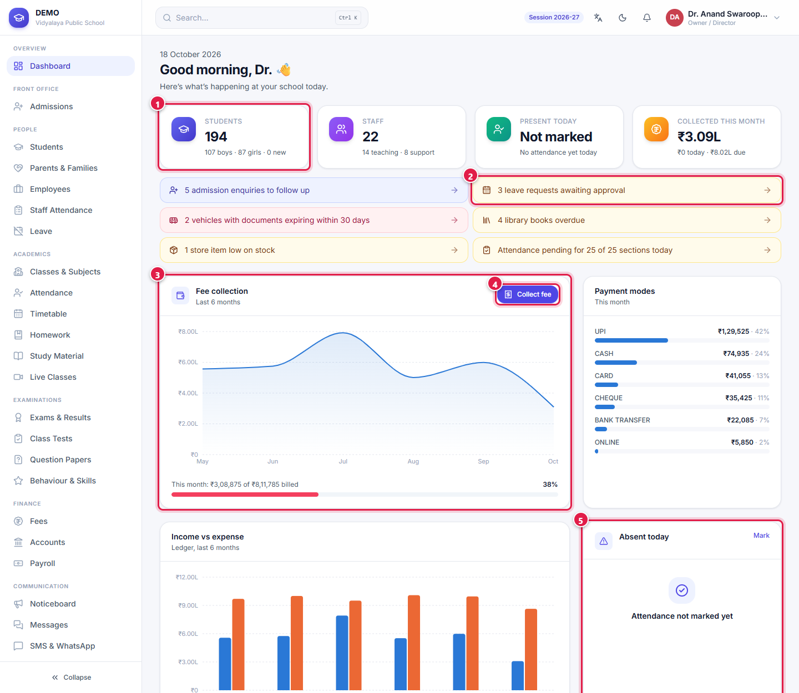

*Figure 8. Admin dashboard on desktop.*

> **Callouts:** **1** Today's KPIs · **2** Things that need action today · **3** Six-month fee trend · **4** Jump to the fee counter · **5** Absentees (or attendance not marked)
<!-- /fig -->

| Card | Shows | Action |
|---|---|---|
| KPI row | Active students, staff, students present today, fees collected this month | — |
| Fee collection / Income vs expense | Last 6 months from the ledger | Switch series with the chart tabs |
| Payment modes | This month's collection split by Cash, UPI, Card and so on | — |
| Absent today | Absentees, or *"Attendance not marked yet"* | Click a student to open their profile |
| Class-wise strength | Active students per class | — |
| Recent receipts | The latest fee receipts | **Collect fee** opens the fee counter |
| Birthdays today | Students and staff | — |
| Noticeboard / Upcoming | Latest notices and calendar events | **View all**, **Calendar** |

#### 5.1.2 Teacher view

<!-- placeholder: Teacher dashboard. Arrow 1 → "Today's periods" list with subject, class and room. Arrow 2 → "My classes" card with "Mark now" button for the class-teacher section. Arrow 3 → "Quick actions" tiles. Arrow 4 → "Full timetable" link. -->
<!-- fig:04-dashboard-teacher -->
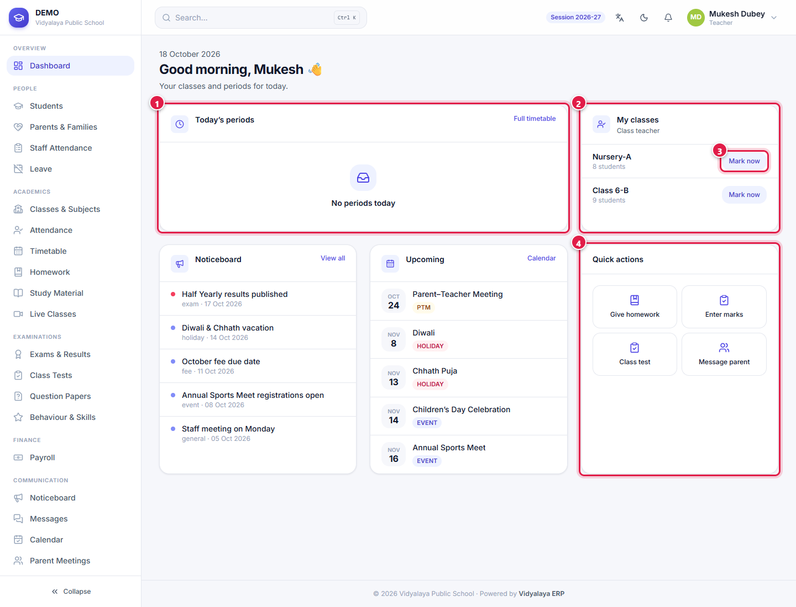

*Figure 9. Teacher dashboard.*

> **Callouts:** **1** Your periods today · **2** Your class-teacher section · **3** Open attendance for your section · **4** Shortcuts
<!-- /fig -->

- **Today's periods** — your timetable for today. **Full timetable** opens the week view.
- **My classes** — the section where you are class teacher, showing whether attendance is marked. **Mark now** opens attendance for that section. If you are not a class teacher, the card says *"You are not a class teacher"*.
- **Quick actions** — shortcuts to attendance, homework, marks and similar tasks.

#### 5.1.3 Parent / Student view

<!-- placeholder: Parent dashboard on a phone. Arrow 1 → child chips at the top (one per child). Arrow 2 → KPI tiles: Attendance this month, Fees due, Homework due, latest exam result. Arrow 3 → "Today's classes". Arrow 4 → "Homework" list with due dates. Arrow 5 → "Live classes" with Join link. -->
<!-- fig:05-dashboard-parent-mobile -->
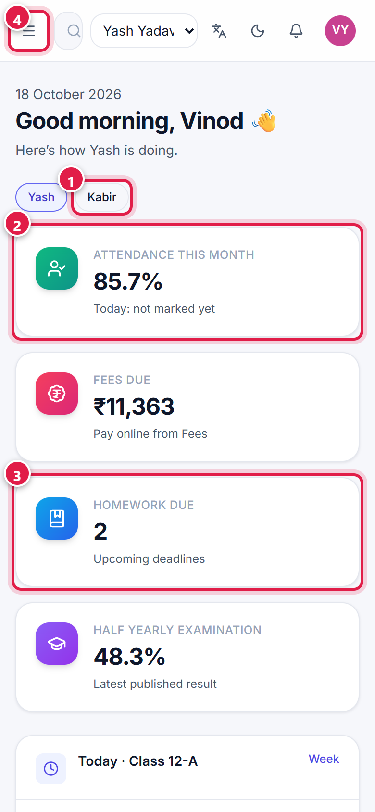

*Figure 10. Parent dashboard on a phone.*

> **Callouts:** **1** Choose the child · **2** Attendance, fees due, homework, result · **3** Homework due · **4** Menu
<!-- /fig -->

1. If you have several children, tap a child's name chip. Every screen switches to that child.
2. Read the tiles: attendance percentage this month, fees due, homework due and the latest published result.
3. Tap any card to open the full module.

**Expected result:** If no student is linked to the login, the dashboard shows *"No student linked to this account — Please contact the school office."*

---

### 5.2 Admissions & Enquiries

*Sidebar → Front Office → Admissions*

| Who uses it | Owner | Principal/Admin | Front Office |
|---|:-:|:-:|:-:|
| Rights | VCED | VCED | VCE |

**Purpose:** Track every prospective student from the first enquiry to admission. Enquiries come from walk-ins, phone calls and the school's public online form.

**Pipeline stages:** Enquiry → Applied → Docs verified → Test / interview → Seat offered → **Admitted**. Applications can also be closed as **Rejected** or **Withdrawn**.

<!-- placeholder: Admissions pipeline (Kanban) on desktop. Arrow 1 → column headers Enquiry / Applied / Docs verified / Test / interview / Seat offered with counts. Arrow 2 → an application card showing student name, class and next follow-up date. Arrow 3 → "Pipeline" / "Closed (n)" toggle. Arrow 4 → search box "Name, phone, application no." and class filter. Arrow 5 → "Copy online form link" button. Arrow 6 → "New enquiry" button. -->
<!-- fig:06-admissions -->
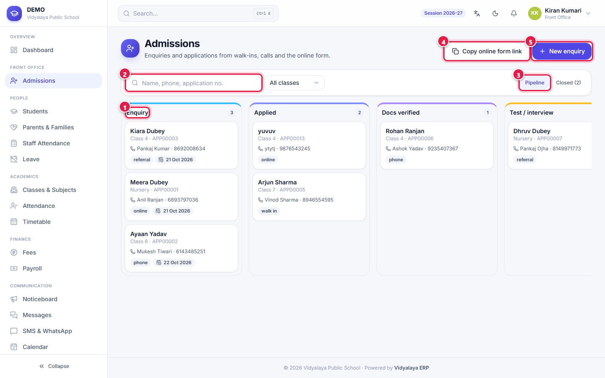

*Figure 11. Admissions pipeline (Kanban) on desktop.*

> **Callouts:** **1** Pipeline stages · **2** Search applications · **3** Pipeline / Closed · **4** Share the online form · **5** Record a walk-in or phone enquiry
<!-- /fig -->

#### 5.2.1 Record a new enquiry

1. Click **New enquiry**.
2. Fill in the student's name, the class applied for, gender, date of birth, and the parent's name, mobile and email. Previous school and address are optional.
3. Click **Save**.

**Expected result:** A card appears in the **Enquiry** column with an auto-generated application number.

#### 5.2.2 Work an application

<!-- fig:07-admission-detail -->
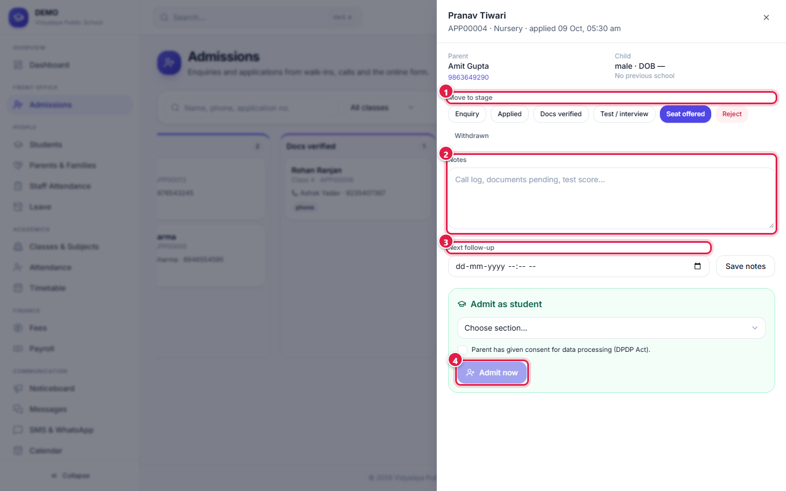

*Figure 12. Move to the next stage.*

> **Callouts:** **1** Move to the next stage · **2** Call log, documents, test score · **3** Follow-up date · **4** Enrol the applicant
<!-- /fig -->

1. Click the application card.
2. **Move to stage** — pick the next stage.
3. **Notes** — record call logs, pending documents and test scores.
4. **Next follow-up** — set a date. It shows on the card so nobody forgets to call back.
5. Click **Save notes**.

**Expected result:** The card moves to the new column and keeps its notes.

To close an application without admitting, click **Reject** or **Withdrawn**. It moves to **Closed**.

#### 5.2.3 Admit an applicant

1. Open the application and click **Admit now**.
2. Choose the **section** of the class applied for.
3. Confirm that the guardian has given consent to data processing. This is required under the DPDP Act.
4. Confirm.

**Expected result:** The student is enrolled with an admission number, a family record is created (or linked to an existing family with the same mobile number), and student and parent logins are created. The application moves to **Admitted**. You need permission to create students as well as edit admissions.

> **Tip:** The applicant's gender must be recorded before admitting.

#### 5.2.4 Share the online admission form

Click **Copy online form link** and share it on WhatsApp, your website or social media. Applications submitted through it appear in the **Applied** column. See [5.39](#539-public-pages-online-admission-and-certificate-verification).

---

### 5.3 Students

*Sidebar → People → Students*

| Who uses it | Owner | Principal/Admin | Front Office | Teacher | Accountant | Librarian | Transport |
|---|:-:|:-:|:-:|:-:|:-:|:-:|:-:|
| Rights | VCED | VCED | VCE | V (own sections) | V | V | V |

**Purpose:** The central student register: admission, profile 360°, status changes, promotion and logins.

#### 5.3.1 Student list

<!-- placeholder: Students list on desktop. Arrow 1 → search box "Name, admission no., parent or mobile…". Arrow 2 → "All classes" and "All sections" filters. Arrow 3 → toolbar buttons Export, Promote, Logins, Import. Arrow 4 → "New admission" primary button. Arrow 5 → a student row with photo, admission number, class and parent mobile. -->
<!-- fig:08-students -->
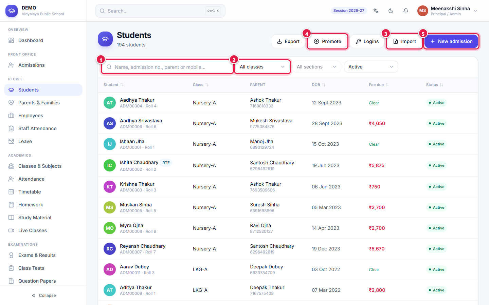

*Figure 13. Students list on desktop.*

> **Callouts:** **1** Search · **2** Filter by class and section · **3** Bulk import (CSV) · **4** Session-end promotion · **5** Admit one student
<!-- /fig -->

- Search by name, admission number, parent name or mobile.
- Filter by class and section.
- **Export** downloads the current list as CSV, which opens in Excel.
- Click a row to open the student profile.

#### 5.3.2 Admit a single student

*Students → **New admission***

<!-- placeholder: New admission form, long scrolling page. Arrow 1 → "Student details" section. Arrow 2 → "Admission & class" section with Class and Section drop-downs. Arrow 3 → "Parents / guardian" section with "Primary mobile". Arrow 4 → "Government IDs" section with Aadhaar and APAAR. Arrow 5 → consent checkbox. Arrow 6 → Save button. -->
<!-- fig:09-new-admission -->
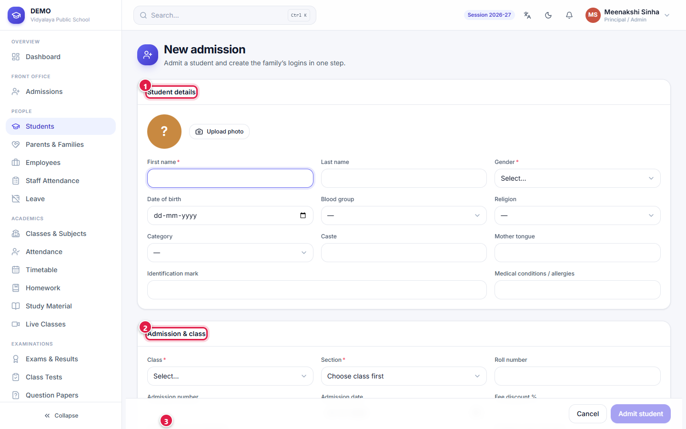

*Figure 14. New admission form, long scrolling page.*

> **Callouts:** **1** Student details · **2** Class, section, admission no. · **3** Primary mobile links siblings
<!-- /fig -->

| Section | Fields | Notes |
|---|---|---|
| Student details | **First name** (required), Last name, **Gender** (required), Date of birth, Blood group, Religion, Category, Caste, Mother tongue, Identification mark, Medical conditions / allergies, photo | |
| Admission & class | **Class** (required), **Section** (required, choose the class first), Roll number, Admission number, Admission date, RTE seat (free education quota), discount, Previous school, Previous board roll no. | Leave **Admission number** blank to auto-generate it. A discount applies to every fee head. |
| Parents / guardian | Father's and mother's details, **Primary mobile** (required), Guardian (if other) and relation | The primary mobile is used for the parent login and SMS/WhatsApp alerts. **Siblings are linked automatically by this number.** |
| Address | Address, City / village, State, PIN code | |
| Government IDs | Aadhaar number, APAAR ID, APAAR consent (Not yet asked / Granted / Declined) | Aadhaar is encrypted. Only the last 4 digits are ever shown. |
| Consent | Guardian consent to data processing | **Required** (DPDP Act). |

**Steps**

1. Fill in the required fields (marked above) and any optional ones you have.
2. Tick the consent box.
3. Click **Save**.

**Expected result:** The **Admission complete — login details** screen shows the new admission number and one-time temporary passwords for the student and (for a new family) the parent. Print or share them now, because they are not shown again. Use **Print login slips** for a printable slip.

#### 5.3.3 Bulk import from a spreadsheet

*Students → **Import***

1. **Prepare your file:** click **Download template** and fill one row per student (up to 500 rows per file). Keep the column headings unchanged.
2. **Upload:** choose the saved CSV file.
3. **Results:** the system lists admitted rows and any errors by row number. Click **View** to see the generated login credentials and print them.

**Expected result:** Valid rows are admitted. Rows with errors are skipped with a reason so you can fix and re-upload them.

#### 5.3.4 Student profile (360° view)

Open any student from the list.

<!-- placeholder: Student profile header with photo, name, admission number and class. Arrow 1 → tabs Profile / Attendance / Fees / Results / Behaviour / Logins & consent. Arrow 2 → summary tiles (Attendance (session), Fee due, Latest result, Siblings). Arrow 3 → "Collect fee" button. Arrow 4 → "Edit" button. Arrow 5 → "More" menu (Admission letter, Change status / leaving, Delete record). -->
<!-- fig:10-student-profile -->
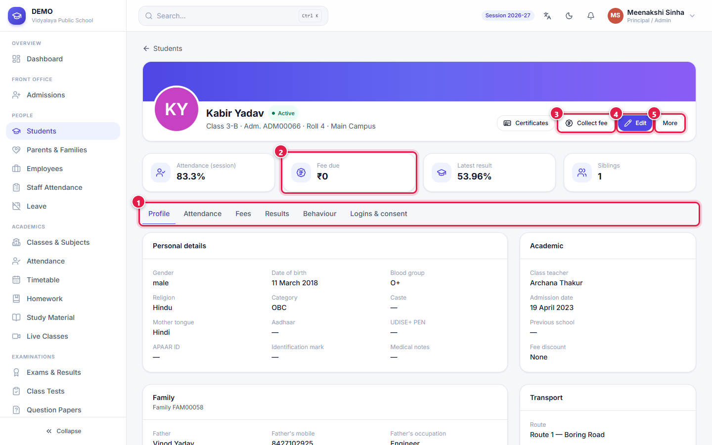

*Figure 15. Student profile header with photo, name, admission number and class.*

> **Callouts:** **1** Profile · Attendance · Fees · Results · Behaviour · Logins · **2** Summary tiles · **3** Collect this student's fees · **4** Edit details · **5** Admission letter, status / leaving, delete
<!-- /fig -->

| Tab | Contents | Actions |
|---|---|---|
| **Profile** | Personal details, academic, family (with siblings), transport | **Edit** |
| **Attendance** | Last 30 marked days and a month-wise summary | — |
| **Fees** | Invoices and receipts | **Print receipt**, **Collect fee** |
| **Results** | Exam-by-exam marks and grades | **Report card** |
| **Behaviour** | Ratings and observations | — |
| **Logins & consent** | Student and parent accounts, consent records (DPDP) | **Reset** password |

Each tab appears only if your role can view that module. Teachers can open only students in their own sections.

#### 5.3.5 Change status or record leaving

1. On the profile, open **More → Change status / leaving**.
2. **New status** — Active, Inactive, Transferred, Passed out or Dropped.
3. **Leaving date** and **Reason** (for example *"Family relocated to Delhi"*).
4. Click **Update**.

**Expected result:** The student leaves active lists but keeps their full history. Their logins are disabled automatically. Issue a Transfer Certificate from [Certificates](#530-certificates--id-cards).

**Delete record** (in **More**) is for records created by mistake. Use a status change for real leavers.

#### 5.3.6 Promote students at session end

*Students → **Promote***

<!-- placeholder: Promote students screen. Arrow 1 → "From class" and "From section". Arrow 2 → student list with checkboxes. Arrow 3 → "Action" drop-down (Promote / Detain / Pass out). Arrow 4 → "To class" and "To section". Arrow 5 → confirm button. -->
<!-- fig:11-promote -->
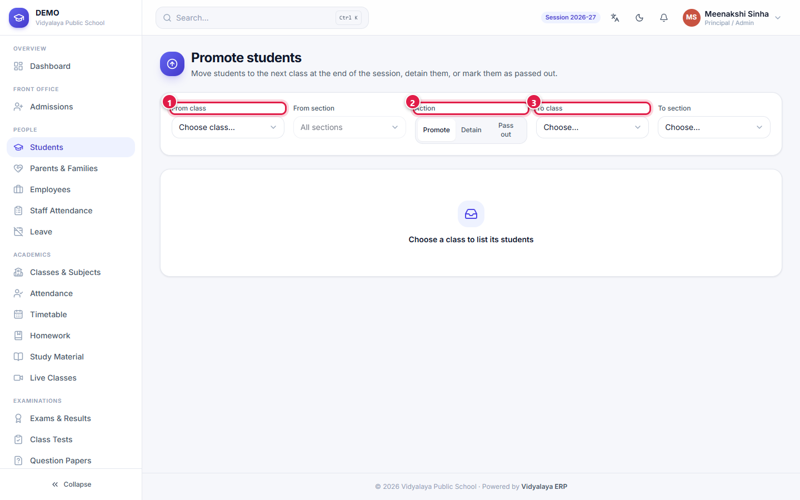

*Figure 16. Promote students screen.*

> **Callouts:** **1** Class to promote · **2** Promote / Detain / Pass out · **3** Destination class
<!-- /fig -->

1. Choose **From class** (and optionally **From section**). The class's students are listed.
2. Untick any student who should be handled differently.
3. **Action:** **Promote** (move to the next class), **Detain** (stay in the same class), or **Pass out** (final year).
4. For Promote, choose **To class** and **To section**.
5. Confirm.

**Expected result:** The selected students are moved or marked. Repeat for detained students with **Detain**.

#### 5.3.7 Manage logins (students, parents and staff)

*Students → **Logins***, *Parents & Families → **Parent logins***, *Employees → **Staff logins***

<!-- placeholder: Student & parent logins list. Arrow 1 → type switch (Students / Parents). Arrow 2 → search "Search name, username, phone…" and class filter. Arrow 3 → status badges (Active, Pending first login, Locked). Arrow 4 → row "Account actions" menu with Reset password / Unlock / Disable. Arrow 5 → "Print login slips". -->
<!-- fig:12-logins -->
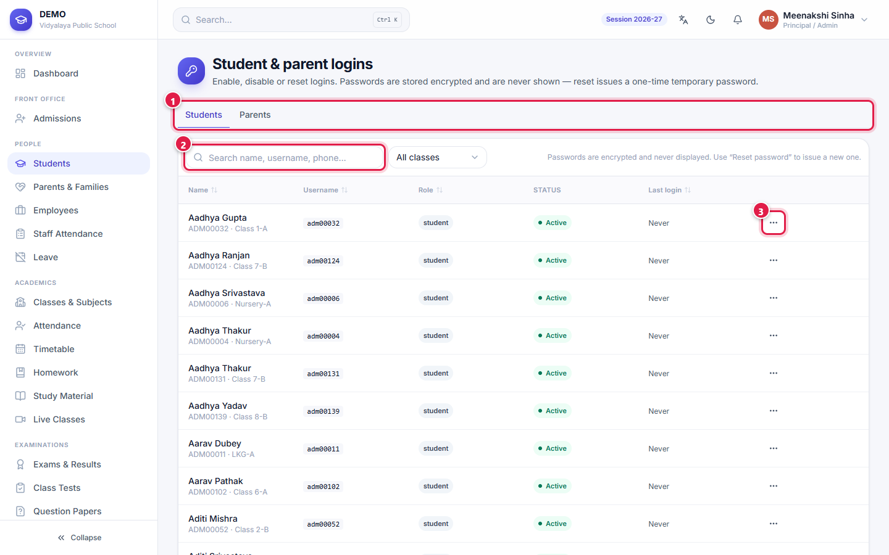

*Figure 17. Student & parent logins list.*

> **Callouts:** **1** Students / Parents · **2** Search accounts · **3** Reset password · Unlock · Disable
<!-- /fig -->

| Action | Result |
|---|---|
| **Reset password** | Issues a new one-time temporary password, shown once, and signs the user out everywhere. The user must change it at next sign-in. |
| **Unlock** | Clears a lockout after repeated wrong passwords. |
| **Enable / Disable** | Disabling signs the user out immediately and blocks sign-in. |
| **Change role** (staff only) | Moves a staff login to another role and signs them out so it takes effect. |
| **Print login slips** | Printable credential slips for the passwords just issued. |

Rules: passwords are never displayed. Only the Owner can manage Owner and Principal/Admin accounts. You cannot manage your own login here. Teachers see only logins for students and families in their own sections.

---

### 5.4 Parents & Families

*Sidebar → People → Parents & Families*

| Who uses it | Owner | Principal/Admin | Front Office | Teacher | Accountant |
|---|:-:|:-:|:-:|:-:|:-:|
| Rights | VCED | VCED | VCE | V (own sections) | V |

**Purpose:** Each family groups siblings under one parent login, so a parent sees all their children and fees can be collected family-wise.

<!-- placeholder: Families list. Arrow 1 → search "Parent, mobile, family code or child…". Arrow 2 → class filter. Arrow 3 → a family row listing children with class labels. Arrow 4 → row edit (pencil) icon. Arrow 5 → "Export page" and "Parent logins" buttons. -->
<!-- fig:13-guardians -->
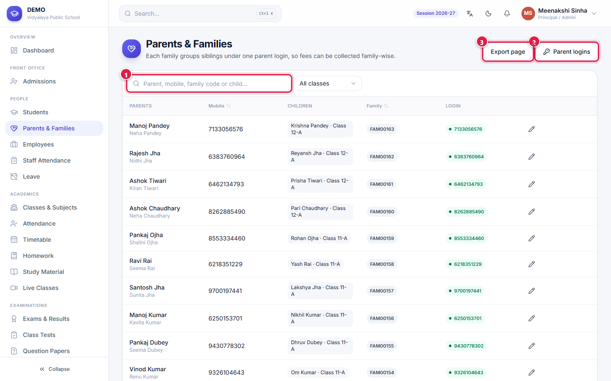

*Figure 18. Families list.*

> **Callouts:** **1** Search families · **2** Parent accounts · **3** Export
<!-- /fig -->

**Edit a family**

1. Click the edit icon on the family row.
2. Update the father's, mother's or guardian's names, occupation, phones, emails, address or annual income.
3. Click **Save**.

**Expected result:** The family record updates. If you changed the primary mobile or a parent's name, the parent login's phone and display name update too. A mobile number already used by another family is rejected. To merge siblings, edit the student and use the same family instead.

---

### 5.5 Employees

*Sidebar → People → Employees*

| Who uses it | Owner | Principal/Admin | Accountant |
|---|:-:|:-:|:-:|
| Rights | VCED | VCED | V |

**Purpose:** Staff directory, joining records, job letters, salary structure and staff logins.

<!-- placeholder: Employees list. Arrow 1 → tabs All / Teaching / Non-teaching. Arrow 2 → search "Name, code, designation, mobile…". Arrow 3 → "Export" and "Staff logins". Arrow 4 → "Add employee" button. Arrow 5 → salary columns (visible to payroll managers only). -->
<!-- fig:14-employees -->
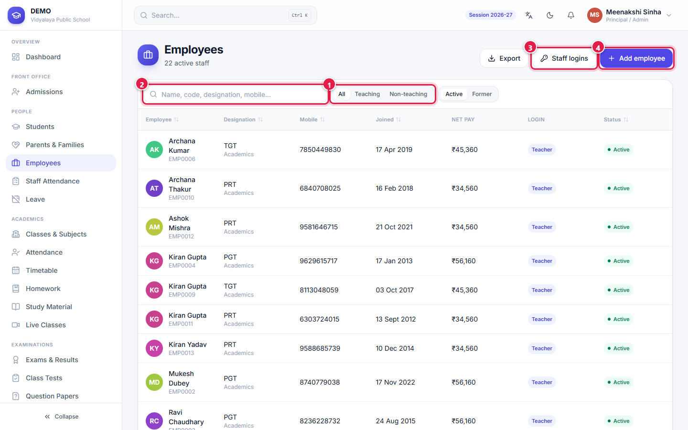

*Figure 19. Employees list.*

> **Callouts:** **1** All / Teaching / Non-teaching · **2** Search staff · **3** Staff accounts · **4** Hire
<!-- /fig -->

#### 5.5.1 Add an employee

1. Click **Add employee**.
2. Fill in the details:

| Group | Fields |
|---|---|
| Personal | **First name**, Last name, **Gender**, Date of birth, Blood group, Address |
| Job | **Designation**, Department, Teaching staff (yes/no), **Date of joining**, Qualification, Experience (years) |
| Contact | Mobile (SMS / WhatsApp), Email |
| Statutory | Aadhaar, PAN, EPF UAN |
| Bank | Bank name, Bank account no., IFSC |
| Salary (monthly) | Basic salary, Allowances (HRA/DA), Deductions (PF/ESI/TDS) |
| Login | **Create login with role** (optional), Username (optional; the employee code is used if blank) |

3. Click **Save**.

**Expected result:** The employee gets an employee code. If you chose a login role, a temporary password is shown once. Only the Owner can create Owner or Principal/Admin logins.

#### 5.5.2 Employee profile

<!-- fig:15-employee-profile -->
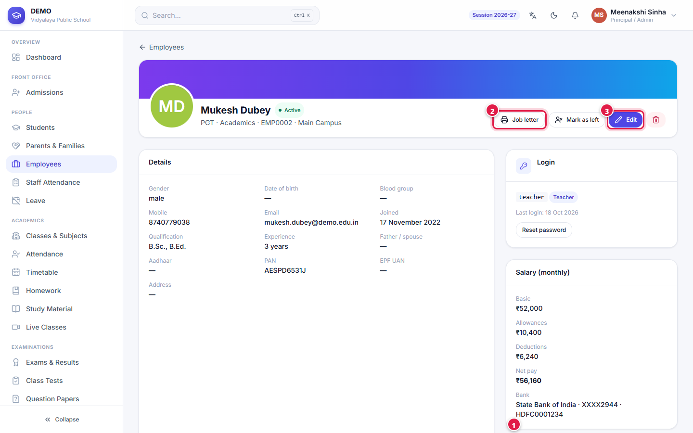

*Figure 20. Sections and subjects.*

> **Callouts:** **1** Sections and subjects · **2** Print appointment letter · **3** Edit or mark inactive
<!-- /fig -->

Shows **Details**, **Login**, **Salary (monthly)** and **Teaching load** (class-teacher sections and subjects taught). Actions:

- **Edit** — update details, or set the status to Inactive with a leaving date. This also disables the login.
- **Job letter** — prints an appointment letter on the school letterhead.
- **Create login** / **Reset password**.

Bank account numbers are masked (last 4 digits only). Salary is visible only to payroll managers and to the employee themselves.

---

### 5.6 Classes & Subjects

*Sidebar → Academics → Classes & Subjects*

| Who uses it | Owner | Principal/Admin | All other staff |
|---|:-:|:-:|:-:|
| Rights | VCED | VCED | V |

**Purpose:** The academic structure everything else depends on: sessions, classes, sections, subjects, chapters and which teacher teaches what.

<!-- placeholder: Classes & Subjects with the "Classes & sections" tab open. Arrow 1 → tabs Classes & sections / Subjects / Teacher allocation / Academic years / Chapters. Arrow 2 → a class card with its sections, capacity and class teacher. Arrow 3 → "Class actions" menu (Edit class, Subjects & marks, Add section, Delete class). Arrow 4 → "Add class" button. -->
<!-- fig:16-academics -->
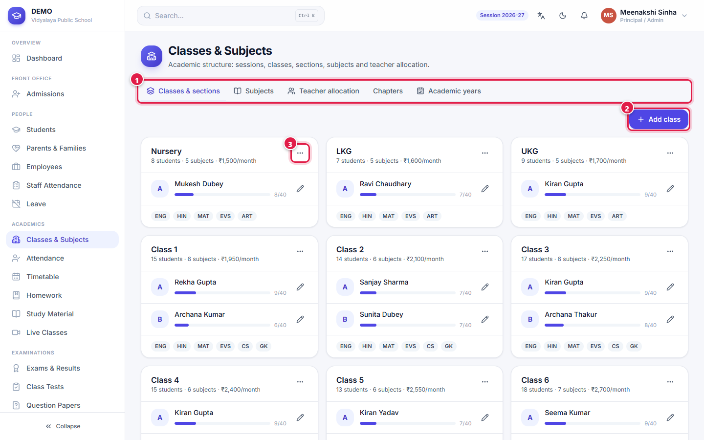

*Figure 21. Classes & Subjects with the "Classes & sections" tab open.*

> **Callouts:** **1** Classes · Subjects · Teacher allocation · Years · Chapters · **2** Add a class · **3** Subjects & marks, add section
<!-- /fig -->

| Tab | What you do |
|---|---|
| **Classes & sections** | **Add class** (name, order, monthly fee). Add sections with capacity and a **class teacher**. |
| **Subjects** | Maintain the subject master list (name, code). |
| *Class actions → **Subjects & marks*** | Tick the subjects taught in a class and set default **Full marks** and **Pass marks**. |
| **Teacher allocation** | For each section, choose who teaches each subject, then **Save allocation**. This controls which sections a teacher can see and mark. |
| **Academic years** | Create sessions and **Make current** at the start of a new session. |
| **Chapters** | Chapter list per class and subject, used by the question bank. |

**Recommended setup order:** Academic year → Classes → Sections (with class teachers) → Subjects → Subjects & marks per class → Teacher allocation.

<!-- fig:17-teacher-allocation -->
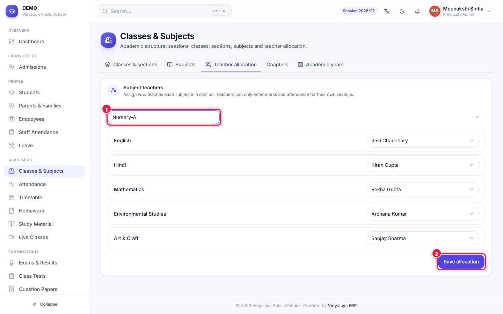

*Figure 22. Choose a section.*

> **Callouts:** **1** Choose a section · **2** Save who teaches each subject
<!-- /fig -->

> **Important:** A teacher with no allocation sees *"No sections assigned to you"* on attendance and marks screens.

---

### 5.7 Student Attendance

*Sidebar → Academics → Attendance* (staff) · *My School → Attendance* (families)

| Who uses it | Owner | Principal/Admin | Teacher | Front Office | Parent / Student |
|---|:-:|:-:|:-:|:-:|:-:|
| Rights | VCED | VCED | VCE (own sections) | V | V (own) |

**Purpose:** Daily attendance by section, ID-card scanning, registers and automatic absence alerts to parents.

**Statuses:** Present, Absent, Late, Half day, Leave, Holiday. Students on approved leave are pre-filled as **Leave**.

#### 5.7.1 Mark attendance (Mark tab)

<!-- placeholder: Attendance Mark tab on a tablet. Arrow 1 → "Class & section" picker. Arrow 2 → "Date" picker. Arrow 3 → "Mark all present" button. Arrow 4 → a student row with status buttons P / A / L / H / LV. Arrow 5 → running counts Present / Absent. Arrow 6 → Save button. -->
<!-- fig:18-attendance-mark -->
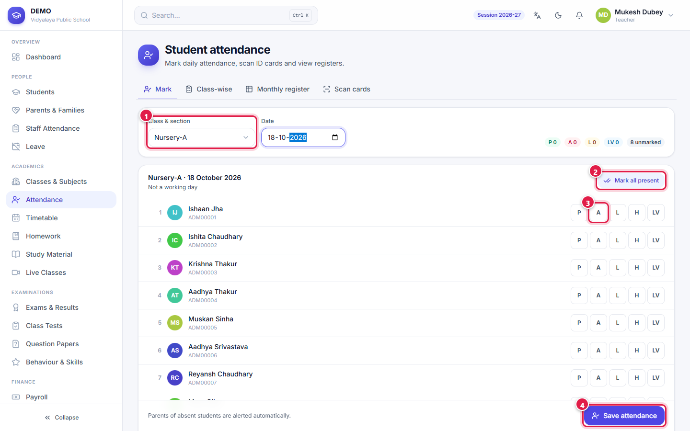

*Figure 23. Attendance Mark tab on a tablet.*

> **Callouts:** **1** Your section · **2** Mark everyone present · **3** P / A / L / H / LV per student · **4** Save (absent alerts go to parents)
<!-- /fig -->

1. **Class & section** — choose your section. Teachers see only their own.
2. **Date** — defaults to today.
3. Click **Mark all present**, then change the exceptions (Absent, Late and so on). Add remarks if needed.
4. Click **Save**.

**Expected result:** Attendance is saved with your name and time. Parents of students newly marked **Absent** get an in-app notification and an SMS, if the school has absence alerts on and an SMS gateway configured. Re-saving does not alert the same student twice.

**Rules**

- On a holiday or non-working day, the screen shows a banner.
- Teachers can change attendance only within the school's edit window (default **2 days**). Older dates are locked.
- Changing a day that is already marked needs **Edit** permission on Attendance.

#### 5.7.2 Scan ID cards (Scan cards tab)

<!-- fig:19-attendance-scan -->
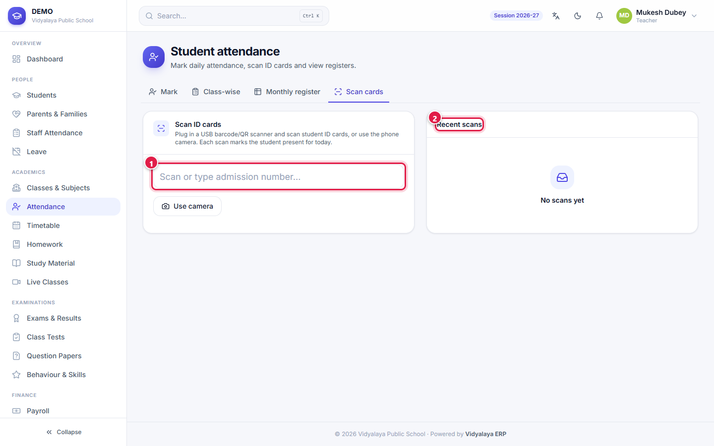

*Figure 24. Scanner input.*

> **Callouts:** **1** Scanner input · **2** Scanned students
<!-- /fig -->

1. Plug in a USB barcode/QR scanner, or click the camera button to use a phone or tablet camera.
2. Scan each student's ID card, or type the admission number.

**Expected result:** Each scan marks that student **Present** for today and appears under **Recent scans**.

#### 5.7.3 Registers and reports

<!-- fig:20-attendance-register -->
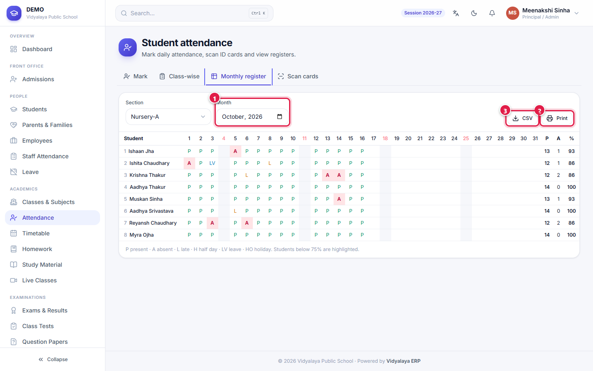

*Figure 25. Month.*

> **Callouts:** **1** Month · **2** Print · **3** Export
<!-- /fig -->

- **Class-wise** — today's summary per section (sections marked, present and absent counts).
- **Monthly register** — the full month grid for a section. **Print** or **CSV**.

#### 5.7.4 Parent / Student view

A calendar of the child's attendance for the selected month with **This month** totals. Days are colour-coded by status.

---

### 5.8 Staff Attendance

*Sidebar → People → Staff Attendance*

| Who uses it | Owner / Principal/Admin | All other staff |
|---|:-:|:-:|
| Rights | VCED (whole staff) | V (own record only) |

<!-- placeholder: Staff attendance "Mark today" tab. Arrow 1 → date header. Arrow 2 → "All present" button. Arrow 3 → a staff row with status buttons and "In time" / "Out time" fields. Arrow 4 → Save button. Arrow 5 → "Monthly register" tab with "Month" picker and CSV button. -->
<!-- fig:21-staff-attendance -->
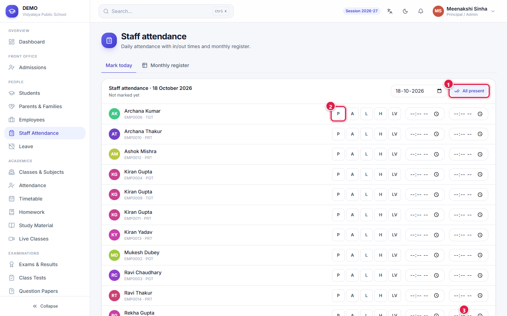

*Figure 26. Staff attendance "Mark today" tab.*

> **Callouts:** **1** Mark all present · **2** Status per employee (P / A / L / H / LV) · **3** Save
<!-- /fig -->

**Mark staff attendance (administrators)**

1. Open **Mark today** and confirm the date.
2. Click **All present**, then adjust exceptions. Enter **In time** and **Out time** (HH:MM) if you track them.
3. Click **Save**.

**Expected result:** Staff on approved leave are pre-filled as **Leave**. The monthly register updates and feeds the attendance summary on payslips.

**Staff (view only):** the screen title is **My attendance** and shows only your own monthly row.

---

### 5.9 Leave Management

*Sidebar → People → Leave* (staff) · *My School → Leave* (parents)

| Who uses it | Owner/Admin | Teacher | Other staff | Parent |
|---|:-:|:-:|:-:|:-:|
| Rights | VCED (approve all) | VCE (apply; approve own class's students) | VC (apply) | VC (apply for child) |

**Leave types:** Sick, Casual, Earned, Family, Maternity, Other.

<!-- placeholder: Leave screen. Arrow 1 → tabs "My applications" and "To review" / "My students". Arrow 2 → "Apply for leave" button. Arrow 3 → an application card with dates, days, type and status badge. Arrow 4 → "Approve" / "Reject" buttons on a pending item. Arrow 5 → "Withdraw" on your own pending item. -->
<!-- fig:22-leave -->
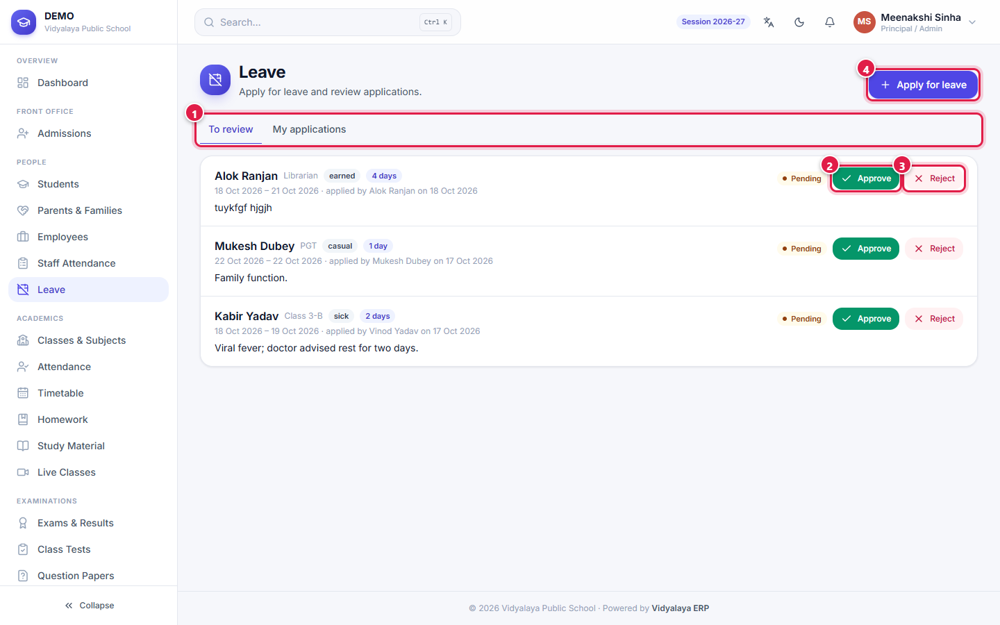

*Figure 27. Leave screen.*

> **Callouts:** **1** My applications / To review · **2** Approve · **3** Reject · **4** Apply
<!-- /fig -->

#### Apply for leave

1. Click **Apply for leave**.
2. Choose **Leave type**, **From** and **To** dates, and write a **Reason** (at least 3 characters). Parents with several children choose which child.
3. Submit.

**Expected result:** The application shows as **Pending**. Student leave notifies the class teacher. Staff leave notifies administrators. Overlapping applications are rejected.

#### Review leave

1. Open **To review** (administrators) or **My students** (class teachers).
2. Click **Approve** or **Reject** and optionally add a note.

**Expected result:** The applicant is notified. Approved leave is pre-filled as **Leave** on attendance. You cannot approve your own leave.

**Withdraw:** applicants can **Withdraw** a pending application.

---

### 5.10 Timetable

*Sidebar → Academics → Timetable*

| Who uses it | Owner/Admin | Teacher | Front Office | Parent / Student |
|---|:-:|:-:|:-:|:-:|
| Rights | VCED | V | V | V (own class) |

<!-- placeholder: Timetable grid for one section. Arrow 1 → tabs Timetable / Periods / Rooms. Arrow 2 → class/teacher selector. Arrow 3 → a grid cell showing Subject, Teacher, Room. Arrow 4 → "Auto-generate" button. Arrow 5 → "Save", "Clear" and "Print" buttons. -->
<!-- fig:23-timetable -->
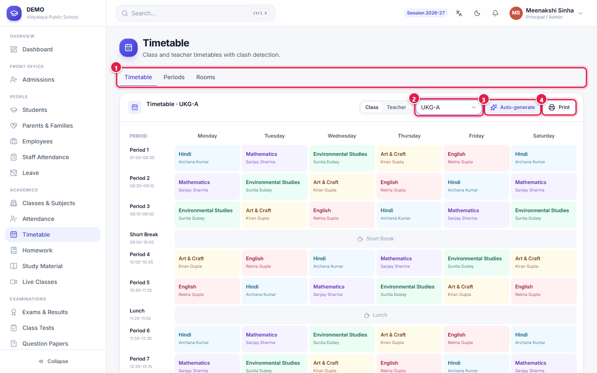

*Figure 28. Timetable grid for one section.*

> **Callouts:** **1** Timetable · Periods · Rooms · **2** Class or teacher · **3** Draft automatically · **4** Print
<!-- /fig -->

**Set up (administrators)**

1. **Periods** tab — define the day's periods (name, start and end time, breaks).
2. **Rooms** tab — list rooms and labs (optional).
3. **Timetable** tab — choose a class/section. Click a cell and pick **Subject**, **Teacher** and **Room**.
4. Click **Save**.

**Expected result:** If a teacher is already booked in another section in the same period, the clash is flagged and not saved.

- **Auto-generate** fills a draft timetable from the subject allocation. Review it and **Save**.
- Choose a **teacher** instead of a class to see that teacher's week.
- **Print** produces a wall-chart copy.

Families see their child's class timetable. Teachers can view any class or their own timetable.

---

### 5.11 Homework

*Sidebar → Academics → Homework* (staff) · *My School → Homework* (families)

| Who uses it | Owner/Admin | Teacher | Student | Parent |
|---|:-:|:-:|:-:|:-:|
| Rights | VCED | VCED (own) | VC (submit) | V |

#### 5.11.1 Give homework (teacher)

<!-- placeholder: "Give homework" dialog. Arrow 1 → "Class & section". Arrow 2 → "Subject". Arrow 3 → "Title" (e.g. "Exercise 4.2, questions 1–10"). Arrow 4 → "Details". Arrow 5 → "Assigned on" and "Due on". Arrow 6 → "Attachment" upload. Arrow 7 → "Post homework" button. -->
<!-- fig:25-give-homework -->
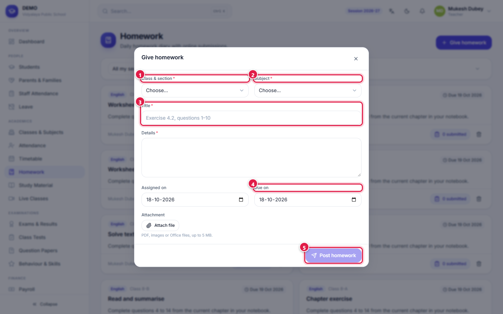

*Figure 29. "Give homework" dialog.*

> **Callouts:** **1** Section · **2** Subject · **3** Title · **4** Due date · **5** Post
<!-- /fig -->

1. Click **Give homework**.
2. Fill in **Class & section**, **Subject**, **Title**, **Details**, **Assigned on**, **Due on** and an optional **Attachment** (PDF or image).
3. Click **Post homework**.

**Expected result:** The homework appears for students and parents of that section, who are notified.

#### 5.11.2 Check submissions (teacher)

<!-- fig:24-homework -->
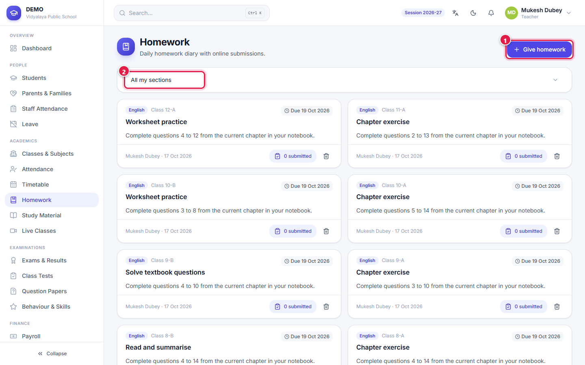

*Figure 30. Post homework.*

> **Callouts:** **1** Post homework · **2** Filter
<!-- /fig -->

1. Open a homework item to see each student's submission status.
2. Open a submission and mark it **Checked** or **Redo**.

**Expected result:** The student sees the status and can **Resubmit** if asked to redo.

#### 5.11.3 Submit homework online (student)

<!-- placeholder: Student homework list on a phone. Arrow 1 → homework card with due date and subject. Arrow 2 → "Submit online" button. Arrow 3 → in the dialog, "Your answer" text box. Arrow 4 → "Attach photo / PDF". Arrow 5 → "Submit". -->
<!-- fig:26-homework-student-mobile -->
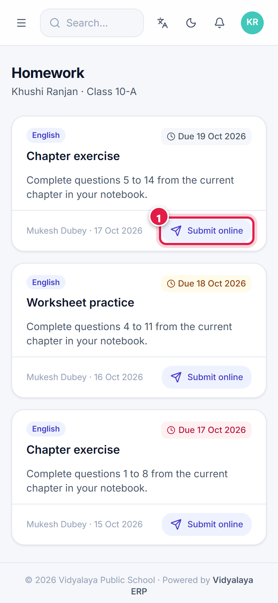

*Figure 31. Student homework list on a phone.*

> **Callouts:** **1** Submit from the phone
<!-- /fig -->

1. Tap **Submit online** on the homework card.
2. Type in **Your answer**, and/or **Attach photo / PDF** (for example, a photo of your notebook).
3. Tap **Submit**.

**Expected result:** The card shows **submitted**. If the teacher marks **Redo**, tap **Resubmit**.

Teachers can delete only homework they posted.

---

### 5.12 Study Material

*Sidebar → Academics → Study Material*

| Who uses it | Owner/Admin | Teacher | Parent / Student |
|---|:-:|:-:|:-:|
| Rights | VCED | VCED (own) | V |

<!-- placeholder: Study material grid. Arrow 1 → search box and "All classes" / "All subjects" filters. Arrow 2 → material card showing type icon (note, video, link). Arrow 3 → "Add material" button. Arrow 4 → "Share" action. -->
<!-- fig:27-lms -->
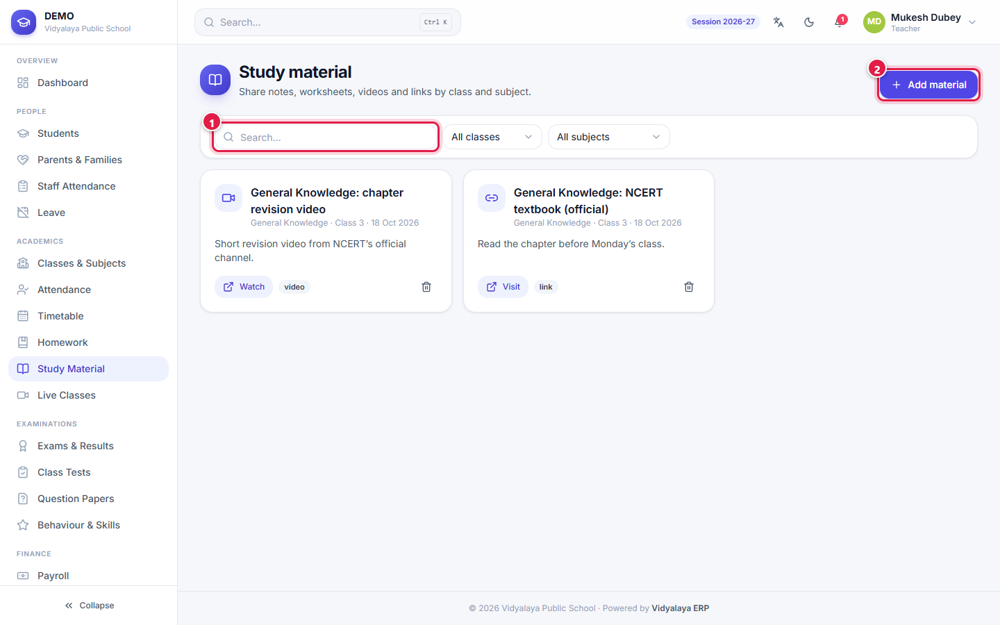

*Figure 32. Study material grid.*

> **Callouts:** **1** Search material · **2** Add notes, video or link
<!-- /fig -->

1. Click **Add material**.
2. Choose **Class**, **Subject**, **Title**, **Description** and **Type** (file, video or link). Upload a file or paste a **Link (https://)**, for example a YouTube video.
3. Save.

**Expected result:** Students and parents of that class can open the material, filtered by subject.

---

### 5.13 Live Classes

*Sidebar → Academics → Live Classes*

| Who uses it | Owner/Admin | Teacher | Parent / Student |
|---|:-:|:-:|:-:|
| Rights | VCED | VCED (own) | V |

**Purpose:** Schedule online classes on Google Meet, Zoom, Teams or Jitsi.

<!-- placeholder: Live classes list. Arrow 1 → tabs Upcoming / Past. Arrow 2 → class card with time, section, platform and "Join" link. Arrow 3 → "Schedule class" button. -->
<!-- fig:28-live-classes -->
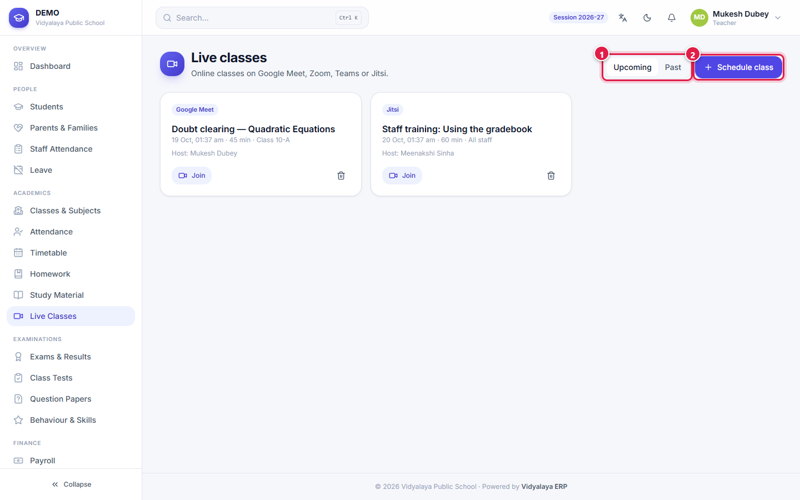

*Figure 33. Live classes list.*

> **Callouts:** **1** Upcoming / Past · **2** Schedule
<!-- /fig -->

1. Click **Schedule class**.
2. Enter a **Title** and choose the **Platform** (Google Meet, Zoom, Teams, Jitsi or Other).
3. Paste the **Meeting link** (https).
4. Choose the **Audience**: all students, all staff, one class or one section (then pick it).
5. Set the **start date and time** and **Duration** (10–480 minutes). Add an optional message.
6. Save.

**Expected result:** The class appears under **Upcoming** for the chosen audience, who are notified. They join from the card or from their Dashboard. Teachers can cancel only classes they scheduled.

---

### 5.14 Exams & Report Cards

*Sidebar → Examinations → Exams & Results* (staff) · *My School → Results* (families)

| Who uses it | Owner/Admin | Teacher | Parent / Student |
|---|:-:|:-:|:-:|
| Rights | VCED | VE (marks for own subjects) | V (published results only) |

**Purpose:** Exam setup, date sheet, marks entry, grading, result sheets and printable report cards.

#### 5.14.1 Configure grading (once per school)

*Exams → **Grading & pass criteria***

1. **Grading scale** — review the grade bands (the default follows the CBSE 8-point scale). Use **Add grade** to add a band, then **Save grading**.
2. **Pass criteria** — set **Overall pass %**, **Pass % in each subject**, and **Subjects a student may fail and still pass (compartment)**.

**Expected result:** All result sheets and report cards use these rules.

#### 5.14.2 Create an exam

<!-- placeholder: Exams list. Arrow 1 → tabs Exams / Grading & pass criteria. Arrow 2 → exam card (e.g. "Half-Yearly 2026", Term 1, dates, Published badge) with buttons Date sheet, Marks, Results. Arrow 3 → "New exam" button. -->
<!-- fig:29-exams -->
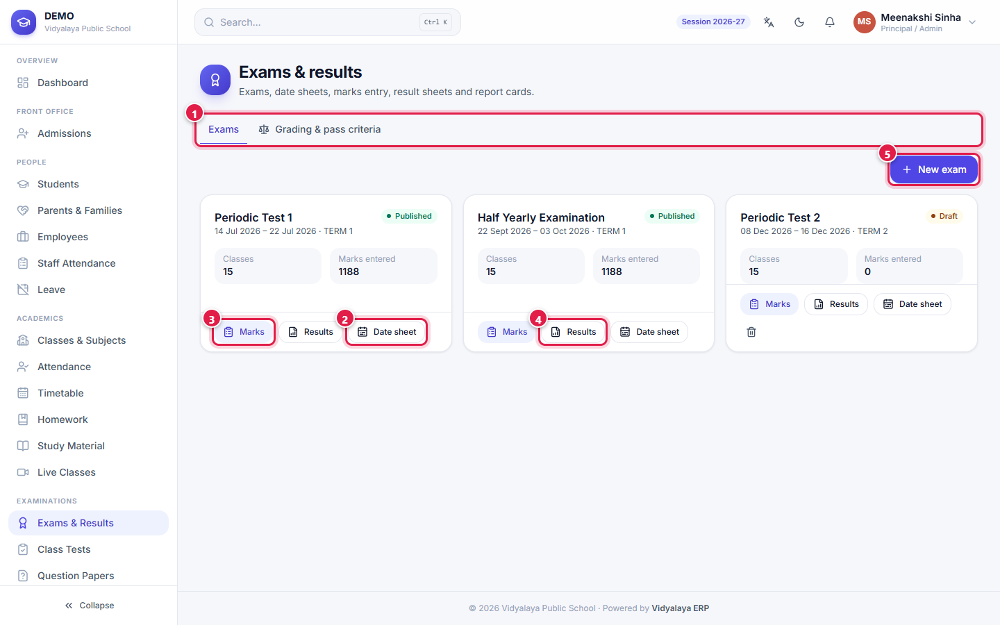

*Figure 34. Exams list.*

> **Callouts:** **1** Exams / Grading & pass criteria · **2** Date sheet · **3** Marks entry · **4** Results · **5** Create exam
<!-- /fig -->

1. Click **New exam**.
2. Enter the **Name**, **Term** (Term 1, Term 2, Annual or Pre-board), **Default max marks per subject**, **Start date** and **End date**.
3. Save.

#### 5.14.3 Date sheet

*Exam → **Date sheet***

1. Choose a class. Its mapped subjects are listed. If there are none, map subjects first under [Classes & Subjects](#56-classes--subjects).
2. Tick the subjects included in this exam.
3. Set each subject's date, timings, **max marks** and **pass marks**.
4. Click **Save**.

#### 5.14.4 Enter marks (teachers and administrators)

<!-- placeholder: Marks entry tab. Arrow 1 → "Section" picker. Arrow 2 → "Subject" picker. Arrow 3 → max/pass marks header. Arrow 4 → a student row with marks input, "Absent" checkbox and remarks. Arrow 5 → "Save marks" button. -->
<!-- fig:30-marks-entry -->
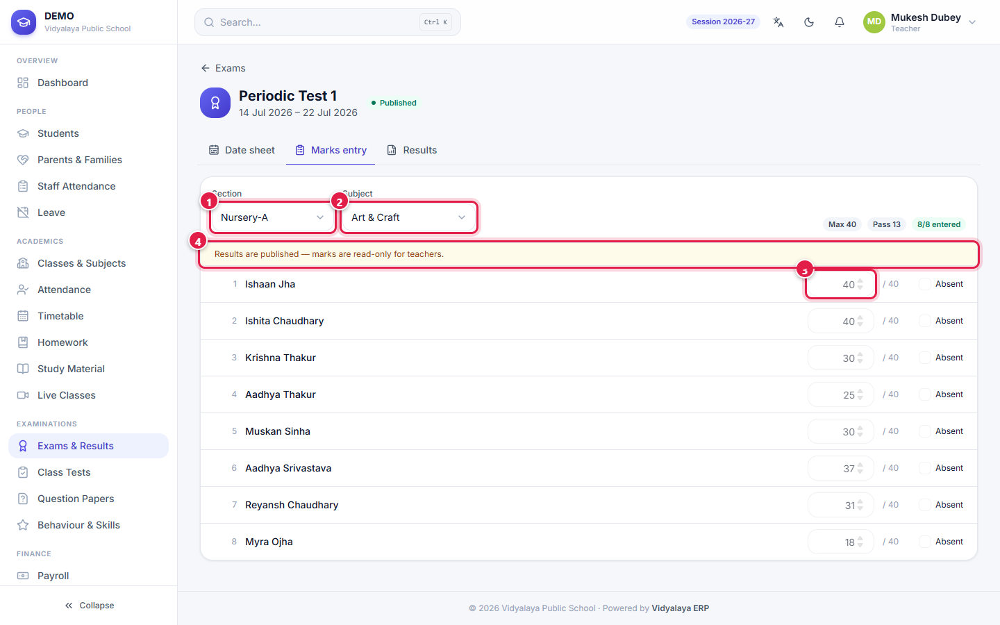

*Figure 35. Marks entry tab.*

> **Callouts:** **1** Section · **2** Subject · **3** Marks per student (tick Absent if absent) · **4** Read-only for teachers once results are published
<!-- /fig -->

1. Open the exam → **Marks entry**.
2. Choose **Section** and **Subject**. Teachers see only the subjects they teach in that section (or every subject in a section where they are class teacher).
3. Type each student's marks, or tick **Absent**. Add remarks if needed.
4. Click **Save marks**.

**Expected result:** Marks are saved. Marks above the subject's maximum are rejected (*"Marks cannot exceed the maximum of …"*). Teachers see *"Can't enter marks here"* for a section and subject they don't teach. Once an exam is published, teachers can no longer change marks. Administrators can.

#### 5.14.5 Results, publishing and report cards

*Exam → **Results***

<!-- placeholder: Result sheet for a section. Arrow 1 → summary tiles Students / Passed / Failed / Class average. Arrow 2 → "Subject-wise average %" chart. Arrow 3 → result table with total, percentage, grade, rank, result. Arrow 4 → "Result sheet" and "Report cards (section)" print buttons. Arrow 5 → "Publish results" button (top of the exam page; shows "Withhold" once published). -->
<!-- fig:31-results -->
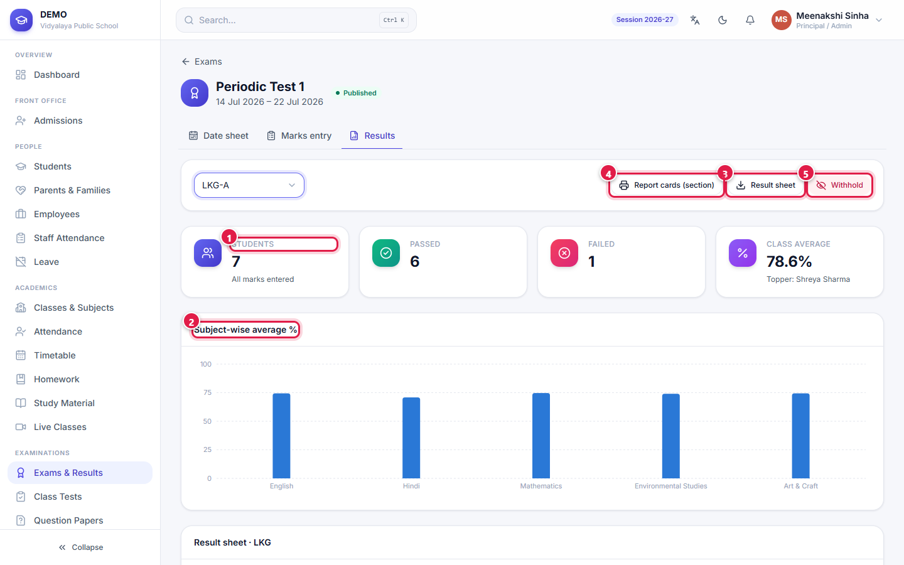

*Figure 36. Result sheet for a section.*

> **Callouts:** **1** Pass / fail summary · **2** Subject averages · **3** Print result sheet · **4** Print report cards · **5** Publish results / Withhold (shown once published)
<!-- /fig -->

1. Choose a section to see the result sheet: totals, percentage, grade, rank (if enabled in settings) and PASS / COMPARTMENT / FAIL.
2. Click **Result sheet** to print the class sheet, or **Report cards (section)** to print one report card per student. A report card can include up to four exams, plus attendance and co-scholastic ratings.
3. When results are final, click **Publish results** (Owner/Admin) and confirm.

**Expected result:** Parents and students are notified and can see the result and download the report card. Unpublished results are never shown to families. **Withhold** hides published results again.

**Single report card:** open a student's profile → **Results** → **Report card**.

<!-- fig:65-report-card -->
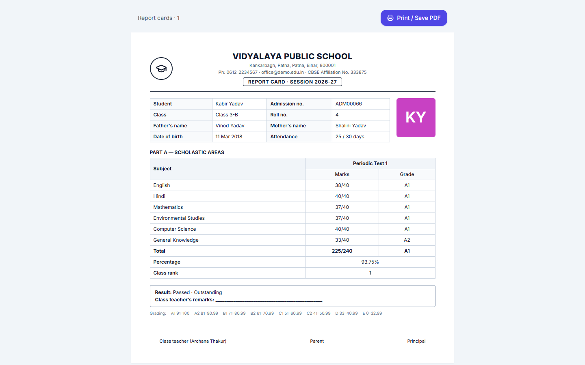

*Figure 37. Printable report card as a parent downloads it.*
<!-- /fig -->

---

### 5.15 Class Tests

*Sidebar → Examinations → Class Tests*

| Who uses it | Owner/Admin | Teacher | Parent / Student |
|---|:-:|:-:|:-:|
| Rights | VCED | VCED (own) | V |

**Purpose:** Quick quizzes and weekly tests with marks tracking, without setting up a formal exam.

1. Click **New test**. Choose the section, subject, title, date and maximum marks, then save.
2. Click **Enter marks** on the test, fill in marks or mark absent, and click **Save**.

**Expected result:** Families see the test and marks under **Class Tests**. They also appear on the student's profile.

<!-- placeholder: Class tests list with "Recent tests". Arrow 1 → "All my sections" filter. Arrow 2 → test row with average score. Arrow 3 → "Enter marks" button. Arrow 4 → "New test" button. -->
<!-- fig:32-class-tests -->
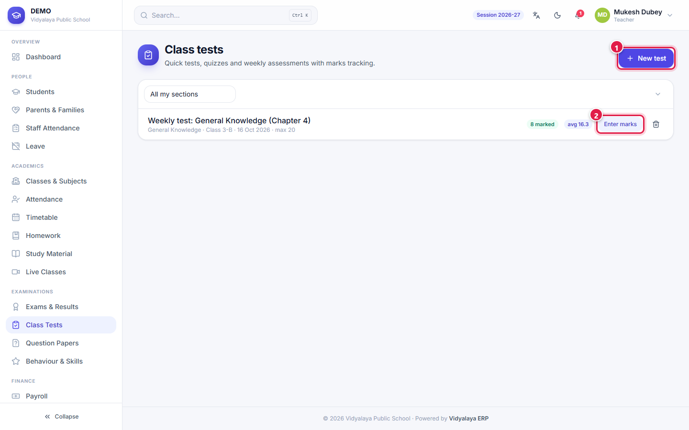

*Figure 38. Class tests list with "Recent tests".*

> **Callouts:** **1** Create a quick test · **2** Enter marks
<!-- /fig -->

---

### 5.16 Question Papers

*Sidebar → Examinations → Question Papers*

| Who uses it | Owner/Admin | Teacher |
|---|:-:|:-:|
| Rights | VCED | VCED |

**Purpose:** A chapter-wise question bank and a paper builder that produces a printable paper with an answer key.

<!-- placeholder: Question bank tab. Arrow 1 → tabs Question bank / Question papers. Arrow 2 → class, subject and chapter filters. Arrow 3 → question row with type (MCQ, Short answer…) and difficulty badges. Arrow 4 → "Build question paper" button. -->
<!-- fig:33-question-bank -->
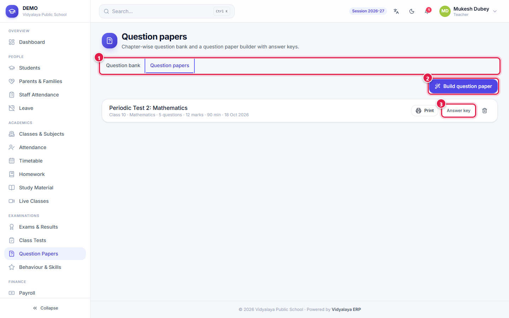

*Figure 39. Question bank tab.*

> **Callouts:** **1** Question bank / Question papers · **2** Paper builder · **3** Print the paper or its answer key
<!-- /fig -->

#### Add questions

In **Question bank**, add questions with class, subject, chapter, **type** (Multiple choice, Short answer, Long answer, True / false, Fill in the blank), **difficulty** (Easy, Medium, Hard), marks, options and answer.

#### Build a paper

1. Click **Build question paper**.
2. Enter the **Title** (for example *"Periodic Test 2 — Mathematics"*), **Class**, **Subject**, **Duration (minutes)**, **Difficulty** (or Mixed) and **Instructions**.
3. **Blueprint:** use **Add section** to add sections, each with a question type and **Number of questions**.
4. Click **Generate**. The system draws random questions from the bank to match the blueprint.
5. Review the paper, then **Save paper**.

**Expected result:** The paper appears under **Question papers**. Use **Print** for the paper and **Answer key** for the solutions.

---

### 5.17 Behaviour & Skills

*Sidebar → Examinations → Behaviour & Skills*

| Who uses it | Owner/Admin | Teacher | Parent / Student |
|---|:-:|:-:|:-:|
| Rights | VCED | VCE | V (shared items only) |

**Purpose:** Co-scholastic ratings for report cards, and teacher observations shared with parents.

#### Ratings

<!-- placeholder: Ratings grid. Arrow 1 → section and term pickers. Arrow 2 → Behaviour / Skills switch. Arrow 3 → grid of students × traits with 1–5 rating buttons. Arrow 4 → "Save ratings" button. -->
<!-- fig:34-behaviour -->
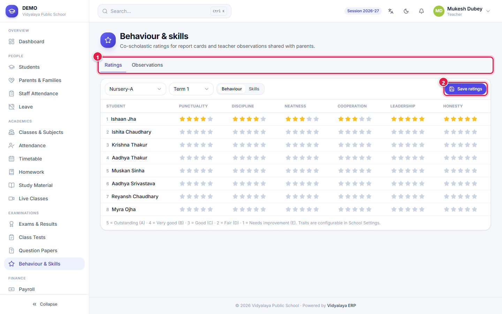

*Figure 40. Ratings grid.*

> **Callouts:** **1** Ratings / Observations · **2** Save
<!-- /fig -->

1. Open **Ratings**. Choose the section and term, then **Behaviour** or **Skills**.
2. Rate each student 1–5 on each trait. The traits are configured in [School Settings → Academic](#535-school-settings).
3. Click **Save ratings**.

**Expected result:** The ratings print on report cards.

#### Observations

1. Open **Observations** → **Add observation**.
2. Pick the student. Choose the type: **Appreciation**, **General note** or **Concern**.
3. Write the observation and choose whether to share it with the parent.
4. Save.

**Expected result:** Shared observations appear in the parent and student view and on the student profile. Teachers can delete only their own observations.

---

### 5.18 Fees

*Sidebar → Finance → Fees* (staff) · *My School → Fees* (families)

| Who uses it | Owner/Admin | Accountant | Front Office | Parent / Student |
|---|:-:|:-:|:-:|:-:|
| Rights | VCED | VCED | VC (collect) | V (own; pay online) |

**Purpose:** Fee heads, class-wise fee structure, monthly invoices, counter collection, receipts, concessions, defaulters, late fees and online payment.

**Tabs:** **Collect** · **Invoices** · **Receipts** · **Defaulters** · **Report** (school-wide roles) · **Fee structure** · **Heads & concessions**

**Recommended setup order:** Fee heads → Fee structure → Concessions → Generate invoices → Collect.

#### 5.18.1 Fee heads and concessions

*Fees → **Heads & concessions***

1. **Fee heads** — **Add** heads such as Tuition Fee, Exam Fee or Admission Fee. Choose **Recurring** or **One time** (for example, admission fee).
2. **Concessions & scholarships** — **Add concession**: choose the **Student**, **Fee head** (or all heads), **Reason**, **Type** (**Percentage** or **Fixed ₹ per invoice**) and **Value**. Save.

**Expected result:** Concessions are applied automatically when invoices are generated (for example sibling, staff ward, RTE or merit).

#### 5.18.2 Fee structure

*Fees → **Fee structure***

<!-- placeholder: Fee structure for a class. Arrow 1 → year picker. Arrow 2 → class list with "Edit" per class. Arrow 3 → fee head row with Amount ₹, Frequency, Due day, Late fee type and Fine ₹. Arrow 4 → "Copy from another year" button. -->
<!-- fig:38-fee-structure -->
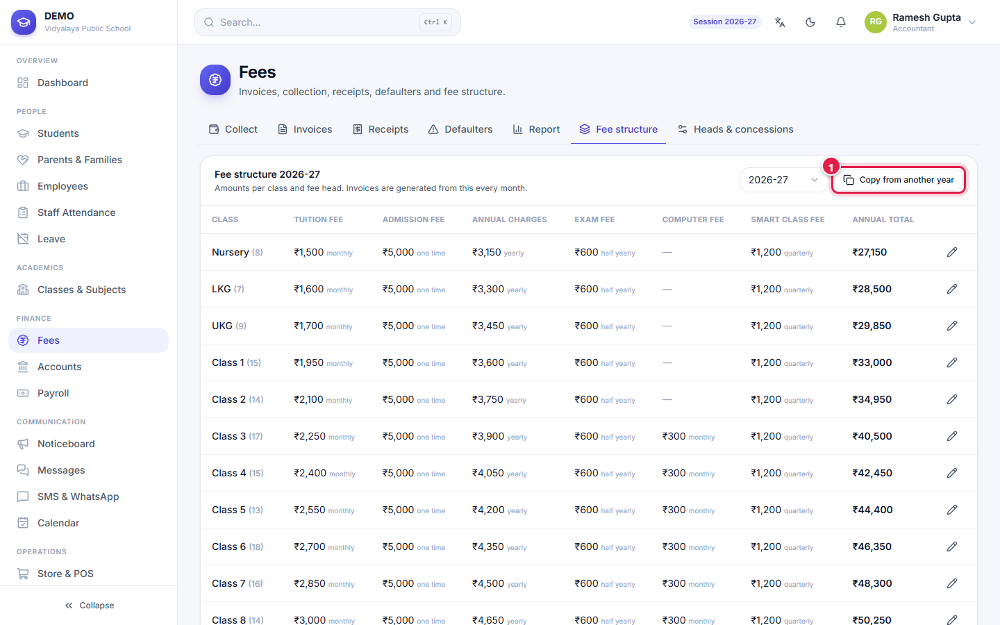

*Figure 41. Fee structure for a class.*

> **Callouts:** **1** Roll over with % increase
<!-- /fig -->

1. Click **Edit** on a class.
2. For each head, set the **Amount ₹**, **Frequency** (Monthly, Quarterly, Half-yearly, Yearly, One time), **Due day**, **Late fee** (None, Fixed or Per day) and **Fine ₹**.
3. Click **Save**.

To roll over to a new session, click **Copy from another year**, choose **Copy from**, and enter **Increase %** for an annual fee hike. This replaces the whole structure for the target year.

#### 5.18.3 Generate monthly invoices

<!-- fig:36-fees-invoices -->
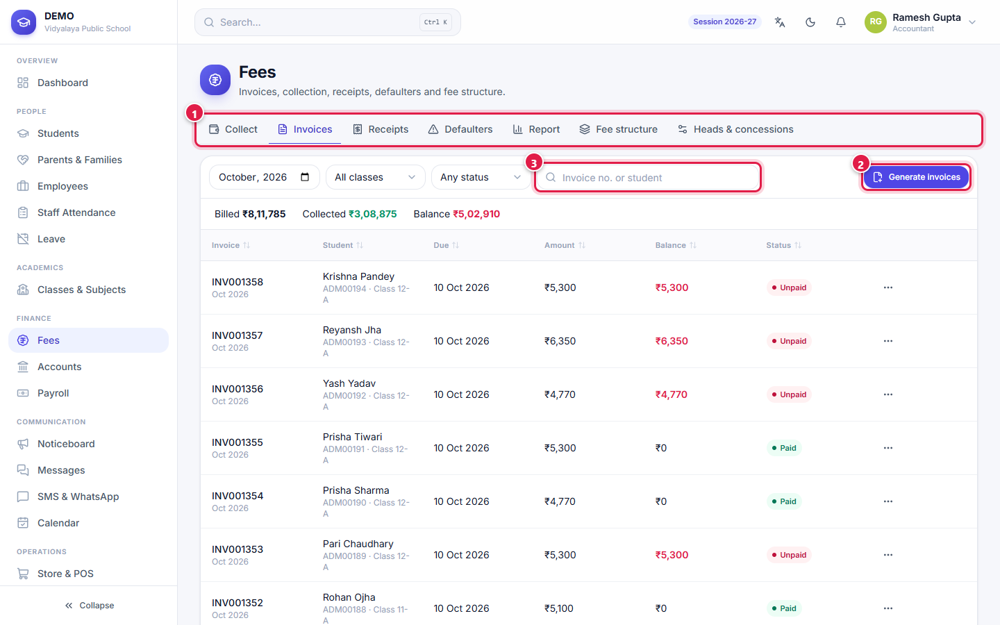

*Figure 42. Collect · Invoices · Receipts · Defaulters · Report · Structure · Heads.*

> **Callouts:** **1** Collect · Invoices · Receipts · Defaulters · Report · Structure · Heads · **2** Monthly invoice run · **3** Search
<!-- /fig -->

*Fees → **Invoices** → **Generate invoices***

1. Choose the **Billing month** (and optionally a class).
2. Confirm.

**Expected result:** One invoice per active student, built from the fee structure plus transport fare, with discounts and concessions applied. Students who already have an invoice for that month are skipped, so running it twice is safe.

Invoice list filters: class, status (Unpaid + partial, Unpaid, Partial, Paid, Cancelled), and search by invoice number or student. Row actions: **Print challan** (includes the school's bank details for offline deposits) and **Cancel invoice** (unpaid invoices only, with a reason).

#### 5.18.4 Collect fees at the counter

*Fees → **Collect***

<!-- placeholder: Fee counter on desktop. Arrow 1 → student search "name, admission number or parent's mobile". Arrow 2 → "Whole family" switch. Arrow 3 → list of pending invoices with checkboxes and balances. Arrow 4 → Payment panel: Amount received, Payment mode, Transaction / UTR reference, Payment date, Remarks. Arrow 5 → collect button. Arrow 6 → "Recent receipts" panel with Print. -->
<!-- fig:35-fees-collect -->
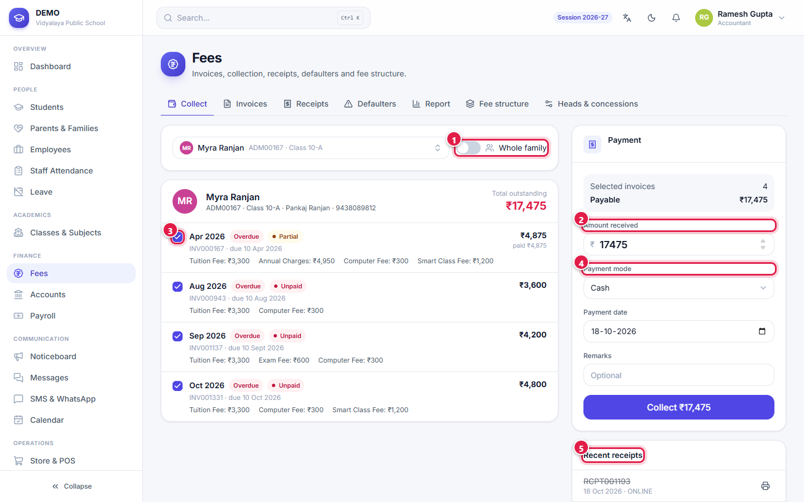

*Figure 43. Fee counter on desktop.*

> **Callouts:** **1** Collect for all siblings · **2** Amount · **3** Tick the invoices being paid · **4** Cash, UPI, card, cheque… · **5** Print recent receipts
<!-- /fig -->

1. Search for the student by name, admission number or the parent's mobile.
2. Optional: turn on **Whole family** to collect for all siblings at once.
3. Tick the invoices being paid. Oldest dues come first.
4. **Amount received** — defaults to the selected total. You can accept a part payment.
5. **Payment mode** — Cash, UPI, Card / POS, Net banking, Bank transfer / NEFT, Cheque or Demand draft. For digital modes, enter the **Transaction / UTR reference**. For cheque or DD, enter the **Cheque / DD no.** and **Bank**.
6. Check the **Payment date** and add **Remarks** if needed.
7. Click collect.

**Expected result:** A receipt with a sequential receipt number is created. Invoices become Paid or Partial. The amount posts to Accounts automatically, and the parent is notified. Click **Print** for the receipt, or **Next student** to continue.

#### 5.18.5 Receipts

<!-- fig:64-print-receipt -->
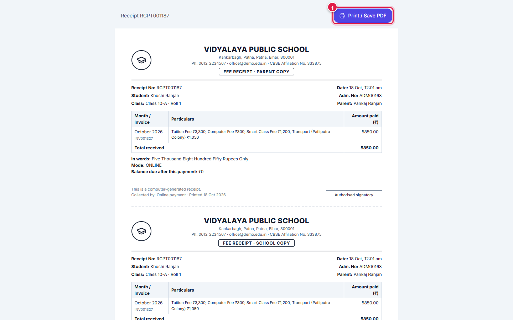

*Figure 44. Print or save as PDF.*

> **Callouts:** **1** Print or save as PDF
<!-- /fig -->

*Fees → **Receipts***: filter by date (**From** / **To**), mode or status, or search by receipt number, UTR or student. Actions: **Print receipt**, **Cancel receipt** (for example, a bounced cheque). Cancelling requires a reason, reverses the allocation and the ledger entry, and keeps the receipt in the list as **Cancelled**. **Export page** downloads CSV.

#### 5.18.6 Defaulters, late fees and reminders

*Fees → **Defaulters***

<!-- placeholder: Defaulters list. Arrow 1 → class filter. Arrow 2 → student rows with overdue months and pending amount, plus selection checkboxes. Arrow 3 → "Send" reminders button. Arrow 4 → "Apply late fees" button. Arrow 5 → "Collect" row action. Arrow 6 → "Export". -->
<!-- fig:37-fees-defaulters -->
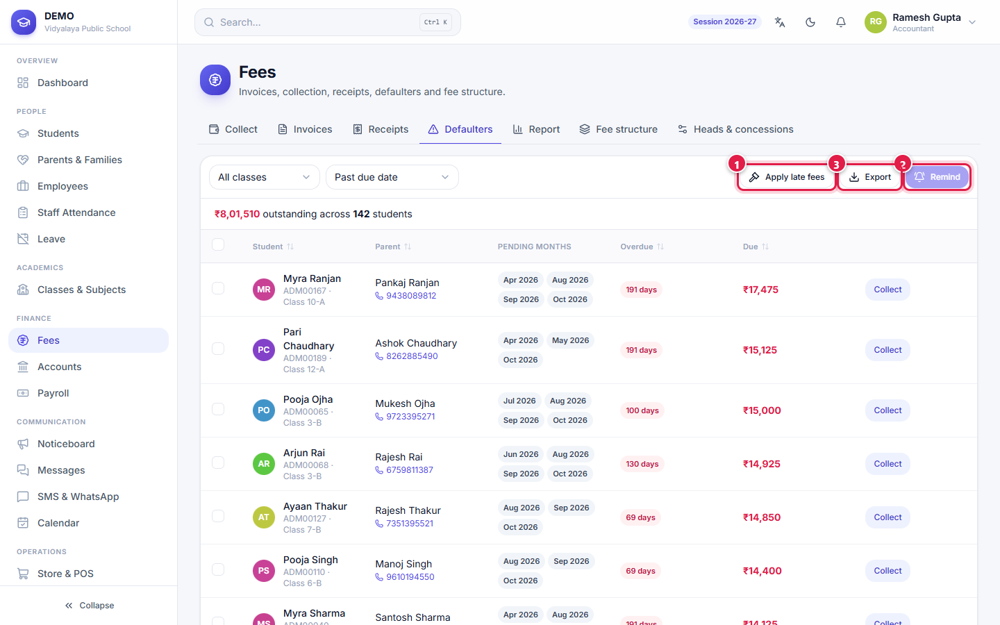

*Figure 45. Defaulters list.*

> **Callouts:** **1** Late fees · **2** SMS / WhatsApp reminders · **3** Export
<!-- /fig -->

- **Send** — select students and click **Send** to send reminders. Each family gets its exact pending amount by in-app notification and SMS/WhatsApp (using the gateway in School Settings).
- **Apply late fees** — adds the late fee defined in the fee structure to overdue invoices.
- **Collect** — jumps to the counter for that student.

#### 5.18.7 Collection report

<!-- fig:39-fees-report -->
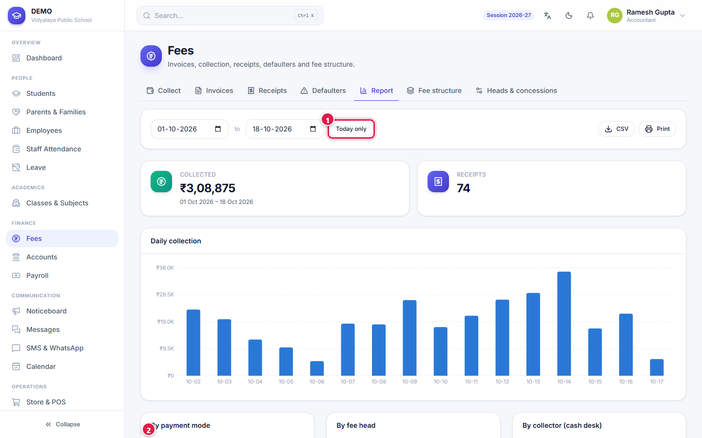

*Figure 46. Day-book.*

> **Callouts:** **1** Day-book · **2** Collection by class
<!-- /fig -->

*Fees → **Report***: choose **From** / **To** dates or **Today only**. You see the total collected, the receipt count, daily collection and the collection **By class**. **CSV** or **Print**.

#### 5.18.8 Parent and student view: pay online

<!-- placeholder: Parent fees screen on a phone. Arrow 1 → tiles Due now / Paid this session / Billed this session. Arrow 2 → invoice list with selection checkboxes. Arrow 3 → "Pay online" button (UPI, cards, net banking, wallets via Razorpay). Arrow 4 → "Challan" button. Arrow 5 → Receipts list with "Download receipt". -->
<!-- fig:40-fees-parent-mobile -->
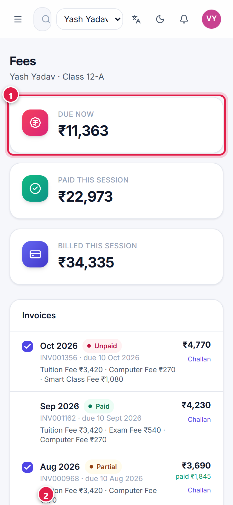

*Figure 47. Parent fees screen on a phone.*

> **Callouts:** **1** Due, paid, billed · **2** UPI, cards, net banking
<!-- /fig -->

1. Open **Fees** (choose the child first if you have several).
2. Tick the invoices to pay.
3. Tap **Pay online** and complete payment in the Razorpay window (UPI, card, net banking or wallet).

**Expected result:** *"Payment successful"* appears, and a receipt is generated and downloadable. If you close the window early, the payment is still confirmed automatically once the bank confirms it. Online payment appears only if the school has turned it on. Otherwise, print the **Challan** and pay at the bank or the school office.

---

### 5.19 Accounts

*Sidebar → Finance → Accounts*

| Who uses it | Owner/Admin | Accountant |
|---|:-:|:-:|
| Rights | VCED | VCED |

**Purpose:** Chart of accounts, income and expense entries, and the account statement. Fee receipts, salary payments, library fines and store sales post here automatically.

<!-- placeholder: Accounts statement. Arrow 1 → tabs Statement / Income / Expenses / Chart of accounts. Arrow 2 → From / To dates and "This financial year" button. Arrow 3 → tiles Opening balance / Income / Expense / Closing balance. Arrow 4 → statement table with running balance. Arrow 5 → "By account head" breakdown. Arrow 6 → CSV and Print buttons. -->
<!-- fig:41-accounts -->
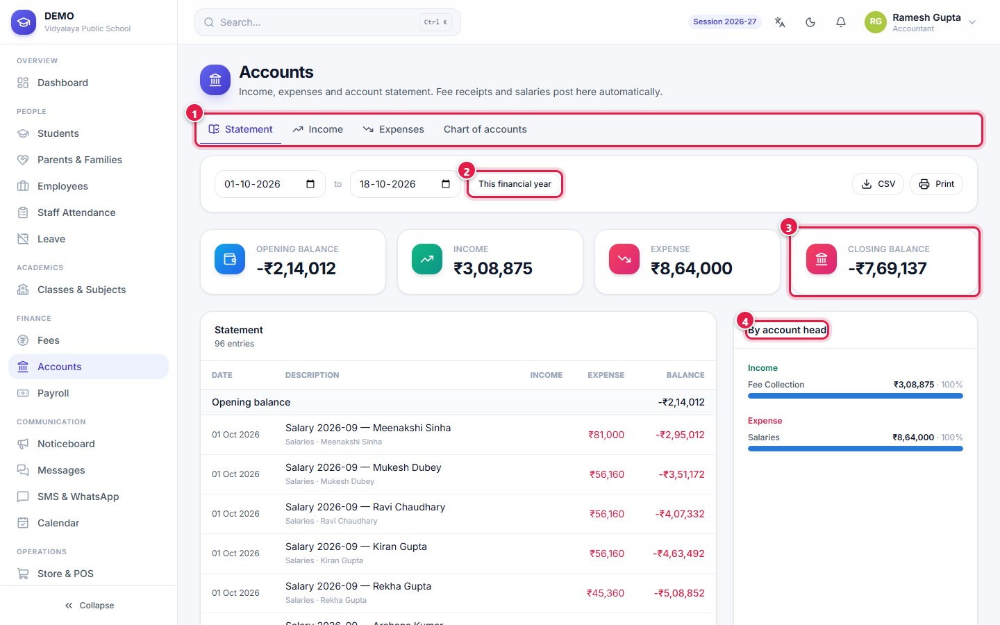

*Figure 48. Accounts statement.*

> **Callouts:** **1** Statement · Income · Expenses · Chart of accounts · **2** Date range · **3** Balances · **4** Breakdown
<!-- /fig -->

**Record an expense (or income)**

1. Open **Expenses** (or **Income**) → **Add**.
2. Choose the account head and enter the amount, date, mode, party, reference number and description.
3. Save.

**Expected result:** The entry appears in the statement and the totals. Automatic entries (fees, salaries) cannot be deleted from here. Cancel them at their source instead (a fee receipt or salary payment).

**Export to Tally:** on **Statement**, choose the period and click **Tally**:

<!-- fig:78-tally-menu -->
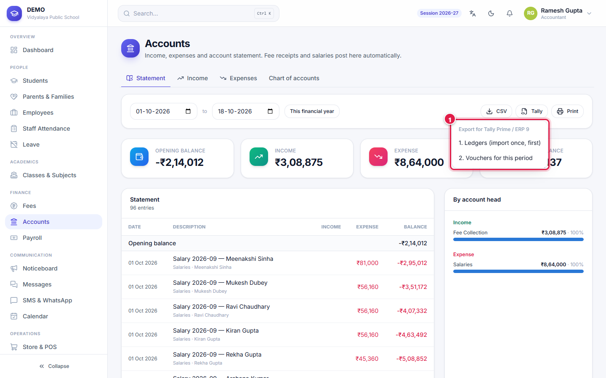

*Figure 49. Accounts → Statement → Tally export menu.*

> **Callouts:** **1** 1. Ledgers once, 2. vouchers for the chosen period
<!-- /fig -->

- **1. Ledgers**: import this once into Tally (*Gateway of Tally → Import → Masters*) to create the cash, bank and head ledgers.
- **2. Vouchers for this period**: import with *Import → Vouchers*. Income becomes **Receipt** vouchers and expenses become **Payment** vouchers, posted to the cash or bank ledger by payment mode, with the reference, party and mode in the narration.

Set the Tally company name, the cash and bank ledger names, and any head-to-ledger renames under *School Settings → Fees & payments → Tally export*.

**Chart of accounts:** add your own heads (for example Electricity, Diesel, Maintenance). System heads are created for you.

---

### 5.20 Payroll

*Sidebar → Finance → Payroll*

| Who uses it | Owner/Admin | Accountant | Other staff |
|---|:-:|:-:|:-:|
| Rights | VCED (salary run) | VCED (salary run) | V (own payslips) |

#### 5.20.1 Monthly salary run (payroll managers)

<!-- placeholder: Salary sheet for a month. Arrow 1 → "Salary month" picker. Arrow 2 → tiles Payable / Paid. Arrow 3 → staff rows with basic, allowances, deductions, net, bank (masked) and a paid badge. Arrow 4 → selection checkboxes and the "Pay n" button. Arrow 5 → "Bank sheet (CSV)" button. -->
<!-- fig:42-payroll -->
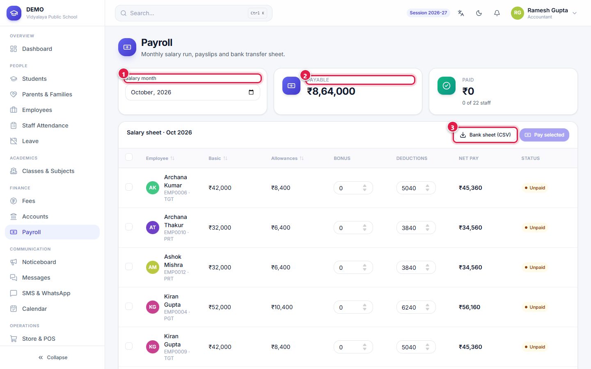

*Figure 50. Salary sheet for a month.*

> **Callouts:** **1** Month · **2** Payable vs paid · **3** Bank transfer file
<!-- /fig -->

1. Choose the **Salary month**. All active staff are listed with net pay calculated from their salary structure.
2. Tick the employees to pay. Adjust bonus or deductions for this month if needed.
3. Click **Pay**. Choose the **Mode** (Cash, UPI, Net banking, Cheque, Bank transfer) and **Paid on** date.
4. Click **Confirm payment**.

**Expected result:** Sequential payslips are created, the expense posts to Accounts, and each employee is notified. An employee cannot be paid twice for the same month. **Bank sheet (CSV)** gives the transfer file for your bank. Per-slip actions: **Print payslip** and **Reverse payment** (for mistakes; this also removes the ledger entry).

#### 5.20.2 My payslips (all staff)

<!-- fig:43-payslips-staff -->

*Figure 51. Own payslips only.*

> **Callouts:** **1** Own payslips only
<!-- /fig -->

Staff see **My salary** with a list of their payslips. **Payslip** opens a printable slip with earnings, deductions, net pay in words, and that month's attendance summary.

---

### 5.21 Noticeboard

*Sidebar → Communication → Noticeboard*

| Who uses it | Owner/Admin | Teacher | Everyone else |
|---|:-:|:-:|:-:|
| Rights | VCED | VC (own classes) | V |

<!-- placeholder: Noticeboard. Arrow 1 → pinned notice at the top with an "urgent" badge. Arrow 2 → notice card showing author, publish time and audience. Arrow 3 → "Rules & regulations" button. Arrow 4 → "New notice" button. -->
<!-- fig:44-notices -->

*Figure 52. Noticeboard.*

> **Callouts:** **1** School rules · **2** Post a notice
<!-- /fig -->

**Post a notice**

1. Click **New notice**.
2. Enter the **Title** and **Message**, and choose a **Category** (General, Urgent, Exam, Fee, Holiday, Event).
3. Choose the audience: roles (staff, parents, students) and, optionally, specific classes.
4. Optional: pin it, set **Publish at** (to schedule) and **Expires at**. Administrators can also send it as SMS.
5. Click **Publish**.

**Expected result:** The notice appears for its audience at the publish time, and they are notified. Teachers can address only parents and students of their own classes, and cannot pin or send SMS.

**Rules & regulations** shows the school rules from School Settings. Families see student rules. Staff see both student and employee rules.

---

### 5.22 Messages

*Sidebar → Communication → Messages* · Every role can send and receive.

**Purpose:** Private one-to-one chat inside the app.

**Who can message whom:** parents can message their children's teachers and the school office. Teachers can message their students' parents. Staff can message colleagues.

<!-- placeholder: Messages on desktop. Arrow 1 → conversation list with unread counts. Arrow 2 → open conversation thread. Arrow 3 → "Type a message…" box and Send button. Arrow 4 → "New message" button. On phone: list and thread are separate screens with a "Back" button. -->
<!-- fig:45-messages -->

*Figure 53. Messages on desktop.*

> **Callouts:** **1** Message a teacher or the office
<!-- /fig -->

1. Click **New message** and search for the person ("Search people…").
2. Type your message and click **Send**.

**Expected result:** The recipient is notified. Messages are marked read when they open the conversation. You cannot message a deactivated user.

---

### 5.23 SMS & WhatsApp

*Sidebar → Communication → SMS & WhatsApp*

| Who uses it | Owner/Admin | Accountant | Front Office |
|---|:-:|:-:|:-:|
| Rights | VCED | VC | VC |

**Purpose:** Bulk SMS and WhatsApp to parents and staff, using DLT-registered templates, with a delivery log.

<!-- placeholder: Compose tab. Arrow 1 → tabs Compose / Delivery log / Templates. Arrow 2 → channel switch SMS / WhatsApp. Arrow 3 → "Send to" options. Arrow 4 → "Use a template" picker. Arrow 5 → "Message" box with character count. Arrow 6 → Send button. Arrow 7 → "Configure gateway" link. -->
<!-- fig:46-sms -->

*Figure 54. Compose tab.*

> **Callouts:** **1** Compose · Delivery log · Templates · **2** Audience · **3** DLT template · **4** Send
<!-- /fig -->

1. **Compose** → choose **SMS** or **WhatsApp**.
2. **Send to** — All parents (one message per family), Parents of selected classes, Parents of selected sections, All staff, or Custom numbers.
3. **Use a template** (required by DLT rules for SMS in India), or type the **Message**.
4. Click **Send**.

**Expected result:** Messages are queued and sent through the school's gateway. If no gateway is configured, messages are recorded as **skipped**. See [School Settings → SMS & WhatsApp](#535-school-settings).

**Delivery log:** filter by status. **Retry failed** resends failed messages. **Templates:** maintain your DLT-approved templates.

---

### 5.24 Calendar & Events

*Sidebar → Communication → Calendar* · Everyone can view. Administrators manage it.

<!-- placeholder: Month calendar. Arrow 1 → Previous / Next month arrows and "Today". Arrow 2 → event chips colour-coded by type. Arrow 3 → "This month" list on the right. Arrow 4 → "Add event" button. -->
<!-- fig:47-calendar -->

*Figure 55. Month calendar.*

> **Callouts:** **1** Today · **2** Holiday, PTM, exam, event
<!-- /fig -->

1. Click **Add event**.
2. Choose the type (**Event**, **Holiday**, **Parent–teacher meeting**, **Exam**, **Activity**), title, dates and description.
3. Save.

**Expected result:** The event shows for everyone. **Holidays** also make those dates non-working days on attendance screens.

---

### 5.25 Parent Meetings

*Sidebar → Communication → Parent Meetings* (parents see **Meet a teacher**)

| Who uses it | Owner/Admin | Teacher | Parent |
|---|:-:|:-:|:-:|
| Rights | VCED | VCE (host) | VC (request) |

**Purpose:** Book 1:1 parent–teacher or principal meetings without phone calls.

<!-- placeholder: Meetings list. Arrow 1 → tabs Upcoming / Past. Arrow 2 → meeting card with topic, child, time, mode and status. Arrow 3 → host buttons Confirm / Decline / Complete. Arrow 4 → "Request meeting" button. -->
<!-- fig:48-meetings -->

*Figure 56. Meetings list.*

> **Callouts:** **1** Upcoming / Past · **2** Book a teacher
<!-- /fig -->

**Request a meeting (parent, or teacher inviting a parent)**

1. Click **Request meeting**.
2. Choose who to meet and (for parents) which child. Enter the **Topic** and an optional agenda.
3. Choose the **Mode** (In person, Video call, Phone call), date and time, and duration (5–120 minutes).
4. Submit.

**Expected result:** The other person is notified. The host can **Confirm** (adding a video link if needed), **Decline**, or later **Complete** with an outcome note. Either side can **Cancel**. Rescheduling by the requester sends the meeting back for confirmation.

---

### 5.26 Transport

*Sidebar → Operations → Transport*

| Who uses it | Owner/Admin | Transport Mgr | Front Office | Parent / Student |
|---|:-:|:-:|:-:|:-:|
| Rights | VCED | VCED | V | V (own route) |

**Tabs:** **Students** · **Live map** · **Routes & stops** · **Vehicles**. Live tracking setup and the Live map are covered in [5.42](#542-live-bus-tracking-and-driver-mode).

<!-- placeholder: Vehicles tab. Arrow 1 → vehicle row with registration number (e.g. BR01PA4521), capacity and driver. Arrow 2 → compliance chips Insurance / Fitness / PUC / Permit, coloured red when expired or due soon. Arrow 3 → add vehicle button. -->
<!-- fig:49-transport -->

*Figure 57. Vehicles tab.*

> **Callouts:** **1** Vehicles · Routes & stops · Students · **2** Compliance expiry dates
<!-- /fig -->

1. **Vehicles** — add each vehicle with its registration number (for example `BR01PA4521`), model, capacity, driver and attendant names, phones and licence number, GPS device id (optional), and **Insurance**, **Fitness**, **PUC** and **Permit** expiry dates. Expiring documents are highlighted.
2. **Routes & stops** — create a route and assign a vehicle. Click **Edit stops**, then **Add stop** for each stop in pickup order: **Stop name**, **Pickup** time, **Drop** time, **Monthly fare**. Click **Save stops**.
3. **Students** — click **Assign student**. Choose the **Student**, **Route & stop**, and **Trip** (Pickup & drop, Pickup only, Drop only), then **Assign**.

**Expected result:** The stop's monthly fare is added to the student's fee invoices automatically. **Export manifest** gives a route-wise student list for drivers. **Remove from transport** stops future transport charges.

**Family view:** route, stop, pickup/drop times and vehicle. If not enrolled: *"Not using school transport — Contact the school office to opt in."*

---

### 5.27 Library

*Sidebar → Operations → Library*

| Who uses it | Owner/Admin | Librarian | Teacher / Parent / Student |
|---|:-:|:-:|:-:|
| Rights | VCED | VCED | V (own borrowings) |

<!-- placeholder: Library Circulation tab. Arrow 1 → tabs Circulation / Catalogue. Arrow 2 → status filters Issued / Overdue / Returned. Arrow 3 → issue row with borrower, book, due date and overdue badge. Arrow 4 → "Return" button. Arrow 5 → "Issue book" button. -->
<!-- fig:50-library -->

*Figure 58. Library Circulation tab.*

> **Callouts:** **1** Circulation / Catalogue · **2** Issue · **3** Return (fine calculated)
<!-- /fig -->

1. **Catalogue** — add books: title, author, ISBN (10 or 13 digits), publisher, category, rack number and number of copies. Available copies update as books are issued and returned.
2. **Issue a book:** click **Issue book**. Choose **Student** or **Staff**, the borrower, the **Book** and the **Due date**, then click **Issue**.
3. **Return:** find the issue (filter **Issued** or **Overdue**) and click **Return**.

**Expected result:** On return, an overdue fine is calculated at **₹2 per day late** by default. You can change it or waive it. Collected fines post to Accounts as income. Families see the child's books under **My books**.

---

### 5.28 Store & POS

*Sidebar → Operations → Store & POS*

| Who uses it | Owner/Admin | Store Mgr | Accountant |
|---|:-:|:-:|:-:|
| Rights | VCED | VCED | V |

**Tabs:** **Billing** · **Sales** · **Products** · **Categories**

<!-- placeholder: POS billing screen on a tablet. Arrow 1 → "Search or scan SKU…" box. Arrow 2 → product tiles with price and stock. Arrow 3 → Bill panel with quantity Less/More controls. Arrow 4 → "Bill to student (optional)…" or customer name. Arrow 5 → payment mode Cash / UPI / Card / Bank transfer. Arrow 6 → checkout button and "Clear". -->
<!-- fig:51-store -->

*Figure 59. POS billing screen on a tablet.*

> **Callouts:** **1** Scan or search · **2** Cart and payment
<!-- /fig -->

1. **Products / Categories** — set up items (uniforms, books, stationery) with category, SKU, unit, price, GST %, opening stock and reorder level.
2. **Billing** — scan or tap products to add them. Adjust quantities. Optionally bill to a student or type a customer name. Choose the payment mode and check out.
3. **Print bill** prints the GST invoice.

**Expected result:** Stock reduces and the sale posts to Accounts. **Sales** lists past bills. **Cancel sale** reverses the sale and restores stock. **Adjust stock** (on a product) records a correction with **Quantity (+/−)** and **Reason**.

---

### 5.29 Assets & Inventory

*Sidebar → Operations → Assets* · Owner/Admin and Store Manager.

**Purpose:** A register of furniture, equipment and lab assets.

Add each asset line with name, category, quantity, unit cost, location, condition, purchase date and supplier. The summary shows **Asset lines**, **Book value** and **Need repair**. **Export** downloads the register.

<!-- placeholder: Asset register table with summary tiles Asset lines / Book value / Need repair. Arrow 1 → add button. Arrow 2 → row Edit / Delete actions. Arrow 3 → Export. -->
<!-- fig:51b-assets -->

*Figure 60. Asset register table with summary tiles Asset lines / Book value / Need repair.*

> **Callouts:** **1** Register summary · **2** Export the register
<!-- /fig -->

---

### 5.30 Certificates & ID Cards

*Sidebar → Administration → Certificates & ID Cards*

| Who uses it | Owner/Admin | Front Office |
|---|:-:|:-:|
| Rights | VCED | VC |

**Tabs:** **Issue** · **Register** · **Templates** · **ID cards**

**Templates included:** Transfer Certificate, Bonafide Certificate, Character Certificate (students), and Experience Certificate (staff). You can edit them or add your own using placeholders such as `{{student.name}}`.

#### Issue a certificate

<!-- placeholder: Issue tab. Arrow 1 → Student / Staff switch. Arrow 2 → person picker. Arrow 3 → "Certificate" template picker. Arrow 4 → "Date of issue". Arrow 5 → "Additional text". Arrow 6 → live preview on the right. Arrow 7 → "Issue & print" button. -->
<!-- fig:52-certificates -->

*Figure 61. Issue tab.*

> **Callouts:** **1** Issue · Register · Templates · ID cards · **2** Template · **3** Issue with QR code
<!-- /fig -->

1. Choose **Student** or **Staff member** and pick the person.
2. Choose the **Certificate** template and **Date of issue**, and add **Additional text** if needed.
3. Check the preview, then click **Issue & print**.

**Expected result:** The certificate gets a serial number and a QR code. Its content is frozen at issue time. Anyone can scan the QR code to verify it online (see [5.39](#539-public-pages-online-admission-and-certificate-verification)).

**Register:** search by name or serial number. Actions: **Print**, **Copy verification link**, **Revoke** (the verification page then shows it as revoked).

#### Print ID cards

1. Open **ID cards**. Choose **Students** (pick a **Class & section**) or **Staff**.
2. Click **Print cards**.

**Expected result:** Portrait CR80 cards (54 × 86 mm), nine per A4 sheet, with photo, details and a scannable code for attendance. Print on card stock or PVC sheets.

---

### 5.31 Reports

*Sidebar → Administration → Reports*

| Who uses it | Owner/Admin | Accountant |
|---|:-:|:-:|
| Rights | V | V |

<!-- placeholder: Reports page. Arrow 1 → report list on the left (Student information, Parent contacts, Class strength (UDISE+), Attendance eligibility, Birthdays). Arrow 2 → filters (Class, Section, Status, Gender, Category, RTE, Transport). Arrow 3 → column chooser chips. Arrow 4 → result table. Arrow 5 → "Print" and "Export CSV". Arrow 6 → "More reports" links. -->
<!-- fig:53-reports -->

*Figure 62. Reports page.*

> **Callouts:** **1** Report list · **2** Export · **3** Print
<!-- /fig -->

| Report | Use it for | Filters / options |
|---|---|---|
| **Student information** | Any student list, with the columns you choose | Class, Section, Status, Gender, Category, RTE, Transport; pick columns such as Adm. no., Roll, Father, Mobile, Category, PEN, APAAR id, Aadhaar (masked), Address |
| **Parent contacts** | Family-wise phone directory with children | Search |
| **Class strength (UDISE+)** | Boys/girls and social category per section, including RTE (25% quota) | — |
| **Attendance eligibility** | Session-to-date attendance % and students below the threshold | **Threshold %** (default 75), class |
| **Birthdays** | Students and staff by month | **Month** |

**More reports** links to other registers: Fee collection, Fee defaulters, Daily attendance register, Staff attendance register, Exam results & report cards, and Income & expense statement.

Every report can be printed or exported to CSV (opens in Excel). Large reports are capped at 5,000 rows and say so when truncated.

---

### 5.32 Clubs & Activities

<!-- fig:54-activities -->

*Figure 63. Join a club (or waitlist).*

> **Callouts:** **1** Join a club (or waitlist)
<!-- /fig -->

*Sidebar → Student Life → Clubs & Activities*

| Who uses it | Owner/Admin | Teacher | Student | Parent |
|---|:-:|:-:|:-:|:-:|
| Rights | VCED | VCE | VC (join) | V |

1. **Staff:** click **New activity** (for example Robotics, Eco Club, Chess or Football). Set the name, category, description, in-charge teacher, schedule and **Seats** (leave empty for no limit).
2. Open **Members** to add students, see the waitlist, and use **Record achievement** for medals and certificates.
3. **Students:** browse the activities and tap **Join** (or **Join waitlist** when full), or **Leave** to drop out.

**Expected result:** When an activity is full, new sign-ups are waitlisted. If a seat frees up (or capacity is raised), the next student on the waitlist is confirmed automatically and the family is notified.

---

### 5.33 Study Tools

*Sidebar → Student Life → Study Tools*

| Who uses it | Student | Parent | Teacher | Admin |
|---|:-:|:-:|:-:|:-:|
| Rights | VC | V | VE (answer doubts) | V |

**Tabs:** **Focus timer** · **Study log** · **Doubt desk**

<!-- placeholder: Focus timer on a phone. Arrow 1 → subject picker. Arrow 2 → large countdown. Arrow 3 → Pause / "Finish & log" / Reset buttons. Arrow 4 → Study log tiles: Study streak, This week, Last 30 days. -->
<!-- fig:55-study-tools -->

*Figure 64. Focus timer on a phone.*

> **Callouts:** **1** Focus timer · Study log · Doubt desk · **2** Choose a duration · **3** Start the timer
<!-- /fig -->

- **Focus timer:** pick a **Subject** and start. Use **Pause**, then **Finish & log** to save the session to your study log.
- **Study log:** shows the **Study streak**, minutes **This week** and over the **Last 30 days**, minutes per day for the last 7 days, and time **By subject**.
- **Doubt desk:** under **Ask a doubt**, choose the subject and type your question (for example *"Why does the moon change shape every night?"*), then **Ask**. Your class and subject teachers are notified and reply here. Mark it **Resolved** when you are satisfied. Filters: Open, Answered, All.

Parents can view their child's study log and doubts.

---

### 5.34 AI Assistant

<!-- fig:56-ai-assistant -->

*Figure 65. Ask a question.*

> **Callouts:** **1** Ask a question · **2** Suggested prompts for your role
<!-- /fig -->

*Sidebar → Student Life → AI Assistant*

| Who uses it | Admin | Teacher | Accountant | Parent | Student |
|---|:-:|:-:|:-:|:-:|:-:|
| Rights | VC | VC | VC | VC | VC |

**Purpose:** A role-aware assistant. For students it is a study buddy (explain, quiz, revision plans). For staff it drafts notices, letters and lesson plans and explains school data they can already see.

1. Type your question in the box ("Ask anything…"). Press **Enter** to send, or **Shift+Enter** for a new line.
2. **Copy** an answer to reuse it. **New chat** starts over.

**Limits:** each user has a daily usage cap (default 50,000 tokens), set in School Settings. If the school has not configured AI, the screen shows *"Assistant unavailable"*. The assistant only uses data your role is allowed to see.

---

### 5.35 School Settings

*Sidebar → Administration → School Settings* · Owner and Principal/Admin.

<!-- placeholder: School settings, Profile & branding tab. Arrow 1 → tabs Profile & branding / Academic / Fees & payments / SMS & WhatsApp / Campuses / Rules / Numbering & AI. Arrow 2 → school profile fields. Arrow 3 → logo upload. Arrow 4 → brand colour picker. Arrow 5 → Subscription card. Arrow 6 → Save button. -->
<!-- fig:57-settings -->

*Figure 66. School settings, Profile & branding tab.*

> **Callouts:** **1** Profile · Academic · Fees · SMS · Campuses · Rules · Numbering & AI · **2** Branding · **3** Plan
<!-- /fig -->

| Tab | Settings | Effect |
|---|---|---|
| **Profile & branding** | School name, address, contact, board, affiliation no., UDISE code; **Logo**; **Brand colour**; **Subscription** (plan and dates, read-only) | Letterhead of receipts, report cards, certificates, ID cards and the admission page |
| **Academic** | **Board**, **State**, **Session starts in** (month), **Default language**, **Working days**, **Teachers may edit attendance for (days)**, absence alerts to parents, **Behaviour traits** and **Co-scholastic skills** for report cards | Attendance rules and report card content |
| **Fees & payments** | Fee collection options (part payments, carry forward, **Accept advance fees**), **Receipt footer**, **Online payments (Razorpay)**: Key id, Key secret, Webhook secret; **Bank accounts for offline payment** (**Add account**); **Tally export** ledger names | Enables parent online payment; bank details print on challans; ledger names for Tally |
| **SMS, WhatsApp & Email** | **SMS provider**, **DLT sender ID** and credentials; **WhatsApp provider** (WhatsApp Cloud API (Meta), Gupshup), **Phone number id**, **WhatsApp access token**; **Email (SMTP)** host, port, user, password, From address, **Send test** | Required for absence alerts, fee reminders, bulk messages and email ([5.60](#560-email-single-sign-on-and-bigbluebutton)) |
| **Campuses** | Add or edit campuses (branches) | Multi-campus schools |
| **Rules** | **For students & parents**, **For employees**; **Remark bank**, **Discipline categories**, gate-pass parent alerts | Rules show on the Noticeboard; remarks and categories feed [5.45](#545-discipline-register)–[5.46](#546-report-card-remarks-and-gradebook) |
| **Languages & app** | **Languages** offered and the default; **Phone notifications** on/off; **Live bus tracking** (on/off, show to parents, driver update interval, approach alert distance, history retention); **Map tiles** provider | See [5.42](#542-live-bus-tracking-and-driver-mode) and [5.43](#543-phone-app-and-notifications) |
| **Integrations & data** | **Single sign-on** (Google Workspace, Microsoft 365, allowed domains); **Public pages** (school news, alumni sign-up); **Apps** (App Frame); **BigBlueButton** server; **Data export** (owner) | See [5.51](#551-news--blog), [5.55](#555-alumni), [5.57](#557-apps-app-frame), [5.59](#559-imports-exports-and-the-report-builder), [5.60](#560-email-single-sign-on-and-bigbluebutton) |
| **Numbering & AI** | Prefixes for admission, receipt, invoice, salary slip and certificate numbers; **Daily tokens per user** for AI | Numbers stay sequential and gap-free. A new prefix affects new documents only. |

Saved secrets show as *"•••••••• saved — type to replace"*. They are encrypted and never displayed again.

<!-- fig:74-settings-app -->

*Figure 67. School Settings → Languages & app.*

> **Callouts:** **1** Choose languages and the default · **2** Phone alerts on/off · **3** Tracking, parent visibility, interval, alert distance, history · **4** Map provider
<!-- /fig -->

---

### 5.36 Roles & Permissions

*Sidebar → Administration → Roles & Permissions* · Owner (full); Principal/Admin (view and edit, except the Principal/Admin row).

<!-- placeholder: Role permissions matrix. Arrow 1 → tabs Modules / Role permissions. Arrow 2 → role selector or role columns. Arrow 3 → module row with View / Create / Edit / Delete checkboxes. Arrow 4 → "Customised" badge on changed rows. Arrow 5 → greyed-out checkbox that cannot be granted. Arrow 6 → "Reset to defaults" button. -->
<!-- fig:58-access-control -->

*Figure 68. Role permissions matrix.*

> **Callouts:** **1** Modules / Role permissions · **2** Save changes
<!-- /fig -->

#### Switch modules on or off

1. Open **Modules**. Each module shows a switch.
2. Turn modules on or off for the whole school.

**Expected result:** A switched-off module disappears from every user's menu and its screens are blocked. Core modules show **Always on**. Modules not in your plan show **Upgrade plan to enable**.

#### Change what a role can do

1. Open **Role permissions** and choose the role.
2. Tick or untick **View**, **Create**, **Edit** and **Delete** per module. Giving any write right also gives View.
3. Save.

**Expected result:** Changes apply to all users with that role within about 30 seconds. Changed cells show **Customised**. **Reset to defaults** restores the factory rights for that role.

**Safety rules:** the Owner is never restricted. Only the Owner can change the Principal/Admin row. Parent and Student rights cannot exceed their defaults. Only administrators can be given Roles & Permissions. Every change is written to the Audit Log.

---

### 5.37 Audit Log

*Sidebar → Administration → Audit Log* · Owner and Principal/Admin (view only).

**Purpose:** A tamper-proof record of every change, sign-in, failed sign-in, export and password reset, with who did it, when, and from which IP address and device. Entries cannot be edited or deleted. This supports accountability under the DPDP Act.

<!-- placeholder: Audit log table. Arrow 1 → From / To date filters. Arrow 2 → search "Search details, user, IP…". Arrow 3 → "All actions" and "All records" filters. Arrow 4 → row showing time, user, role, action (CREATE / UPDATE / DELETE / LOGIN…), record and summary. Arrow 5 → "Export page" and Previous / Next. -->
<!-- fig:59-audit-log -->

*Figure 69. Audit log table.*

> **Callouts:** **1** Search · **2** Filter by action and record · **3** Export
<!-- /fig -->

Use it to answer questions like *"Who cancelled receipt R00123?"* (filter **Record = FeePayment**, action **CANCEL**) or *"Who changed permissions?"* (record **RolePermission**).

---

### 5.38 My Profile & Notifications

**My profile** (*avatar menu → My profile*), available to everyone:

| Section | What you can do |
|---|---|
| **Account** | See your name, username and role; upload a photo |
| **Language** | Any language your school offers |
| **App & notifications** | Install the app on this device; turn phone notifications on or off; send a test ([5.43](#543-phone-app-and-notifications)) |
| **Change password** | Current and new password. Changing it signs you out on all other devices. |
| **Devices** | **Sign out everywhere**: ends every session on every device (use it if a phone is lost) |

**Notifications** (*bell → see all*, or *Search → Notifications*): the full list of your alerts, with **Mark all read**.

---

### 5.39 Public pages: online admission and certificate verification

These pages need no login.

#### Online admission form — `https://<your-domain>/apply/<SCHOOLCODE>`

<!-- placeholder: Public admission form with the school logo and name at the top. Arrow 1 → "Full name". Arrow 2 → "Class applying for". Arrow 3 → Gender and Date of birth. Arrow 4 → parent Name / Mobile / Email. Arrow 5 → "Anything you'd like us to know?" box. Arrow 6 → "Submit application" button. -->
<!-- fig:61-apply-form -->

*Figure 70. Public admission form with the school logo and name at the top.*

> **Callouts:** **1** Child's name · **2** Class · **3** Submit
<!-- /fig -->

1. The parent opens the link shared by the school.
2. They fill in **Full name**, **Class applying for**, **Gender**, **Date of birth**, **Previous school**, the parent's **Name**, **Mobile**, **Email** and **Address**, and an optional message.
3. They click **Submit application**.

**Expected result:** A confirmation with an application number appears, and the application lands in the school's **Admissions → Applied** column. Submissions are rate-limited to prevent spam.

#### Certificate verification — `https://<your-domain>/verify/<code>`

<!-- fig:62-verify -->

*Figure 71. Public verification page reached by scanning a certificate QR code.*
<!-- /fig -->

Scanning the QR code on any issued certificate opens this page. It shows the school, certificate type, holder, serial number and issue date, with the verdict **Genuine certificate** or **Certificate revoked**.

---

### 5.40 Platform console (SaaS operator)

*For the Vidyalaya service operator only.* Sign in with an **empty school code** and the platform account. School users can never open this console.

<!-- placeholder: Platform overview. Arrow 1 → tabs Overview / Schools / Plans. Arrow 2 → KPI tiles Paying schools / On trial / Monthly recurring revenue / Active students. Arrow 3 → "Trials ending soon" list. Arrow 4 → "Schools by plan" chart. Arrow 5 → "Onboard school" button. -->
<!-- fig:63-platform -->

*Figure 72. Platform overview.*

> **Callouts:** **1** Overview · Schools · Plans · **2** Find a school · **3** Create a school
<!-- /fig -->

| Task | Steps | Result |
|---|---|---|
| **Onboard a school** | **Onboard school** → School name, School code (typed at login, e.g. `DPSRANCHI`), Board, City, State, school phone and email, Plan, Start as (**Free trial** with trial days, or **Paid (active)** with paid-until date), Owner / principal name, Owner username, owner email and mobile → create | The school is created with a main campus, current session, grade scale, fee and account heads, certificate templates and an owner login. The owner's temporary password is shown **once**: **Copy** it and share it securely. |
| **Change plan or dates** | Schools → row **Actions → Plan & dates** | Updates the plan and trial/subscription end dates |
| **Activate / Suspend** | Row actions | Suspended schools cannot sign in. Lapsed schools become read-only. |
| **Reset owner password** | Row actions | New one-time owner password, shown once |
| **Manage plans** | Plans → **New plan** / **Edit** → name, price, included modules → **Save plan** | Modules outside a school's plan cannot be switched on by that school |

---

### 5.41 Hostel

*Sidebar → Operations → Hostel* (staff) · *My School → Hostel* (families)

| Who uses it | Owner/Admin | Accountant | Front Office | Parent / Student |
|---|:-:|:-:|:-:|:-:|
| Rights | VCED | V | V | V (own child) |

A warden can be given Hostel rights under [Roles & Permissions](#536-roles--permissions). Use **Other Staff** and tick View/Create/Edit on Hostel.

**Purpose:** Hostels, rooms and beds, who lives where, and hostel fees that bill themselves.

**Tabs:** **Hostels & rooms** · **Residents**

#### 5.41.1 Set up hostels and rooms

<!-- fig:71-hostel-rooms -->

*Figure 73. Hostels and rooms with bed occupancy.*

> **Callouts:** **1** Occupancy across all hostels · **2** Add a hostel · **3** Add a room with beds and monthly fee · **4** Each room: beds taken, free beds, fee (click to edit)
<!-- /fig -->

1. Click **Add hostel**. Enter the **Hostel name**, who it is **For** (Boys, Girls or Co-ed), the **Warden** (an employee), hostel phone and address. Save.
2. Click **Add room** (or **+ Room** on a hostel card). Enter the **Room number**, **Floor**, **Room type** (for example *3-seater, attached bath*), number of **Beds** and the **Monthly fee**. Save.

**Expected result:** Each room appears as a tile with a bar per bed, the number of free beds, and its fee. Full rooms are highlighted.

#### 5.41.2 Allot, move and vacate

<!-- fig:72-hostel-residents -->

*Figure 74. Residents with move and vacate actions.*

> **Callouts:** **1** Give a student a bed · **2** Move to another room · **3** Vacate (fee stops from next invoice)
<!-- /fig -->

1. Open **Residents** and click **Allot room**.
2. Pick the **Student**, a **Room** (only rooms with free beds are listed), an optional **Bed** label and the **From** date. Click **Allot room**.

**Expected result:** The student appears under Residents and the family is notified. From the next invoice run, the room's monthly fee is added to the student's invoice as *"Hostel (hostel name, room number)"*.

Rules the system enforces:

- one active room per student;
- a room never exceeds its beds, and a bed label can't be used twice;
- boys' and girls' hostels only accept the matching gender;
- only active students can be allotted a room.

- **Move** shifts the student to another room with free beds, keeping the history.
- **Vacate** frees the bed on the chosen date, and the hostel fee stops from the next invoice.
- **Export** downloads the residents list with parent mobiles.

#### 5.41.3 Family view

<!-- fig:73-hostel-family-mobile -->

*Figure 75. A parent sees the child’s hostel room and warden.*

> **Callouts:** **1** Hostel, room, bed and monthly fee · **2** Call the warden
<!-- /fig -->

Parents and students see the hostel, room, bed, floor, room type, start date and monthly fee, with one-tap calls to the warden and the hostel office.

---

### 5.42 Live bus tracking and Driver mode

**Turn it on:** *School Settings → Languages & app → Live bus tracking*. It is off until a school enables it.

| Who | What they use |
|---|---|
| Driver (any employee with a login, linked to a vehicle) | **Driver mode** in the sidebar, on their phone |
| Transport Manager / Admin | **Transport → Live map**, GPS device links, stop coordinates |
| Parent / Student | **Transport**: live map, distance, ETA, "bus approaching" alerts |

#### 5.42.1 One-time setup (transport manager)

<!-- fig:79-device-link -->

*Figure 76. GPS device link for hardware trackers or the Traccar Client app.*

> **Callouts:** **1** Secret link for GPS hardware · **2** Or use any phone with the free Traccar Client app
<!-- /fig -->

1. **Link each driver.** *Transport → Vehicles →* edit the vehicle and set **Driver login (for live tracking)** to the driver's employee login. The driver doesn't need any other Transport rights.
2. **Or link a GPS device** instead of (or as well as) a phone. On the vehicle row, open **Actions → GPS device link → Create or rotate link**. Then either:
   - give the **Device URL** to your GPS tracker supplier (HTTP / OsmAnd protocol, which most trackers support); or
   - install the free **Traccar Client** app on a phone kept in the bus, and enter the **Server URL** and **Device identifier** shown.

   Treat the link like a password. **Rotate** it if it leaks, and the old link stops working at once.
3. **Add stop locations.** *Routes & stops → Edit stops*: enter **Latitude** and **Longitude** for each stop, or stand at the stop with your phone and tap **Use my location**. Coordinates power the parent map and approach alerts.

#### 5.42.2 Driving a trip (driver)

<!-- fig:70-driver-mobile -->

*Figure 77. Driver mode on the driver’s phone during a pickup trip.*

> **Callouts:** **1** Trip status (parents can see the bus) · **2** End the trip when the bus reaches school · **3** What is sent: time, speed, GPS accuracy, connection
<!-- /fig -->

1. Open **Driver mode** on the phone. The first time, allow location access.
2. Check the **Vehicle** and **Route**, then tap **Start pickup trip** or **Start drop trip**.
3. Keep the screen open while driving. The phone sends its position every few seconds (the interval is set by the school) and keeps the screen awake. In areas with no signal, positions are queued and sent when the connection returns.
4. At school, tap **End trip**.

**Expected result:** While a trip runs, the bus shows as **Live** to staff and families. Parents whose stop the bus comes within the alert distance (default 800 m) get one **"Bus approaching \<stop\>"** notification per trip. On a drop trip the alert goes to students set to *Drop* or *Pickup & drop*.

#### 5.42.3 Live map (staff)

<!-- fig:68-live-board -->

*Figure 78. Live map: every bus, its trip and last-seen time.*

> **Callouts:** **1** Each bus, with its direction of travel · **2** Live status, running trip and last-seen time for every vehicle · **3** Live map tab
<!-- /fig -->

*Transport → **Live map***: every bus on one map, with its direction of travel. The **Fleet** list shows whether each bus is live, whether a trip is running, when it was last seen, and warns about vehicles with no driver or device linked. Click a vehicle to focus on it and draw its route and stops.

#### 5.42.4 Parent view

<!-- fig:69-parent-live-mobile -->

*Figure 79. A parent sees the bus, their stop and the ETA.*

> **Callouts:** **1** Distance and arrival time to your stop · **2** The bus and your stop on the map
<!-- /fig -->

At the top of *Transport*, parents see:

- the bus and their stop on a map;
- **"Bus is about N min away"**, with the distance and speed;
- the last-seen time when no trip is running.

The view refreshes every 15 seconds. If the school turns off *Show the bus to parents and students*, families see no map.

**Privacy:** positions are kept only for the school's retention period (default 30 days) and shown only to staff with Transport access and to families of children on that route.

---

### 5.43 Phone app and notifications

Vidyalaya installs like an app, with its own icon, full-screen view and offline page. It can also send alerts to the phone's notification tray.

#### Install on a phone

<!-- fig:77-profile-app-mobile -->

*Figure 80. My profile → App & notifications on a phone.*

> **Callouts:** **1** Install the app and turn on phone alerts
<!-- /fig -->

| Phone | Steps |
|---|---|
| Android (Chrome) | Open your school's Vidyalaya link → *My profile → App & notifications → **Install app*** (or the browser's menu → **Install app**). |
| iPhone / iPad (Safari) | Open the link → **Share** → **Add to Home Screen**. |
| Computer (Chrome / Edge) | Avatar menu → **Install app**. |

A store-listed Android/iOS app can be built from the included `mobile/` wrapper (see `mobile/README.md`). It loads the same site, so every feature and permission is identical.

#### Turn on phone notifications

1. *My profile → App & notifications → **Turn on notifications***, and allow notifications when the phone asks.
2. Tap **Send a test** to check.

**Expected result:** every in-app alert (absence, fee receipt, results published, homework, leave decisions, messages, bus approaching) also arrives on that phone. Each device is turned on separately, and **Turn off** stops it on that device only. Administrators can switch phone notifications off for the whole school under *School Settings → Languages & app*. On iPhone, notifications need iOS 16.4 or later and the app added to the Home Screen.

---

### 5.44 Gate & Visitors

<!-- fig:80-gate-visitors -->

*Figure 81. Gate & Visitors: today’s visitor register.*

> **Callouts:** **1** Check a visitor in; a numbered pass prints · **2** Who is still inside right now · **3** Register with in/out times; guard checks visitors out
<!-- /fig -->

<!-- fig:81-gate-pass -->

*Figure 82. Student gate passes with collection details and status.*

> **Callouts:** **1** Early leave: who collects the child and why · **2** Parent is alerted on issue and when the child leaves
<!-- /fig -->

*Sidebar → Front Office → Gate & Visitors*

| Who uses it | Owner/Admin | Front Office | Other Staff (guard) | Teacher |
|---|:-:|:-:|:-:|:-:|
| Rights | VCED | VCED | VCE | V |

**Purpose:** A visitor register with printed passes, and early-leave gate passes for students.

**Tabs:** **Visitors** · **Student gate passes**

1. **Visitor check-in:** click **New visitor** and enter the name, mobile, purpose, whom to meet, number of people, vehicle number and the ID shown. Record only the ID type and its last four digits (for example *Aadhaar 1234*); full ID numbers are refused. Click **Check in**, then **Pass** to print the numbered visitor pass.
2. **Check out:** the guard taps **Check out** when the visitor leaves. Switch the register to **Still inside** to see everyone on campus; the **On campus now** card shows the count.
3. **Gate pass (student leaving early):** click **Issue gate pass**, pick the student, the reason, who is collecting them, their relation and mobile. Print it with the printer icon (the pass carries a QR code).
4. **At the gate:** the guard taps **Left** when the child goes out.

**Expected result:** visitor and gate pass numbers are issued automatically. With *School Settings → Rules → Tell parents…* on (the default), the parent is notified when a pass is issued and again when the child leaves, with the time and who collected them.

### 5.45 Discipline register

<!-- fig:82-discipline -->

*Figure 83. Discipline register with severity and status.*

> **Callouts:** **1** Record facts, severity and action taken · **2** Open, action taken and serious cases at a glance · **3** Choose per incident whether parents see it
<!-- /fig -->

*Sidebar → Student Life → Discipline* (staff) · *My School → Discipline* (families)

| Who uses it | Owner/Admin | Teacher | Parent / Student |
|---|:-:|:-:|:-:|
| Rights | VCED | VCE (own sections) | V (own child, shared notes only) |

1. Click **Record incident**. Pick the student, date, **category** (the list is set under *School Settings → Rules*), severity, a title and what happened.
2. Choose whether the family can see it (**Share with parent and student**) and whether to notify the parent now.
3. Later, open the incident to record the **action taken** and mark it **Action taken** or **Resolved**.

**Expected result:** staff see every incident with filters for status, severity and class. Families see only the notes shared with them; private staff notes never reach the family.

### 5.46 Report-card remarks and Gradebook

*Exams & results → **Report-card remarks*** and *Exams & results → **Gradebook***

**Remarks:** pick an exam and a section. Each student has a box for the class teacher's remark. Start typing to pick a ready-made remark from the **remark bank** (edited under *School Settings → Rules*), or write your own, then click **Save remarks**. The remark prints on the report card in place of the blank line.

**Gradebook:** pick a section and the exams to combine, and give each a **weight** (for example Periodic Test 20, Half-yearly 30, Annual 50). The gradebook shows each subject's weighted percentage, the overall percentage, the grade from your grading scale and the rank. Missing marks are left out; an absence counts as zero. Click **Export** for a spreadsheet.

### 5.47 Online exams

*Sidebar → Examinations → Online Exams* (staff) · *My School → Online Exams* (families)

| Who uses it | Owner/Admin | Teacher | Student | Parent |
|---|:-:|:-:|:-:|:-:|
| Rights | VCED | VCED (own sections) | Take the exam | See the score |

**Set an exam (teacher)**

<!-- fig:83-online-exam-create -->

*Figure 84. Creating an online exam from the question bank.*

> **Callouts:** **1** Pick questions from the question bank · **2** Optional negative marking · **3** Different order for every student
<!-- /fig -->

1. Click **New online exam**. Choose the class (and optionally one section), the subject, the window (opens / closes), the **duration**, negative marks per wrong objective answer, and whether to shuffle the questions.
2. Tick questions in the **Questions from the bank** list (MCQ, true/false, fill-in-the-blank, short and long answers). The MCQ answer must match an option's text or letter.
3. Save as a draft, then **Publish**. Students are notified.

**Take it (student)**

<!-- fig:84-online-exam-take -->

*Figure 85. A student taking a timed online exam.*

> **Callouts:** **1** Countdown and progress; answers save automatically · **2** Jump to any question · **3** Submits itself when time runs out
<!-- /fig -->

1. Open the exam during its window and click **Start exam** (or **Resume** after a dropped connection). The timer shows the time left: the duration, or less if the window closes sooner.
2. Answers save automatically. Click **Submit** when done. When time runs out, the saved answers are submitted.

**Mark and publish (teacher)**

- MCQ, true/false and fill-in-the-blank answers are marked automatically. Blanks accept alternatives separated by `|`, for example `New Delhi|Delhi`.
- Open the exam, go to **Answer sheets** and click **Mark written answers** to give marks for short and long answers.
- Click **Publish results**. Students then see their score and a question-by-question review; parents see the score.

**Rules the system enforces:** one attempt per student; no attempts before the window opens or after it closes; the answer key is never sent to the student's device; the timing is locked once anyone has started; results cannot be published while written answers are unmarked.

### 5.48 Polls & forms

<!-- fig:86-polls-create -->

*Figure 86. Creating a poll or form with its audience and options.*

> **Callouts:** **1** Quick poll or a full form with many question types · **2** Choose roles and classes · **3** Anonymous, editable answers, private results
<!-- /fig -->

<!-- fig:85-polls-family -->

*Figure 87. A parent’s view: vote, see live results, fill in forms.*

> **Callouts:** **1** Vote; results show after voting · **2** Forms (consent, surveys) open in a dialog
<!-- /fig -->

*Sidebar → Communication → Polls & Forms* · *My School → Polls & Forms*

1. Click **New poll or form** and choose **Quick poll** (one choice question) or **Form / survey** (any mix of short text, paragraph, single choice, multiple choice, rating 1–5, date and number).
2. Pick the **audience**: roles, and optionally classes (the class filter applies to parents and students). Choose whether answers are **anonymous**, whether people can change their answer, whether to **Keep results private** (otherwise people see results after answering), and an optional closing time.
3. Publish. Everyone in the audience is notified.

**Expected result:** each person answers once. Poll results update live. Managers see totals, averages and text answers, with names only when the form isn't anonymous. Click **Export** for the responses, or **Close** to stop new answers.

### 5.49 Discussions

<!-- fig:87-discussions -->

*Figure 88. Discussions for a parent: class topics and replies.*

> **Callouts:** **1** Families start topics for their own class · **2** Pinned topics first; teachers moderate
<!-- /fig -->

*Sidebar → Communication → Discussions* · *My School → Discussions*

Start a topic, choose who can see it, and reply in a thread. Topics started by parents and students are always limited to their own class(es) and that class's teachers. The topic's author is notified of new replies. Moderators (Edit right) can **pin**, **lock** and **remove** replies; anyone can remove their own reply.

### 5.50 Gallery

<!-- fig:88-gallery -->

*Figure 89. Event albums as families see them.*

> **Callouts:** **1** Event albums shared with families
<!-- /fig -->

*Sidebar → Communication → Gallery* · *My School → Gallery*

1. Click **New album**, enter the title, event date and who can see it (**Everyone** or **Staff only**).
2. Open the album and click **Add photos**. Select many images at once (JPG, PNG or WebP, up to 5 MB each), add captions if you like, and choose whether to notify families.
3. Click a photo to view it full-screen; set any photo as the **cover**.

Teachers can manage their own albums; admins manage all. Staff-only albums and their photos are never shown to families.

### 5.51 News & blog

<!-- fig:89-blog -->

*Figure 90. News & Blog with the review queue and public page.*

> **Callouts:** **1** Teachers and students write; editors review · **2** Optional public news page for the website · **3** Posts waiting for review
<!-- /fig -->

*Sidebar → Communication → News & Blog*

1. Click **Write a post**. Add a title, a cover image and the text. Formatting works like a chat app: `**bold**`, `*italic*`, `## heading`, `- list`, links. Switch to **Preview** to see how it will look.
2. Teachers and students click **Send for review**. Editors (Edit right, usually the admin) see it under **Review**. They can **Publish**, or **Request changes** with a note, and the author is notified either way.
3. Editors can turn on **Also show on the public news page**. With *School Settings → Integrations & data → School news page* on, public posts appear at `/news/<school code>` for anyone, without signing in. Share that link on your website and social media.

### 5.52 Reminders

<!-- fig:92-reminders -->

*Figure 91. Scheduled and repeating reminders.*

> **Callouts:** **1** Once or repeating; app, SMS or email · **2** Who it is for and how it is sent
<!-- /fig -->

*Sidebar → Communication → Reminders*

Set a reminder with a title, message, date and time, and **repeat** (none, daily, weekly or monthly). Staff can set reminders for themselves. People with the Edit right on Reminders (admin by default) can also send them to roles and classes, by in-app/phone notification, SMS or email.

Reminders go out on time when the server's scheduler calls `/api/public/cron` every minute (see the setup notes). Without it, due reminders still go out the next time anyone uses the app.

### 5.53 Tasks

<!-- fig:90-tasks -->

*Figure 92. Tasks across staff with priorities and due dates.*

> **Callouts:** **1** Assign to one or more staff with a due date · **2** Priority, due date and overdue highlighted
<!-- /fig -->

*Sidebar → Administration → Tasks*

1. Click **New task**. Enter the title, details, priority and due date, and add one or more **staff** as assignees.
2. Each assignee marks their own part **In progress** or **Done**, and anyone on the task can add comments. The task shows **Done** when everyone has finished.

Views: **Assigned to me**, **I assigned** and, for admins, **All**; plus **Open** / **Closed**. Overdue tasks are highlighted. Click a task to update your progress or comment.

### 5.54 Document manager

<!-- fig:91-documents -->

*Figure 93. Document manager with folders, sharing and renewal alerts.*

> **Callouts:** **1** Licences expiring within 30 days · **2** Choose who can open each document · **3** Folders, versions and validity
<!-- /fig -->

*Sidebar → Administration → Documents* · *My School → Documents*

1. Create **folders** (Policies, Circulars, Licences…).
2. Click **Upload document**. Choose the file, title, folder, tags, **who can open it** (by role) and an optional **valid till** date.
3. To replace a document, click **Edit** and upload the new file. It becomes the next **version**.

**Expected result:** people see only the documents shared with their role, and opening the file follows the same rule. Admins see a **Renewals due** banner for documents that expire within 30 days or have already expired (fire NOC, building safety, transport permits, affiliation).

### 5.55 Alumni

<!-- fig:93-alumni -->

*Figure 94. Alumni directory with mentors and self-registration.*

> **Callouts:** **1** Public self-registration link · **2** Bring in passed-out students · **3** Careers, mentors and contact consent
<!-- /fig -->

*Sidebar → People → Alumni*

- **Add alumnus** manually, or **Add former students**: pick students marked *Passed out* or *Transferred* and add them to the directory in one go.
- Record what each person does now (studying, employed, organisation, city, higher education) and whether they will **mentor** current students.
- **Self-registration:** turn it on under *School Settings → Integrations & data*, then share `/alumni-join/<school code>`. Entries wait under **Waiting approval** until an admin picks **Approve** from the row menu.
- **Export** the directory for reunions and newsletters.

### 5.56 Placements

<!-- fig:94-placements-student -->

*Figure 95. A student’s placement drives and application status.*

> **Callouts:** **1** Application status from the placement cell · **2** Apply in one tap
<!-- /fig -->

*Sidebar → Student Life → Placements* · *My School → Placements* (students)

1. The placement cell clicks **New drive**: company, role, description, location, package, drive date, last date to apply and **eligible classes**.
2. Eligible students see the drive and click **Apply** (with an optional note), and can withdraw before being selected.
3. Staff open **Applicants** and move each one to **Shortlisted**, **Selected** or **Not selected**. The student and parent are notified at each step.

### 5.57 Apps (App Frame)

<!-- fig:98-apps -->

*Figure 96. Apps a teacher can open (App Frame).*

> **Callouts:** **1** School-chosen tools for this role
<!-- /fig -->

*Sidebar → Overview → Apps*

Add other web tools the school uses (Google Classroom, a library catalogue, a survey site…) under *School Settings → Integrations & data → Apps*: a title, an `https://` link, the roles that may open it, and whether it opens in a new tab. They then open inside Vidyalaya for those roles. Some sites block being shown inside another site; tick **New tab** for those.

### 5.58 Fees: advance, instant invoices and fee import

<!-- fig:95-instant-invoice -->

*Figure 97. Fees → Invoices → Instant invoice.*

> **Callouts:** **1** One-off charge outside the fee structure · **2** Chosen students, a class or a section · **3** Advance balances are used automatically
<!-- /fig -->

- **Advance fees:** when a parent pays more than the dues at the counter, the extra is kept as **advance** and shown on the receipt. It is used automatically on the next invoices, including monthly runs and instant invoices. Families see the advance on their Fees page. Turn it off under *School Settings → Fees & payments → Accept advance fees*; overpayments are then refused.
- **Instant invoice:** *Fees → Invoices → Instant invoice* raises a one-off charge (a trip, costumes, an exam re-sit) for chosen students or a whole class, with its own title and items, outside the fee structure.
- **Import:** *Fees → Invoices → Import* brings in **opening dues** (one invoice per row) or **past receipts** from your old software (allocated oldest-first, exactly like counter collection). Every row is checked first; nothing is saved while any row has an error.

### 5.59 Imports, exports and the report builder

<!-- fig:96-report-builder -->

*Figure 98. Reports → Report builder with chosen columns.*

> **Callouts:** **1** Pick any allowed columns · **2** Run, export or save and share · **3** Results (up to 5000 rows)
<!-- /fig -->

| What | Where |
|---|---|
| Import staff | *Employees → Import* (no logins are created; give logins from the staff profile) |
| Import library books | *Library → Import books* (the same title and author, or the same ISBN, adds copies) |
| QuickBooks | *Accounts → QuickBooks*: chart of accounts and journal entries, as CSV for QuickBooks Online or IIF for QuickBooks Desktop |
| Paybooks | *Payroll → Paybooks*: employee master and monthly attendance (with loss-of-pay days) |
| All data | *School Settings → Integrations & data → Data export* (owner only): one Excel workbook with every record. Passwords, encrypted Aadhaar and gateway secrets are left out. Limited to 3 an hour. |
| Report builder | *Reports → Report builder*: pick a data source (students, staff, fee invoices, fee receipts, attendance summary, library issues), choose columns and filters, run, export, and **save** the report (optionally shared with colleagues) |

### 5.60 Email, single sign-on and BigBlueButton

<!-- fig:99-sms-email -->

*Figure 99. SMS, WhatsApp & Email: composing an email.*

> **Callouts:** **1** Email channel with subject · **2** Parents, classes, staff or custom addresses
<!-- /fig -->

<!-- fig:97-settings-integrations -->

*Figure 100. School Settings → Integrations & data.*

> **Callouts:** **1** Google / Microsoft sign-in · **2** News page and alumni registration · **3** Other tools inside the app
<!-- /fig -->

- **Email:** set up your SMTP server (Google Workspace, Microsoft 365, Zoho…) under *School Settings → SMS, WhatsApp & Email*, then click **Send test**. *SMS, WhatsApp & Email → Compose* then offers **Email**, with a subject, to parents, classes, staff or a typed list of addresses. Passwords are stored encrypted and never shown again.
- **Sign in with Google or Microsoft:** once your platform operator has registered the sign-in apps, turn on **Google Workspace** or **Microsoft 365** under *School Settings → Integrations & data*, and optionally limit it to your email domain. The login page then shows the buttons. Only existing active users whose email matches can sign in. SSO never creates accounts or changes roles.
- **BigBlueButton:** enter your BigBlueButton server URL and shared secret under *Integrations & data*, then choose **BigBlueButton** when scheduling a live class. No meeting link is needed: the host and editors join as moderators, and students get their own signed link from 15 minutes before the start.
- **Google Docs / Drive / YouTube in Study Material:** paste the link as usual. Families and staff can open a **Preview** inside the app.

---

## 6. Real-world use cases

Each use case follows a real school workflow from start to finish, across roles. Steps link to the detailed instructions in Section 5.

| ID | Use case | Primary actors |
|---|---|---|
| [UC-01](#uc-01--set-up-a-new-academic-session) | Set up a new academic session | Principal/Admin, Accountant |
| [UC-02](#uc-02--enquiry-to-enrolment) | Enquiry to enrolment | Front Office, Parent |
| [UC-03](#uc-03--go-live-bulk-onboarding-of-existing-students) | Go-live: bulk onboarding of existing students | Principal/Admin |
| [UC-04](#uc-04--monthly-fee-cycle) | Monthly fee cycle | Accountant, Front Office |
| [UC-05](#uc-05--parent-pays-fees-online) | Parent pays fees online | Parent |
| [UC-06](#uc-06--daily-attendance-with-absence-alerts) | Daily attendance with absence alerts | Teacher, Parent |
| [UC-07](#uc-07--student-sick-leave) | Student sick leave | Parent, Class teacher |
| [UC-08](#uc-08--behaviour-logging-and-parent-follow-up) | Behaviour logging and parent follow-up | Teacher, Parent |
| [UC-09](#uc-09--exam-cycle-to-report-card) | Exam cycle to report card | Principal/Admin, Teachers, Families |
| [UC-10](#uc-10--homework-assign-submit-check) | Homework: assign, submit, check | Teacher, Student |
| [UC-11](#uc-11--monthly-payroll) | Monthly payroll | Accountant, Staff |
| [UC-12](#uc-12--student-leaves-the-school-transfer-certificate) | Student leaves the school (Transfer Certificate) | Front Office, Principal |
| [UC-13](#uc-13--transport-enrolment-and-billing) | Transport enrolment and billing | Transport Manager, Accountant |
| [UC-14](#uc-14--session-end-promotion) | Session-end promotion | Principal/Admin |
| [UC-15](#uc-15--government-and-management-reports) | Government and management reports | Principal/Admin, Accountant |
| [UC-16](#uc-16--staff-member-leaves-secure-off-boarding) | Staff member leaves: secure off-boarding | Principal/Admin |
| [UC-17](#uc-17--tighten-what-a-role-can-do) | Tighten what a role can do | Owner |
| [UC-18](#uc-18--lost-or-shared-phone) | Lost or shared phone | Any user |

---

### UC-01 — Set up a new academic session

**Goal:** Prepare the school for a new session before classes start.
**Preconditions:** You are signed in as Owner or Principal/Admin.

1. *Classes & Subjects → Academic years:* add the new session (for example *2027-28*) and click **Make current**.
2. Check **Classes & sections** (add new sections if intake grew) and assign **class teachers**.
3. *Class actions → Subjects & marks:* confirm the subjects and full/pass marks per class.
4. *Teacher allocation:* assign subject teachers per section and **Save allocation**.
5. *Timetable:* confirm **Periods**, then **Auto-generate** or build each section's timetable, and **Save**.
6. *Fees → Fee structure:* **Copy from another year** with an **Increase %** for the annual fee revision. Review and **Save**.
7. *Calendar:* add holidays, PTMs and exam weeks.
8. *Noticeboard:* publish the session-start notice to parents and students.

**Outcome:** Teachers see their sections, invoices can be generated at the new fees, and families see the new timetable and calendar.

---

### UC-02 — Enquiry to enrolment

**Goal:** Turn a walk-in or online enquiry into an enrolled student with working logins.
**Actors:** Front Office, Principal/Admin, Parent.

1. **Walk-in:** *Admissions → New enquiry* with the child's name, class, gender and the parent's mobile. **Online:** the parent submits the form at `/apply/<SCHOOLCODE>` and it lands in **Applied**.
2. Front Office calls the parent and records the call in **Notes**, with a **Next follow-up** date.
3. When documents are checked, move the card to **Docs verified**. Schedule the entrance test and move it to **Test / interview**, recording the score in **Notes**.
4. Principal approves and the card moves to **Seat offered**.
5. Parent pays the admission fee. Click **Admit now**, choose the section, and confirm guardian consent.
6. The system creates the student, links siblings by mobile number, creates the student and parent logins, and shows the temporary passwords **once**.
7. Front Office prints the **Admission letter** (*student profile → More*) and the **login slips**, and hands them to the parent.
8. *Fees → Collect:* collect the admission fee and print the receipt.

**Alternate flows**
- *The parent already has a child in the school:* the new student is linked to the existing family automatically, and the parent sees both children under one login.
- *The applicant declines:* click **Withdrawn**. *Not eligible:* click **Reject**. Both move to **Closed**.

**Outcome:** The student appears on class lists, attendance and invoices. The parent signs in, sets a new password, and sees the child's dashboard.

---

### UC-03 — Go-live: bulk onboarding of existing students

**Goal:** Load the whole existing school into the system in one day.

1. Complete UC-01 steps 1–4 (session, classes, sections, subjects).
2. *Employees → Add employee* for each staff member (or ask support for a staff import). Create logins with the right roles.
3. *Students → Import → Download template.* Fill one sheet per class (up to 500 rows per file).
4. Upload each file. Fix any rows listed with errors and re-upload just those rows.
5. Under **Results → View**, print the login credentials and distribute them to families.
6. *Fees → Heads & concessions* and *Fee structure:* set up fees. Add concessions (sibling, staff ward, RTE).
7. *Fees → Invoices → Generate invoices* for the current month.

**Outcome:** All students, families and staff can sign in, and the first invoices are issued.

---

### UC-04 — Monthly fee cycle

**Goal:** Bill every student for the month, collect payments, and follow up on dues.
**Actors:** Accountant, Front Office.

1. **1st of the month:** *Fees → Invoices → Generate invoices* for the month. Each student gets one invoice from the fee structure, plus transport fare, minus concessions.
2. **Counter collection (daily):** *Fees → Collect* → search the student or parent mobile → turn on **Whole family** if paying for siblings → tick the invoices → enter the amount and mode (UPI with UTR, cheque with number and bank) → collect → **Print** the receipt.
3. **End of day:** *Fees → Report → Today only* to reconcile cash and UPI against the receipts. **Print** it for the day-book.
4. **After the due date:** *Fees → Defaulters* → filter by class → select → **Apply late fees** (per the structure's late-fee rule).
5. **Send** reminders: each family receives its exact pending amount by notification and SMS/WhatsApp.
6. **Bounced cheque:** *Fees → Receipts* → find the receipt → **Cancel receipt** with the reason *"Cheque bounced"*. The invoice becomes unpaid again and the ledger entry is reversed.

**Outcome:** Accounts show the month's fee income automatically. Defaulters shrink after reminders. Every action is in the Audit Log.

---

### UC-05 — Parent pays fees online

**Preconditions:** The school has configured Razorpay and turned online payment on (*School Settings → Fees & payments*).

1. The parent receives a fee-due notification and opens **Fees**.
2. They select the child (if several), tick the invoices, and tap **Pay online**.
3. They pay by UPI, card, net banking or wallet in the Razorpay window.
4. *"Payment successful"* appears, and the receipt is ready under **Receipts → Download receipt**.

**Alternate flow:** the parent closes the app before returning. Razorpay confirms the payment to the school server, the receipt is generated automatically, and the parent sees it on next sign-in.

**Outcome:** The invoice is marked paid, the receipt carries the gateway reference, and the accountant sees it in **Receipts** with mode *Online*.

---

### UC-06 — Daily attendance with absence alerts

**Actors:** Class teacher, Parent. **Preconditions:** The teacher is class teacher of the section. The SMS gateway is configured for SMS alerts.

1. 08:00 — The teacher opens **Dashboard → My classes → Mark now** (or *Attendance → Mark*).
2. **Mark all present**. Students with approved leave are already shown as **Leave**.
3. Tap **A** for the two absent students and **L** for one late arrival.
4. **Save**.
5. Both absent students' parents immediately receive an in-app alert and an SMS: *"Dear Parent, your ward … was absent today …"*
6. A late-arriving absentee is changed to **L** and saved again. No duplicate alert is sent.
7. The principal sees **Absent today** on the dashboard and **Class-wise** shows all sections marked.

**Alternate flow (ID cards):** at the gate, Front Office uses *Attendance → Scan cards* with a USB scanner. Each scan marks the student present.

**Outcome:** The register is complete, parents are informed within minutes, and the data feeds the attendance-eligibility report and report cards.

---

### UC-07 — Student sick leave

1. **Parent:** *Leave → Apply for leave* → Sick → from/to dates → reason → submit.
2. **Class teacher** gets a notification and opens *Leave → My students* → **Approve**.
3. **Parent** is notified of the approval.
4. On those dates, the attendance roster pre-fills the student as **Leave**, so the teacher doesn't have to.

**Outcome:** The absence is recorded as approved leave, not as unexplained absence.

---

### UC-08 — Behaviour logging and parent follow-up

**Actors:** Teacher, Parent, Principal.

1. **During term:** the teacher records an *Observation* for a student: **Concern**, *"Not submitting homework for two weeks; seems distracted"*, shared with the parent.
2. The parent sees the observation on the student profile and books a meeting: *Parent Meetings → Request meeting* → class teacher → topic *"Homework concerns"* → Video call.
3. The teacher **Confirms** with a video link. After the call, the teacher clicks **Complete** and records the outcome.
4. A month later the teacher records an **Appreciation** observation for the improvement.
5. **End of term:** *Behaviour & Skills → Ratings* → section → term → rate traits (for example Discipline, Punctuality) 1–5 → **Save ratings**. They print on the report card.

**Outcome:** A documented, shared record of behaviour and the actions taken, visible to the principal on the student profile.

---

### UC-09 — Exam cycle to report card

**Actors:** Principal/Admin, Teachers, Parents, Students.

1. **Admin:** *Exams → New exam* → *"Half-Yearly"*, Term 1, max marks 80, dates.
2. **Admin:** **Date sheet** → for each class, tick subjects and set dates, timings, max and pass marks → **Save**. Publish the date sheet as a notice and calendar entry.
3. **Teachers:** after the exam, **Marks entry** → their section and subject → type marks, tick **Absent** where needed → **Save marks**.
4. **Admin:** **Results** → check each section's result sheet for missing marks (shown as incomplete) and failures. Print the **Result sheet** for staff review.
5. **Admin:** **Publish results**.
6. Parents and students are notified, open **Results**, and download the report card (marks, grades, rank if enabled, attendance and co-scholastic ratings).
7. **Admin:** **Report cards (section)** to print hard copies for the PTM.

**Outcome:** Results are published the same day marks are complete, with consistent grading across the school.

---

### UC-10 — Homework: assign, submit, check

1. **Teacher:** *Homework → Give homework* → section, subject, *"Exercise 4.2, questions 1–10"*, due date, worksheet PDF attached → **Post homework**.
2. **Students and parents** are notified. The student opens the homework and taps **Submit online** → attaches a photo of their notebook → **Submit**.
3. **Teacher** opens the homework, reviews each submission, and marks **Checked**, or **Redo** with a note.
4. **Student** sees **Redo**, corrects the work and taps **Resubmit**.

**Outcome:** The teacher sees at a glance who has not submitted. Parents see what was set and its status.

---

### UC-11 — Monthly payroll

1. **Admin:** ensures *Staff Attendance* is marked for the month.
2. **Accountant:** *Payroll → Salary month* → reviews net pay. Adds a bonus or extra deduction for individuals where needed.
3. Selects all → **Pay** → mode *Bank transfer*, paid-on date → **Confirm payment**.
4. Downloads the **Bank sheet (CSV)** and uploads it to the bank portal.
5. Every employee is notified and downloads their payslip from *Payroll → My payslips*.

**Alternate flow:** a wrong amount was paid → open the payslip → **Reverse payment** → pay again with the correct amount.

**Outcome:** Salary expense posts to Accounts, payslips are numbered sequentially, and nobody can be paid twice for the same month.

---

### UC-12 — Student leaves the school (Transfer Certificate)

1. **Accountant** checks *Student profile → Fees* for dues and collects any outstanding amount.
2. **Library** confirms no books are outstanding (*Library → Circulation*, filter by student).
3. **Front Office:** *Student profile → More → Change status / leaving* → **Transferred**, leaving date, reason → **Update**. The student's and (if no other active children) parent's logins are disabled automatically.
4. **Front Office:** *Certificates → Issue* → Student → **Transfer Certificate** → date → **Issue & print**.
5. The new school scans the QR code on the TC to confirm it is **Genuine**.

**Outcome:** The student's history is preserved, they drop out of active lists and invoices, and the TC is verifiable.

---

### UC-13 — Transport enrolment and billing

1. **Transport Manager:** *Transport → Vehicles:* the bus with insurance, fitness, PUC and permit dates. *Routes & stops:* the route with stops in pickup order and monthly fares.
2. **Parent** asks to opt in. *Transport → Students → Assign student* → student → route & stop → Pickup & drop → **Assign**.
3. **Next invoice run:** the stop's monthly fare is added to the student's invoice automatically.
4. **Transport Manager:** **Export manifest** for the driver.
5. **Parent** sees the route, stop and times under *My School → Transport*.

**Outcome:** Transport fees are billed without manual entry, and expiring vehicle documents are flagged before they lapse.

---

### UC-14 — Session-end promotion

1. Make sure final exam results are published (UC-09).
2. *Students → Promote* → **From class** *Class 5*, section *A* → all students listed.
3. Untick the two students being detained. **Action: Promote** → **To class** *Class 6*, section *A* → confirm.
4. Repeat with the two remaining students and **Action: Detain**.
5. For the final class, use **Action: Pass out**.
6. Complete UC-01 for the new session.

**Outcome:** Each student is in the correct class for the new session, with full history retained.

---

### UC-15 — Government and management reports

| Need | Steps |
|---|---|
| UDISE+ enrolment figures | *Reports → Class strength (UDISE+)* → **Print** / **Export CSV** |
| Board-exam eligibility (75% attendance) | *Reports → Attendance eligibility* → threshold 75 → export students below |
| RTE quota list | *Reports → Student information* → **RTE** = RTE → choose columns → export |
| PTM phone list | *Reports → Parent contacts* → class → print |
| Daily cash book | *Fees → Report → Today only* → print; *Accounts → Statement* |
| Management monthly review | Dashboard KPIs, *Fees → Report* for the month, *Accounts → Statement* (income vs expense) |

---

### UC-16 — Staff member leaves: secure off-boarding

1. **Admin:** *Employees → (employee) → Edit* → status **Inactive** with a leaving date. Their login is disabled and they are signed out everywhere immediately.
2. **Admin:** *Classes & Subjects → Teacher allocation* → reassign their sections and subjects. Reassign the class-teacher role on the section.
3. **Front Office:** *Certificates → Issue* → Staff → **Experience Certificate**.
4. **Accountant:** settle the final salary in *Payroll*.
5. **Owner:** review the *Audit Log* for their recent activity if needed.

**Outcome:** The former employee loses access instantly. Their records, payslips and audit history remain.

---

### UC-17 — Tighten what a role can do

**Scenario:** The owner wants Front Office to record enquiries but not collect fees.

1. **Owner:** *Roles & Permissions → Role permissions* → **Front Office**.
2. On **Fees**, untick **Create** (and **View** if they shouldn't see fees at all). Save.
3. Within about 30 seconds, the **Collect** tab disappears for Front Office users and the server rejects fee collection from that role.
4. To undo: **Reset to defaults** for Front Office.

**Outcome:** A change made centrally, with no code changes, recorded in the Audit Log.

---

### UC-18 — Lost or shared phone

1. Sign in from another device.
2. *My profile → Devices → **Sign out everywhere*** (or change your password, which also signs out other devices).
3. If you cannot sign in, ask the school office to **Reset password** for you. This also signs out every session.

---

## 7. Troubleshooting and FAQ

| Problem | Likely cause | What to do |
|---|---|---|
| *"Invalid school code, username or password"* | A typo in any of the three | Check the school code with the office, try your mobile number as the username, and check Caps Lock. |
| *"Too many failed attempts…"* | 5 wrong passwords | Wait 15 minutes, or ask an administrator to **Unlock** / **Reset password**. |
| Sent to **Change password** after signing in | First sign-in, or an administrator reset your password | Set a new password (8+ characters, letters and numbers). |
| A menu item described here is missing | The module is switched off, or your role lacks View | Ask your administrator (Roles & Permissions). |
| Lock icon with *"You don't have access"* | No permission for that screen | As above. |
| Teacher sees *"No sections assigned to you"* | No teacher allocation | The administrator assigns you under Classes & Subjects → Teacher allocation, or makes you class teacher. |
| Teacher can't change last week's attendance | Outside the edit window (default 2 days) | Ask an administrator to correct it, or to extend the window in Settings → Academic. |
| *"Can't enter marks here"* | You don't teach that subject in that section | Check the allocation with the administrator. |
| Marks are locked | The exam is published | An administrator can **Withhold** results, correct marks, and publish again. |
| Parents not receiving absence SMS | No SMS gateway, alerts off, or wrong primary mobile | Settings → SMS & WhatsApp; check the delivery log for *skipped* or *failed*; check the family's primary mobile. |
| **Pay online** button not visible | Online payment not enabled | The school configures Razorpay in Settings → Fees & payments. |
| Invoice generation skipped some students | Those students already had an invoice for that month | Expected. Re-running is safe. |
| *"This entry was posted automatically…"* when deleting in Accounts | Fee, salary or store postings | Cancel the receipt, reverse the payslip or cancel the sale at its source. |
| Red banner: *"…read-only mode…"* | Subscription or trial lapsed | Data is safe and viewable. Contact sales to renew. |
| Parent sees the wrong child's data | The child selector is on another child | Change the child in the top bar or on the Dashboard chips. |
| *"Something went wrong"* | An unexpected error | Retry once. Report the time and screen to your administrator. |

---

## 8. Appendices

### Appendix A — Default permission matrix

`V` view · `C` create · `E` edit · `D` delete · `—` no access. The Owner always has full access. Schools can change these defaults in [Roles & Permissions](#536-roles--permissions). Data scope rules from [3.2](#32-how-access-is-decided) still apply.

| Module | Owner | Principal/Admin | Teacher | Accountant | Front Office | Librarian | Transport Mgr | Store Mgr | Other Staff | Parent | Student |
|---|:-:|:-:|:-:|:-:|:-:|:-:|:-:|:-:|:-:|:-:|:-:|
| Dashboard *(core)* | VCED | V | V | V | V | V | V | V | V | V | V |
| Admissions & Enquiries | VCED | VCED | — | — | VCE | — | — | — | — | — | — |
| Students *(core)* | VCED | VCED | V | V | VCE | V | V | — | — | — | — |
| Parents & Families | VCED | VCED | V | V | VCE | — | — | — | — | — | — |
| Employees *(core)* | VCED | VCED | — | V | — | — | — | — | — | — | — |
| Classes & Subjects *(core)* | VCED | VCED | V | V | V | V | V | V | V | — | — |
| Student Attendance | VCED | VCED | VCE | — | V | — | — | — | — | V | V |
| Staff Attendance | VCED | VCED | V | V | V | V | V | V | V | — | — |
| Leave Management | VCED | VCED | VCE | VC | VC | VC | VC | VC | VC | VC | — |
| Timetable | VCED | VCED | V | — | V | — | — | — | — | V | V |
| Homework | VCED | VCED | VCED | — | — | — | — | — | — | V | VC |
| Study Material | VCED | VCED | VCED | — | — | — | — | — | — | V | V |
| Live Classes | VCED | VCED | VCED | — | — | — | — | — | — | V | V |
| Exams & Report Cards | VCED | VCED | VE | — | — | — | — | — | — | V | V |
| Class Tests | VCED | VCED | VCED | — | — | — | — | — | — | V | V |
| Question Papers | VCED | VCED | VCED | — | — | — | — | — | — | — | — |
| Behaviour & Skills | VCED | VCED | VCE | — | — | — | — | — | — | V | V |
| Fees | VCED | VCED | — | VCED | VC | — | — | — | — | V | V |
| Accounts | VCED | VCED | — | VCED | — | — | — | — | — | — | — |
| Payroll | VCED | VCED | V | VCED | V | V | V | V | V | — | — |
| Noticeboard | VCED | VCED | VC | V | V | V | V | V | V | V | V |
| Messages | VCED | VC | VC | VC | VC | VC | VC | VC | VC | VC | VC |
| SMS & WhatsApp | VCED | VCED | — | VC | VC | — | — | — | — | — | — |
| Calendar & Events | VCED | VCED | V | V | V | V | V | V | V | V | V |
| Parent Meetings | VCED | VCED | VCE | — | — | — | — | — | — | VC | — |
| Transport | VCED | VCED | — | — | V | — | VCED | — | — | V | V |
| Library | VCED | VCED | V | — | — | VCED | — | — | — | V | V |
| Store & POS | VCED | VCED | — | V | — | — | — | VCED | — | — | — |
| Assets & Inventory | VCED | VCED | — | — | — | — | — | VCED | — | — | — |
| Hostel | VCED | VCED | — | V | V | — | — | — | — | V | V |
| Certificates & ID Cards | VCED | VCED | — | — | VC | — | — | — | — | — | — |
| Reports | VCED | V | — | V | — | — | — | — | — | — | — |
| Clubs & Activities | VCED | VCED | VCE | — | — | — | — | — | — | V | VC |
| Study Tools | VCED | V | VE | — | — | — | — | — | — | V | VC |
| AI Assistant | VCED | VC | VC | VC | — | — | — | — | — | VC | VC |
| School Settings *(core)* | VCED | VCED | — | — | — | — | — | — | — | — | — |
| Roles & Permissions *(core)* | VCED | VE | — | — | — | — | — | — | — | — | — |
| Audit Log *(core)* | VCED | V | — | — | — | — | — | — | — | — | — |

### Appendix B — Printable documents

| Document | Printed from | Notes |
|---|---|---|
| Fee receipt | Fees → Collect / Receipts; student profile | Sequential number, amount in words, balance after payment |
| Fee invoice / challan | Fees → Invoices; parent Fees | Includes the school's bank accounts for offline deposit |
| Report card | Exams → Results; student profile → Results | Up to 4 exams, attendance, co-scholastic ratings |
| Result sheet | Exams → Results | Class or section |
| Admission letter | Student profile → More | |
| Login slips (credentials) | After admission, import or password reset | Passwords shown once |
| Certificates (TC, bonafide, character, experience) | Certificates → Issue / Register | Serial number and QR verification |
| ID cards | Certificates → ID cards | CR80, nine per A4 |
| Job letter | Employee profile | |
| Payslip | Payroll | Includes the month's attendance summary |
| Question paper and answer key | Question Papers | |
| Store bill (GST) | Store → Billing / Sales | |
| Timetable, attendance register, reports | Respective screens → **Print** | |

All print pages have a **Print / Save PDF** button. Choose *Save as PDF* in the browser's print dialog to get a PDF.

### Appendix C — Glossary

| Term | Meaning |
|---|---|
| **APAAR ID** | Automated Permanent Academic Account Registry, the national student ID ("One Nation One Student ID"). Requires parental consent. |
| **CR80** | The standard credit-card size for ID cards (54 × 86 mm). |
| **DLT** | Distributed Ledger Technology registration required by TRAI for commercial SMS in India. Templates and sender IDs must be DLT-approved. |
| **DPDP Act** | India's Digital Personal Data Protection Act, 2023. Vidyalaya records guardian consent, encrypts Aadhaar, and keeps an immutable audit log. |
| **Family** | The group of siblings sharing a parent record, primary mobile and parent login. |
| **PEN** | Permanent Education Number from UDISE+. |
| **RTE** | Right to Education Act. 25% of seats in private schools are reserved as free seats. |
| **Session** | The academic year, for example 2026-27. |
| **TC** | Transfer Certificate. |
| **UDISE+** | Unified District Information System for Education Plus, the government school data return. |
| **UTR** | Unique Transaction Reference for UPI, NEFT and RTGS payments. |

### Appendix D — Keyboard shortcuts

| Shortcut | Action |
|---|---|
| `Ctrl` + `K` (Windows) / `⌘` + `K` (Mac) | Open search / command palette |
| `Esc` | Close the palette or dialog |
| `Enter` / `Shift` + `Enter` | Send / new line (AI Assistant, Messages) |

### Appendix E — Notes for the documentation team

- **Screenshots are generated, not hand-made.** `node docs/tools/shoot.cjs` signs in as each role on the running app, opens every screen in `docs/tools/shots.json`, draws the numbered outlines on the real controls, and writes `docs/user-guide/images/*.png` (annotated) plus `docs/demo/shots/*` (clean images and hotspot coordinates for the product tour). Then `python docs/tools/embed-guide.py` refreshes the figures and callout keys in this guide.
- **Before regenerating:** seed the demo school, run `npx tsx docs/tools/demo-content.ts` (adds sample study material, a class test, a question paper and a parent–teacher conversation), and run `npx tsx tests/reset-rate-limits.ts`.
- **To change a figure**, edit its entry in `shots.json` (the path, the role, optional steps such as opening a tab, and the markers in callout order) and re-run the two commands. A marker that cannot be found is reported and never guessed.
- **Never** publish screenshots containing a real school's data, a real temporary password, or an unmasked Aadhaar or bank number.
- **Role access** in this guide reflects the product defaults (Appendix A). If you publish this guide for a specific school, update the **Who uses it** tables to match that school's Roles & Permissions.
